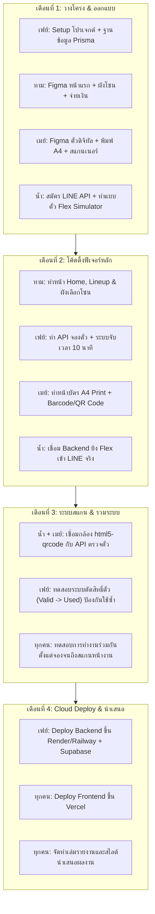

# 🎸 SoundWave Pass — คู่มือการแบ่งงานและแนวทางการพัฒนาทีม Alpha ⚡
**สำหรับ:** เฟย์ (Lead/Backend), ทาม (Frontend Booking), เมย์ (Frontend Ticket & Print), น้ำ (LINE & Scanner)  
**ระดับ:** ประกาศนียบัตรวิชาชีพชั้นปีที่ 2 (ปวช. 2) | ระยะเวลา: 16 สัปดาห์ (4 เดือน)

---

## 📑 สารบัญ
1. [ภาพรวมของทีมและบทบาทหน้าที่](#1-ภาพรวมของทีมและบทบาทหน้าที่)
2. [คู่มือจับมือสอน: เฟย์ (Team Lead & Backend)](#2-คู่มือจับมือสอน-เฟย์-team-lead--backend)
3. [คู่มือจับมือสอน: ทาม (Figma & Frontend Booking Flow)](#3-คู่มือจับมือสอน-ทาม-figma--frontend-booking-flow)
4. [คู่มือจับมือสอน: เมย์ (Figma & Frontend Ticket & A4 Print)](#4-คู่มือจับมือสอน-เมย์-figma--frontend-ticket--a4-print)
5. [คู่มือจับมือสอน: น้ำ (LINE Messaging & Gate Scanner)](#5-คู่มือจับมือสอน-น้ำ-line-messaging--gate-scanner)
6. [คู่มือ GitHub Desktop สำหรับมือใหม่ (ไม่ต้องพิมพ์คำสั่งแม้แต่บรรทัดเดียว)](#6-คู่มือ-github-desktop-สำหรับมือใหม่)
7. [ตาราง Roadmap 16 สัปดาห์](#7-ตาราง-roadmap-16-สัปดาห์)

---

## 1. ภาพรวมของทีมและบทบาทหน้าที่

| ชื่อสมาชิก | หน้าที่หลัก (Role) | สิ่งที่รับผิดชอบ |
| :--- | :--- | :--- |
| 👑 **เฟย์ (Faye)** | **Team Lead & Backend Engineer** | คุมภาพรวมโปรเจกต์, วางฐานข้อมูล (Prisma + SQLite), ทำ REST API ทั้งหมด, ตรวจและรวมโค้ด (Code Review) |
| 🎨 **ทาม (Time)** | **Frontend Dev 1 (Discovery & Booking)** | ออกแบบ Figma + เขียนโค้ดหน้า: หน้าแรก (Home), รายละเอียดคอนเสิร์ต (Lineup/Timetable), แผนผังเลือกโซนบัตร, หน้าจ่ายเงิน Mock PromptPay |
| 🖨️ **เมย์ (May)** | **Frontend Dev 2 (Ticket Experience & Print)** | ออกแบบ Figma + เขียนโค้ดหน้า: หน้ารายละเอียดตั๋ว, ระบบพิมพ์บัตรที่ระลึก A4 (เส้นประ+บาร์โค้ด), หน้าจอ Gate Scanner UI |
| 📱 **น้ำ (Nam)** | **Integration & Scanner Engineer** | สมัครและตั้งค่า LINE Developers, ออกแบบตั๋ว LINE Flex Message, ทำระบบยิงตั๋วเข้า LINE จริง, ทำระบบเปิดกล้องสแกน QR Code หน้างาน |

---

## 2. คู่มือจับมือสอน: เฟย์ (Team Lead & Backend)

### 🎯 เป้าหมายของเฟย์:
ทำให้ระบบหลังบ้านทำงานได้เสถียร มี API ส่งข้อมูลให้เพื่อนหน้าบ้าน (ทาม, เมย์) และเพื่อนเชื่อมต่อระบบ (น้ำ) เรียกใช้ได้สะดวก

### 📌 ขั้นตอนการทำงานทีละสเต็ป (Step-by-Step):

#### สเต็ปที่ 1: เตรียมโปรเจกต์และสร้างกิ่ง (Branches)
1. ตั้งค่าโปรเจกต์โครงสร้างโฟลเดอร์หลัก:
   - `/backend` (Express.js + Prisma)
   - `/frontend` (React + Vite + Tailwind CSS)
2. สร้าง Repository บน GitHub ชวน ทาม, เมย์, น้ำ เข้าเป็น Collaborators
3. สร้าง Branch ให้เพื่อนแต่ละคน:
   - `main` (กิ่งหลัก ห้ามใครดันโค้ดทับตรงๆ)
   - `feature-booking-time` (สำหรับทาม)
   - `feature-tickets-may` (สำหรับเมย์)
   - `feature-line-nam` (สำหรับน้ำ)

#### สเต็ปที่ 2: วางโครงสร้างฐานข้อมูล (Prisma Schema)
เฟย์จะออกแบบตารางหลัก 4 ตารางใน `backend/prisma/schema.prisma`:
* `Concert`: เก็บชื่องาน, วันที่, สถานที่, คำอธิบาย, รูปโปสเตอร์, ตาราง Lineup
* `Zone`: เก็บชื่อโซน (เช่น Standing Pit A, VIP Deck, Camping), ราคา, จำนวนความจุ (Capacity), จำนวนคงเหลือ
* `Booking`: เก็บการจอง รหัสอ้างอิง, เบอร์โทร, ชื่อผู้ซื้อ, สถานะ (`PENDING`, `PAID`, `CANCELLED`), เวลาหมดอายุ (10 นาที)
* `Ticket`: เก็บรหัสตั๋วแต่ละใบ (UUID/Ticket Code), สถานะเข้างาน (`VALID`, `USED`), เวลาที่สแกนเข้างาน

#### สเต็ปที่ 3: เขียน REST API
* `GET /api/concerts`: ดึงข้อมูลคอนเสิร์ตและไลน์อัปศิลปิน
* `GET /api/concerts/:id/zones`: ดึงโซนและจำนวนบัตรที่เหลือ
* `POST /api/bookings`: สร้างการจองใหม่ ล็อกโควต้า 10 นาที
* `POST /api/bookings/:id/confirm-payment`: ยืนยันการชำระเงิน (จำลอง) และออกตั๋ว
* `GET /api/tickets/:ticketCode`: ดึงข้อมูลตั๋วมาแสดงบนเว็บ
* `POST /api/scanner/verify`: ตรวจสอบตั๋วหน้างานว่า "ผ่าน" หรือ "ถูกใช้ไปแล้ว"

---

## 3. คู่มือจับมือสอน: ทาม (Figma & Frontend Booking Flow)

### 🎯 เป้าหมายของทาม:
ทำหน้าตาเว็บส่วนแรกตั้งแต่ผู้ใช้เปิดเข้ามาดูเทศกาลดนตรี จนถึงขั้นตอนการกดเลือกโซนและจ่ายเงินเสร็จ

### 📌 ขั้นตอนการทำงานทีละสเต็ป (Step-by-Step):

#### ช่วงที่ 1: งาน Figma (สัปดาห์ 1 - 3)
ทามเปิด Figma ออกแบบ 3 หน้าจอในธีม **Dark Neon Rock Festival** (พื้นหลังดำ/เทาเข้ม ไฟนีออนสีชมพู/ฟ้า/เหลืองสว่าง):
1. **หน้าแรก (Home & Festival Detail):**
   - แบนเนอร์หัวเว็บ แสงนีออนชื่อ "SoundWave Pass"
   - การ์ดคอนเสิร์ต แสดงวันที่ สถานที่ และปุ่ม "ซื้อบัตรเลย"
   - ส่วน Lineup ศิลปิน แบ่งตามเวที (Stage A / Stage B) และ Timetable เวลาแสดง
2. **หน้าเลือกโซนบัตร (Interactive Zone Map):**
   - แผนผังคอนเสิร์ตมองจากด้านบน:
     - 🎸 [เวทีหลัก MAIN STAGE]
     - 🔴 โซนบัตรยืนหน้าเวที: Standing Pit A (ราคา 3,500.-) & Pit B (ราคา 2,800.-)
     - 🟡 โซนอัฒจันทร์นั่ง: Grandstand Seated (ราคา 2,200.-)
     - ⛺ โซนกางเต็นท์: Festival Camping Zone (ราคา 1,500.-)
   - กล่องเลือกจำนวนใบ (1-4 ใบ) และปุ่ม "ไปชำระเงิน"
3. **หน้าชำระเงิน (Mock PromptPay QR):**
   - แสดง QR Code จำลอง
   - ตัวเลขนับถอยหลัง 10:00 นาที (ตัวอักษรนีออนเรืองแสง)
   - ปุ่มจำลอง "ฉันโอนเงินเรียบร้อยแล้ว"

#### ช่วงที่ 2: งานเขียนโค้ด (สัปดาห์ 4 เป็นต้นไป)
* โค้ดทั้งหมดของทามจะอยู่ในโฟลเดอร์: `frontend/src/pages/booking/`
  - `HomePage.jsx`
  - `ZoneSelectPage.jsx`
  - `PaymentPage.jsx`
* ทามจะดึง API จากที่เฟย์เตรียมไว้เพื่อแสดงชื่อคอนเสิร์ตและโซนบัตรจริง

---

## 4. คู่มือจับมือสอน: เมย์ (Figma & Frontend Ticket & A4 Print)

### 🎯 เป้าหมายของเมย์:
ทำประสบการณ์การรับตั๋วของผู้ซื้อให้ว้าวที่สุด! ทั้งตั๋วหน้าจอดิจิทัล และระบบพิมพ์บัตรที่ระลึก A4 เพื่อตัดเก็บสะสมได้จริง

### 📌 ขั้นตอนการทำงานทีละสเต็ป (Step-by-Step):

#### ช่วงที่ 1: งาน Figma (สัปดาห์ 1 - 3)
เมย์เปิด Figma ออกแบบ 3 ชิ้นงาน:
1. **บัตรดิจิทัลบนหน้าเว็บ (Digital Pass Card):**
   - การ์ดทรงสวยงาม มีแสงนีออนรอบกรอบ
   - ระบุชื่องาน, วันที่, โซนที่นั่ง, ชื่อผู้ถือบัตร และ QR Code ใหญ่ตรงกลาง
2. **บัตรที่ระลึก A4 (A4 Souvenir Festival Ticket):**
   - จำลองหน้ากระดาษ A4 แนวตั้ง (210 x 297 มม.)
   - วางตั๋วคอนเสิร์ตทรงยาว (Long-strip Ticket) 1-2 ใบตรงกลางหน้ากระดาษ
   - ใส่ **เส้นประรอยปรุ (Dashed Cut Line)** รอบตั๋ว พร้อมไอคอนรูปกรรไกร ✂️ เพื่อบอกให้ตัดตามรอย
   - มีฝั่งหางบัตร (Ticket Stub) สำหรับฉีก พร้อมบาร์โค้ดสวยงาม
3. **หน้าจอแอปสแกนเนอร์หน้างาน (Gate Scanner UI):**
   - กรอบสี่เหลี่ยมเล็งกล้องตรงกลาง
   - กล่องแสดงผลลัพธ์:
     - สีเขียวนีออน: ✅ VALID - ผ่านเข้างานได้ (แสดงชื่อโซน)
     - สีแดงนีออน: ❌ ALREADY USED - บัตรนี้ถูกสแกนไปแล้วเมื่อ ...

#### ช่วงที่ 2: งานเขียนโค้ด (สัปดาห์ 4 เป็นต้นไป)
* โค้ดทั้งหมดของเมย์จะอยู่ในโฟลเดอร์: `frontend/src/pages/tickets/`
  - `MyTicketPage.jsx`
  - `SouvenirPrintPage.jsx`
* เทคนิคพิเศษสำหรับปุ่มพิมพ์บัตร A4:
  - ใช้คำสั่ง CSS `@media print` ซ่อนปุ่มและ Navbar ทั้งหมด ให้แสดงเฉพาะกรอบตั๋วบนกระดาษ A4
  - ใส่ไลบรารีสร้าง QR Code (`qrcode.react`) และ Barcode (`jsbarcode`)

---

## 5. คู่มือจับมือสอน: น้ำ (LINE Messaging & Gate Scanner)

### 🎯 เป้าหมายของน้ำ:
ทำระบบส่งการ์ดตั๋วเข้าสู่แอป LINE ในมือถือของผู้ซื้อ และทำระบบกล้องตรวจตั๋วหน้างาน

### 📌 ขั้นตอนการทำงานทีละสเต็ป (Step-by-Step):

#### ส่วนที่ 1: ระบบ LINE Messaging API & Flex Message
1. **สมัคร LINE Developers Console:**
   - เข้าเว็บ https://developers.line.biz ล็อกอินด้วยบัญชี LINE ส่วนตัว
   - สร้าง Provider ชื่อ "SoundWave Pass"
   - สร้าง Channel ชนิด **"Messaging API"**
   - คัดลอกค่าสำคัญ 2 ค่าเก็บไว้: `Channel Access Token` และ `Channel Secret`
2. **ออกแบบการ์ดตั๋วใน LINE Flex Message Simulator:**
   - เข้าเว็บ https://developers.line.biz/flex-simulator/
   - ออกแบบการ์ดตั๋วโทนสีดำ-นีออน: มีโลโก้ SoundWave, ชื่องาน, วันที่, โซนบัตร และปุ่มกดเปิดดู QR Code
   - กดปุ่ม "View as JSON" แล้วคัดลอกโค้ด JSON นั้นไว้
3. **เขียนโค้ดยิงตั๋วเข้าแชท:**
   - โค้ดของน้ำจะอยู่ที่ `backend/services/lineService.js`
   - เมื่อเฟย์กดยืนยันชำระเงิน ให้ฟังก์ชันของน้ำยิงการ์ด JSON นี้เข้า LINE ของผู้ซื้อ

#### ส่วนที่ 2: ระบบสแกนกล้องหน้างาน (Gate Scanner)
1. ติดตั้งไลบรารี `html5-qrcode` ในหน้าเว็บ
2. โค้ดของน้ำจะอยู่ที่: `frontend/src/pages/scanner/GateScannerPage.jsx`
3. เขียนคำสั่งเปิดกล้องเว็บแคมหรือกล้องหลังมือถือ
4. เมื่อสแกนเจอ QR Code:
   - ส่งรหัสตั๋วไปที่ API ของเฟย์ `POST /api/scanner/verify`
   - ถ้าตั๋วผ่าน ให้เล่นเสียง "บี๊บ!" (ใช้ไฟล์เสียงสั้นๆ หรือ Web Audio API) และขึ้นสถานะสีเขียวตามแบบที่เมย์ดีไซน์ไว้

---

## 6. คู่มือ GitHub Desktop สำหรับมือใหม่
*(สำหรับทาม, เมย์, น้ำ — ไม่ต้องพิมพ์คำสั่งใน Terminal เลยสักบรรทัด)*

### 📥 1. การดึงโปรเจกต์ลงคอมครั้งแรก (Clone)
1. ดาวน์โหลดและติดตั้งโปรแกรม **[GitHub Desktop](https://desktop.github.com/)**
2. ล็อกอินด้วยบัญชี GitHub ของตัวเอง
3. กดเมนู **File** -> **Clone Repository...**
4. เลือกโปรเจกต์ `SoundWave-Pass` แล้วกด **Clone**
5. เลือกกิ่งของตัวเองที่มุมบนซ้าย (Current Branch):
   - ทามเลือก: `feature-booking-time`
   - เมย์เลือก: `feature-tickets-may`
   - น้ำเลือก: `feature-line-nam`

### 🔄 2. กิจวัตรประจำวัน 3 สเต็ปทองคำ:
* **สเต็ปที่ 1 (ก่อนเริ่มงาน):** เปิด GitHub Desktop แล้วกดปุ่มฟ้า **"Fetch origin"** (ถ้ามีโค้ดใหม่ปุ่มจะเปลี่ยนเป็น **"Pull origin"** ให้กด 1 ครั้งเพื่อดึงโค้ดล่าสุด)
* **สเต็ปที่ 2 (ทำงาน):** เปิด VS Code เขียนโค้ดในโฟลเดอร์ของตัวเอง เซฟไฟล์ตามปกติ
* **สเต็ปที่ 3 (เลิกงาน / ส่งงาน):**
  1. สลับมาที่โปรแกรม GitHub Desktop จะเห็นรายการไฟล์ที่แก้ขึ้นมาทางซ้าย
  2. ที่มุมซ้ายล่าง พิมพ์บอกสั้นๆ ในช่อง Summary เช่น *"ทำหน้าเลือกโซนเสร็จแล้ว"*
  3. กดปุ่มสีฟ้า **"Commit to feature-..."**
  4. กดปุ่ม **"Push origin"** ที่ด้านบน โค้ดจะถูกส่งขึ้น GitHub ทันที!

### 🚀 3. การส่งงานให้เฟย์รวมโค้ด (Create Pull Request):
* เมื่อทำฟีเจอร์ของตัวเองเสร็จ ให้กดปุ่ม **"Create Pull Request"** ใน GitHub Desktop
* ส่งลิงก์นั้นให้ **เฟย์** ในแชทกลุ่ม เพื่อให้เฟย์ตรวจสอบและกดรวมโค้ดเข้า `main`

---

## 7. ตาราง Roadmap 16 สัปดาห์ (4 เดือน)

## Project handoff documents

- [Customer, organizer, and staff user guide](docs/USER_GUIDE.md)
- [Team Beta Bug Bash worksheet](docs/BUG_BASH.md)
- [10-minute demo runbook](docs/DEMO_RUNBOOK.md)
- [Vercel and Render deployment notes](docs/DEPLOYMENT.md)

