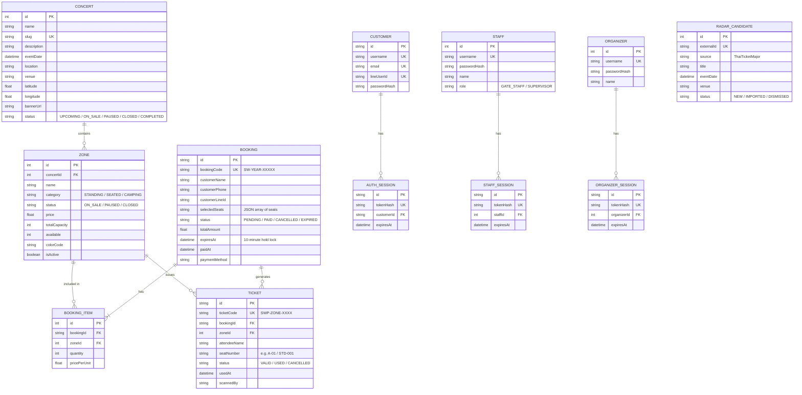

# 🎸 SoundWave Pass — Concert Ticketing & Event Radar System

🌐 **Live Web Demo (Vercel):** [https://soundwave-pas.vercel.app](https://soundwave-pas.vercel.app)

ระบบจองบัตรคอนเสิร์ตตามผังสถานที่จริง (2-Step Venue & Seat Selection), เรดาร์ดึงคอนเสิร์ตสดจาก ThaiTicketMajor (Auto-Discovery Radar), ระบบส่งตั๋วดิจิทัลเข้า LINE OA และสแกนเนอร์ตรวจตั๋วหน้างาน รองรับ 2 ภาษา (`TH | EN`)

---

## 🗄️ โครงสร้างฐานข้อมูลและ ER Diagram (Database Architecture)

ระบบใช้ฐานข้อมูล **MySQL 8.0** ร่วมกับ **Prisma ORM** โดยมีความสัมพันธ์ของตารางหลักดังแผนภาพด้านล่าง:



---

## 📅 แผนการดำเนินงาน 16 สัปดาห์ (Project Roadmap & Milestones)

### 🔵 เดือนที่ 1: ปูพื้นฐานเครื่องมือ & ออกแบบระบบ (สัปดาห์ที่ 1 – 4)
* **Week 1 – Onboarding & Team Setup:**
  * กิจกรรม Icebreaking, ทำสไลด์แนะนำตัวเองบน Canva
  * ติดตั้ง VS Code, Node.js, Git และสมัครบัญชี GitHub
  * ฝึกใช้คำสั่ง Git พื้นฐาน: `git clone`, `git checkout -b`, `git add`, `git commit`, `git push`
  * **Deliverable:** ทุกคนในทีมมีโฟลเดอร์โปรเจกต์บนเครื่องและรันคำสั่ง Git ผ่าน
* **Week 2 – ออกแบบ UI/UX บน Figma:**
  * กำหนด Mood & Tone ของแบรนด์ (ธีม Dark Neon Rock Festival & พาสเทล)
  * วาด Wireframe 4 หน้าจอหลัก: หน้าแรก, หน้ารายละเอียดงาน, หน้าเลือกโซน, และหน้าบัตร A4
  * **Deliverable:** ลิงก์ Figma Prototype ที่พี่เลี้ยงตรวจอนุมัติแล้ว
* **Week 3 – ขึ้นโครงสร้างหน้าเว็บ (Frontend Starter):**
  * สร้างโปรเจกต์ด้วย Vite + React + Tailwind CSS
  * เขียน Component พื้นฐาน: Navbar โลโก้, การ์ดคอนเสิร์ต (Event Card), แถบ Footer
  * นำภาพโปสเตอร์ Mockup มาลองวางแสดงผล
  * **Deliverable:** หน้าแรกของเว็บเปิดดูในเบราว์เซอร์ได้จริง มีความสวยงามและจัด Layout ถูกต้อง
* **Week 4 – ออกแบบ Database & เชื่อมต่อข้อมูลแรก:**
  * วาด ER Diagram ความสัมพันธ์ของตาราง Concerts, Zones, Bookings, Tickets
  * ตั้งค่าโฟลเดอร์ Backend และสร้าง Mock API ส่งข้อมูลคอนเสิร์ตออกมาในรูปแบบ JSON
  * **Deliverable:** หน้าเว็บสามารถดึงข้อมูล JSON มาแสดงผลเป็นการ์ดคอนเสิร์ตได้จริง

---

### 🟡 เดือนที่ 2: ระบบสมาชิก & ตรรกะการจองตั๋ว (สัปดาห์ที่ 5 – 8)
* **Week 5 – ระบบผู้ใช้ & สมัครสมาชิก (Auth):**
  * ฟอร์มสมัครสมาชิกและเข้าสู่ระบบ (เก็บ Username, Password, และ LINE User ID)
  * จดจำผู้ใช้เมื่อล็อกอินสำเร็จ แสดงชื่อและสถานะบนแถบเมนูด้านบน
  * **Deliverable:** ผู้ใช้สามารถสมัครและล็อกอินเข้าสู่ระบบได้
* **Week 6 – หน้ารายละเอียดงาน & ผังเวที (Stage Layout):**
  * หน้ารายละเอียดของคอนเสิร์ตแต่ละงาน (`/concerts/:id`)
  * แสดงผังเวทีรูปตัว T, สิทธิพิเศษของบัตรแต่ละราคา (VIP Soundcheck, Photo Card)
  * แสดงการ์ดโซนบัตรพร้อมราคาต่อใบ
  * **Deliverable:** คลิกเลือกคอนเสิร์ตจากหน้าแรกแล้วเปิดหน้ารายละเอียดได้อย่างถูกต้อง
* **Week 7 – ระบบเลือกโซน & คำนวณยอดเงิน (Zone Selector):**
  * ปุ่มกดบวก/ลบจำนวนตั๋วในแต่ละโซน
  * คำนวณยอดเงินรวมสดแบบเรียลไทม์ (จำนวนใบ x ราคาต่อโซน)
  * ตรวจสอบว่าถ้าบัตรหมด (Sold Out) ให้ปุ่มกดกลายเป็นสีเทาและกดไม่ได้
  * **Deliverable:** ผู้ใช้สามารถเลือกโซน ระบุจำนวนใบ และเห็นยอดสรุปพร้อมเข้าสู่ขั้นตอนชำระเงิน
* **Week 8 – ระบบบันทึกการจอง (MVP Checkpoint):**
  * บันทึกข้อมูลลงฐานข้อมูล: สร้างบันทึกในตาราง Bookings และออกรหัสตั๋วในตาราง Tickets
  * อัปเดตลดจำนวนที่นั่งว่างในฐานข้อมูล
  * ประเมินผลกลางภาค (Midterm Review): ระบบจองตั๋วหน้าเว็บทำงานได้ครบตั้งแต่ต้นจนจบ!
  * **Deliverable:** ระบบจองตั๋วใช้งานได้จริง (Working MVP)

---

### 🟠 เดือนที่ 3: ระบบแจ้งเตือน LINE & พิมพ์ตั๋ว A4 (สัปดาห์ที่ 9 – 12)
* **Week 9 – หน้าพิมพ์ตั๋วที่ระลึก A4 (A4 Souvenir Ticket):**
  * ออกแบบหน้ารายละเอียดตั๋วเป็นรูปบัตรคอนเสิร์ตทรงยาว (Ticket Stub) มีแบนเนอร์รูปศิลปินและรอยปรุ
  * ใช้ CSS `@media print` จัดให้อยู่ตรงกลางหน้ากระดาษ A4 (ส่วนอื่นเป็นพื้นขาว)
  * ทดสอบกด Ctrl + P สั่งพิมพ์ออกเครื่องปริ้นเตอร์ออฟฟิศจริง และใช้กรรไกรตัดออกมาทดลองถือ
  * **Deliverable:** สั่งพิมพ์ตั๋ว A4 ได้อย่างสวยงาม สเกลไม่เพี้ยน
* **Week 10 – สมัครและตั้งค่า LINE Messaging API:**
  * สมัครบัญชี LINE Official Account และเปิดใช้งาน Messaging API บน LINE Developers Console
  * ทดลองเขียนโค้ดยิงข้อความทักทายง่ายๆ เข้าโทรศัพท์มือถือของสมาชิกในทีม
  * **Deliverable:** ยิงข้อความทดสอบจากระบบเข้าแชท LINE บนมือถือได้สำเร็จ
* **Week 11 – ตั๋วคอนเสิร์ตดิจิทัล LINE Flex Message:**
  * ออกแบบตั๋วคอนเสิร์ตบน LINE Flex Message Simulator (ธีมสีพาสเทลสดใส)
  * เมื่อผู้ใช้กดยืนยันการจองตั๋วสำเร็จ ระบบจะส่ง Flex Message ตั๋วคอนเสิร์ตพร้อม QR Code เข้าแชท LINE ของผู้ซื้อทันที
  * **Deliverable:** สั่งจองตั๋วบนเว็บแล้ว ตั๋วเด้งเข้าแชท LINE ของผู้จองแบบอัตโนมัติ
* **Week 12 – หน้าจอตรวจบัตรเข้างาน (Gate Staff Scanner):**
  * สร้างหน้าเว็บเฉพาะสำหรับเจ้าหน้าที่หน้าประตู (`/staff/scanner`)
  * เรียกใช้กล้องเว็บแคมหรือกล้องมือถือผ่านไลบรารี `html5-qrcode`
  * สแกน QR Code ตั๋ว: ถ้าถูกต้องขึ้นเสียงเตือน "ปี๊บ" + แถบสีเขียว "ผ่าน" พร้อมเปลี่ยนสถานะตั๋วเป็น `checked_in`
  * **Deliverable:** หน้ากล้องตรวจตั๋วสแกน QR Code ได้จริงและป้องกันการนำตั๋วมาสแกนซ้ำ
  * *Check-in Checkpoint:* ถ้าพบว่าทีมทำช้ากว่าแผน สามารถสลับมาใช้ Supabase แทน Express ได้ทันทีในสัปดาห์นี้

---

### 🔵 เดือนที่ 4: แดชบอร์ดผู้จัดงาน, ทดสอบ & วันนำเสนอ (สัปดาห์ที่ 13 – 16)
* **Week 13 – แดชบอร์ดผู้จัดงาน (Admin Backoffice):**
  * หน้าจอสำหรับผู้จัดงาน: ดูตัวเลขสรุปยอดขายตั๋วทั้งหมด, เงินรายได้รวม, จำนวนคนที่เข้างานแล้ว
  * ฟอร์มเพิ่มคอนเสิร์ตใหม่ (อัปโหลดรูปโปสเตอร์, กำหนดวันที่, ตั้งราคาโซน)
  * **Deliverable:** ผู้จัดงานสามารถเพิ่มคอนเสิร์ตใหม่ลงในระบบได้ด้วยตัวเอง
* **Week 14 – การทดสอบระบบข้ามกลุ่ม (Cross-Team Bug Bash):**
  * แลกเปลี่ยนระบบกับ Team Alpha: ให้เพื่อน Team Alpha มาลองเล่นและช่วยจับ Bug
  * ทดสอบเคสยากๆ เช่น แกล้งเอาตั๋วที่ใช้แล้วมาสแกนใหม่, ลองกรอกข้อมูลผิดฟอร์ม, ลองเข้าเว็บผ่านมือถือหลายขนาดหน้าจอ
  * รวบรวมรายการ Bug และช่วยกันแก้ไขให้หมด
  * **Deliverable:** เอกสาร Bug Report พร้อมแก้ไขจุดบกพร่องเรียบร้อย
* **Week 15 – Deploy ขึ้น Cloud & จัดทำคู่มือ:**
  * นำหน้าเว็บ Frontend ขึ้นระบบคลาวด์ Vercel ให้ทุกคนบนอินเทอร์เน็ตเข้าถึงได้
  * นำ Backend & Database ขึ้นคลาวด์ Render หรือ Supabase
  * ถ่ายภาพหน้าจอและจัดทำรูปเล่มคู่มือผู้ใช้ (User Manual PDF) สรุปส่งสถานศึกษา
  * **Deliverable:** ลิงก์เว็บไซต์ออนไลน์จริงที่ใครๆ ก็เปิดผ่านมือถือได้
* **Week 16 – Final Demo Day (วันนำเสนอผลงาน):**
  * ซ้อมการพรีเซนต์ 10 นาทีต่อทีม
  * การสาธิตสด (Live Demo Showcase):
    * จองตั๋วผ่านหน้าเว็บสดๆ ต่อหน้าพี่เลี้ยง
    * โชว์ตั๋วที่เด้งเข้า LINE บนมือถือให้ดู
    * กดสั่งพิมพ์ตั๋วออกมาทางเครื่องปริ้นเตอร์ A4
    * ใช้กล้องมือถือสแกนตั๋วใบนั้นเพื่อจำลองการเดินเข้าประตูงานคอนเสิร์ต!
  * **Deliverable:** จบการฝึกงานอย่างสมบูรณ์แบบ ได้ผลงานจริงลงพอร์ตโฟลิโอ!

---

## 🚀 วิธีติดตั้งและรันโปรเจกต์ (สำหรับทีมงานหลัง Clone)

### 1. เตรียมฐานข้อมูล MySQL 8.0
สร้างฐานข้อมูลชื่อ `soundwave_db` บน MySQL เครื่องของคุณ:
```sql
CREATE DATABASE IF NOT EXISTS soundwave_db CHARACTER SET utf8mb4 COLLATE utf8mb4_unicode_ci;
```

### 2. ตั้งค่า Backend & นำเข้าข้อมูลชุดเดียวกันทั้งทีม
```bash
cd backend
npm install
cp .env.example .env
# แก้ไข DATABASE_URL ในไฟล์ .env ให้ตรงกับรหัสผ่าน MySQL ของเครื่องคุณ
# ตัวอย่าง: DATABASE_URL="mysql://root@127.0.0.1:3306/soundwave_db"

npx prisma db push
npm run db:seed
npm run db:import
npm run dev
```
> 💡 คำสั่ง `npm run db:import` จะนำเข้าข้อมูลชุดเดียวกับของทีมจากไฟล์ `backend/prisma/shared-data.json` (4 คอนเสิร์ตหลักบนหน้าเว็บ, 10 โซนที่นั่ง, 58 รายการในเรดาร์, 8 รายการจอง และ 18 ใบตั๋ว)
> หากมีการแก้ไขข้อมูลในฐานข้อมูลและต้องการอัปเดตให้เพื่อนในทีม ใช้คำสั่ง `npm run db:export` แล้ว Commit ไฟล์ `backend/prisma/shared-data.json` ขึ้น GitHub ได้เลย

### 3. รัน Frontend
เปิด Terminal อีกหน้าต่าง:
```bash
cd frontend
npm install
npm run dev
```
- **หน้าเว็บผู้ซื้อบัตร (Storefront):** `http://localhost:5173`
- **พื้นที่ทีมงาน (Team Portal / Scanner / Admin):** `http://localhost:5173/team`
- **Backend API:** `http://localhost:5000/api/health`

---

## 🔑 บัญชีทดสอบเริ่มต้น (หลังรัน `db:seed` หรือ `db:import`)
- **Organizer (เจ้าของงาน - `/admin`):** ชื่อผู้ใช้ `owner` / รหัสผ่าน `1234`
- **Gate Staff & Supervisor (`/scanner`):** ชื่อผู้ใช้ `faye`, `nam`, หรือ `staff01` / รหัสผ่าน `1234`
