# 📘 คู่มือผู้ใช้งานระบบ SoundWave Pass (ฉบับสมบูรณ์พร้อมภาพประกอบทุกหน้าจอ)

> [!IMPORTANT]
> เอกสารคู่มือฉบับนี้แสดง **ภาพหน้าจอจริงของระบบครบทั้ง 17 หน้าจอ/หน้าต่างป๊อปอัพ** พร้อมตารางอธิบาย **ทุกปุ่มที่กดได้ ทุกช่องกรอกข้อมูล และผลลัพธ์หลังกด** แยกตามบทบาทผู้ใช้งานทั้ง 3 กลุ่ม (`ลูกค้าทั่วไป`, `สตาฟฟ์หน้าประตู`, และ `ผู้จัดงาน/แอดมิน`)

---

## สารบัญ (Table of Contents)

1. [บทที่ 1: ภาพรวมระบบและสิทธิ์ผู้ใช้งาน (System Overview & Roles)](#บทที่-1-ภาพรวมระบบและสิทธิ์ผู้ใช้งาน)
2. [บทที่ 2: แถบเมนูหลัก การเข้าสู่ระบบ และประวัติตั๋ว (Navbar, Auth & My Tickets)](#บทที่-2-แถบเมนูหลัก-การเข้าสู่ระบบ-และประวัติตั๋ว)
3. [บทที่ 3: ขั้นตอนการค้นหาและจองบัตรคอนเสิร์ตสำหรับลูกค้า (Customer Booking Flow)](#บทที่-3-ขั้นตอนการค้นหาและจองบัตรคอนเสิร์ตสำหรับลูกค้า)
4. [บทที่ 4: การชำระเงิน ตั๋วดิจิทัล E-Ticket และพิมพ์บัตรที่ระลึก A4](#บทที่-4-การชำระเงิน-ตั๋วดิจิทัล-e-ticket-และพิมพ์บัตรที่ระลึก-a4)
5. [บทที่ 5: ระบบทีมงานและเครื่องสแกนตรวจตั๋วหน้าประตู (Team Portal & Gate Scanner)](#บทที่-5-ระบบทีมงานและเครื่องสแกนตรวจตั๋วหน้าประตู)
6. [บทที่ 6: ระบบหลังบ้านสำหรับผู้จัดงานและผู้ดูแลระบบ (Organizer & Admin Dashboard)](#บทที่-6-ระบบหลังบ้านสำหรับผู้จัดงานและผู้ดูแลระบบ)
7. [บทที่ 7: การแก้ไขปัญหาเบื้องต้นและคำถามที่พบบ่อย (Troubleshooting & FAQ)](#บทที่-7-การแก้ไขปัญหาเบื้องต้นและคำถามที่พบบ่อย)

---

## บทที่ 1: ภาพรวมระบบและสิทธิ์ผู้ใช้งาน

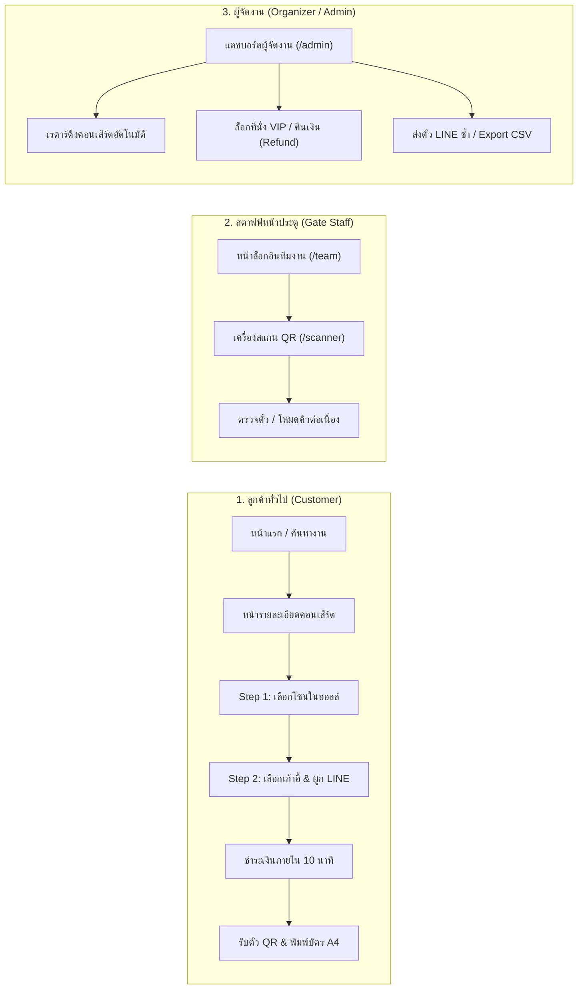

### ตารางบัญชีผู้ใช้งานสำหรับทดสอบระบบ

| บทบาท (Role) | หน้าจอที่เข้าถึง | ชื่อผู้ใช้ (Username) | รหัสผ่าน (Password) | หน้าที่หลัก |
| :--- | :--- | :--- | :--- | :--- |
| **ลูกค้าทั่วไป (Customer)** | `/`, `/concerts/:id`, `/booking/*`, `/tickets/*` | สมัครใหม่ / Google Login | ตามที่ตั้งไว้ | เลือกชมคอนเสิร์ต เลือกเก้าอี้ ชำระเงิน และรับตั๋ว QR Code |
| **สตาฟฟ์หน้าประตู (Gate Staff)** | `/team`, `/scanner` | `nam`, `faye`, `gate01` | `1234` | สแกน QR Code ตรวจบัตรหน้าประตูและตรวจสอบสถานะตั๋ว |
| **ผู้จัดงาน (Organizer / Admin)** | `/team`, `/admin`, `/admin/insights/:type` | `owner` | `1234` | จัดการคอนเสิร์ต ผังที่นั่ง เรดาร์ค้นหางาน ยอดขาย และคืนเงิน |

---

## บทที่ 2: แถบเมนูหลัก การเข้าสู่ระบบ และประวัติตั๋ว

````carousel
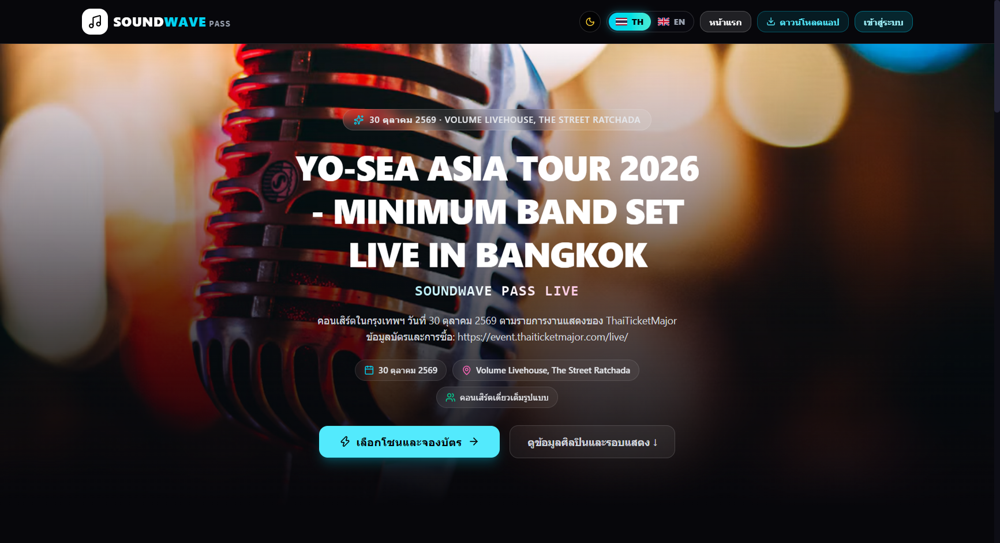
<!-- slide -->
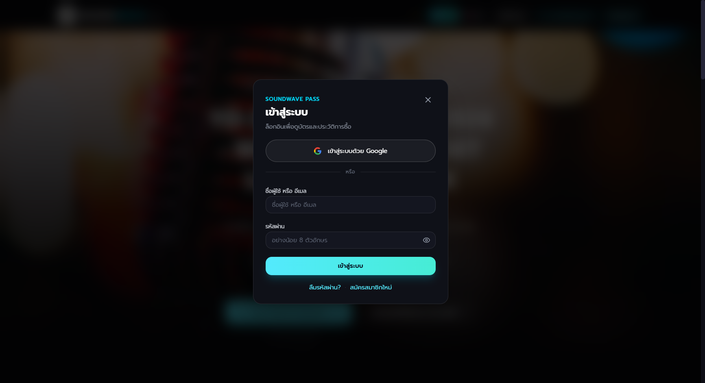
<!-- slide -->

````

### 2.1 ตารางปุ่มกดบนแถบเมนูด้านบน ([Navbar.jsx](file:///C:/Users/USER/Documents/GitHub/SoundWave-Pas/frontend/src/components/Navbar.jsx))

| ชื่อปุ่ม / ไอคอน | ตำแหน่งบนหน้าจอ | หน้าที่การทำงาน | ผลลัพธ์เมื่อกด |
| :--- | :--- | :--- | :--- |
| **โลโก้ `SOUNDWAVE PASS`** | มุมซ้ายบนสุดของทุกหน้า | กลับสู่หน้าแรกของเว็บไซต์ | เปลี่ยนหน้าไปยัง `/` ทันที |
| **ลิงก์ `คอนเสิร์ต (Concerts)`** | ถัดจากโลโก้ด้านซ้าย | ดูรายการคอนเสิร์ตทั้งหมด | เลื่อนหน้าจอไปยังส่วนรายการคอนเสิร์ตในหน้าแรก |
| **ปุ่ม `🎫 ตั๋วของฉัน (X)`** | แถบขวาบน | เปิดดูตั๋วที่ซื้อไว้และค้นหาตั๋วด้วยเบอร์โทร/รหัสจอง | เปิดหน้าต่างป๊อปอัพ **ตั๋วและประวัติการสั่งซื้อ** |
| **ปุ่มสลับภาษา `TH` / `EN`** | แถบขวาบน | เปลี่ยนภาษาทั้งระบบระหว่าง ไทย (`TH`) และ อังกฤษ (`EN`) | ข้อความทุกปุ่มและเมนูเปลี่ยนภาษาทันทีโดยไม่ต้องรีเฟรชหน้า |
| **ปุ่มสลับธีม `☀️` / `🌙`** | แถบขวาบน (ข้างปุ่มภาษา) | สลับโหมดหน้าจอมืด (`Dark Mode`) และสว่าง (`Light Mode`) | เปลี่ยนโทนสีพื้นหลังและตัวอักษรทั้งเว็บไซต์และบันทึกค่าไว้ |
| **ปุ่ม `เข้าสู่ระบบ / สมัครสมาชิก`** | มุมขวาบนสุด (เมื่อยังไม่ล็อกอิน) | เปิดหน้าต่างล็อกอินของลูกค้า | เปิดป๊อปอัพ [AuthModal.jsx](file:///C:/Users/USER/Documents/GitHub/SoundWave-Pas/frontend/src/components/AuthModal.jsx) |
| **ปุ่ม `ออกจากระบบ (🚪)`** | มุมขวาบนสุด (เมื่อล็อกอินแล้ว) | ออกจากบัญชีลูกค้าปัจจุบัน | ล้างเซสชันและกลับสู่สถานะผู้เยี่ยมชมทั่วไป |
| **ปุ่ม `สำหรับทีมงาน (Team Portal)`** | ส่วนท้ายเว็บไซต์ ([Footer.jsx](file:///C:/Users/USER/Documents/GitHub/SoundWave-Pas/frontend/src/components/Footer.jsx)) | ทางเข้าสำหรับสตาฟฟ์หน้าประตูและผู้จัดงาน | นำทางไปยังหน้า `/team` |

### 2.2 ตารางปุ่มในหน้าต่างเข้าสู่ระบบลูกค้า ([AuthModal.jsx](file:///C:/Users/USER/Documents/GitHub/SoundWave-Pas/frontend/src/components/AuthModal.jsx))

| ชื่อปุ่ม / ช่องกรอก | ตำแหน่งในป๊อปอัพ | หน้าที่การทำงาน | ผลลัพธ์เมื่อกด |
| :--- | :--- | :--- | :--- |
| **แท็บ `เข้าสู่ระบบ` / `สมัครสมาชิก`** | ด้านบนของป๊อปอัพ | สลับระหว่างโหมดล็อกอินและสมัครบัญชีใหม่ | เปลี่ยนชุดช่องกรอกข้อมูลในป๊อปอัพทันที |
| **ปุ่ม `ดำเนินการต่อด้วย Google`** | ครึ่งบนของป๊อปอัพ | ล็อกอินด่วนด้วยบัญชี Google (OAuth 2.0) | เปิดหน้าต่างเลือกบัญชี Google และเข้าสู่ระบบอัตโนมัติ |
| **ช่อง `อีเมลหรือเบอร์โทรศัพท์`** | กลางป๊อปอัพ | กรอกอีเมลหรือเบอร์โทรที่ใช้สมัครไว้ | รับค่าข้อความสำหรับตรวจสอบบัญชี |
| **ปุ่มไอคอนดวงตา `👁️`** | ท้ายช่องรหัสผ่าน | แสดง/ซ่อนตัวอักษรรหัสผ่าน | สลับการแสดงผลรหัสผ่านระหว่าง `••••` กับข้อความจริง |
| **ปุ่ม `เข้าสู่ระบบ` / `สร้างบัญชีผู้ใช้`** | ด้านล่างฟอร์ม (ปุ่มสีฟ้า-ชมพู) | ส่งข้อมูลยืนยันตัวตน | หากสำเร็จจะปิดป๊อปอัพและแสดงชื่อผู้ใช้ที่มุมขวาบน |

### 2.3 ตารางปุ่มในหน้าต่างตั๋วและประวัติการสั่งซื้อ ([PurchaseHistoryModal.jsx](file:///C:/Users/USER/Documents/GitHub/SoundWave-Pas/frontend/src/components/PurchaseHistoryModal.jsx))

| ชื่อปุ่ม / ช่องกรอก | ตำแหน่งในป๊อปอัพ | หน้าที่การทำงาน | ผลลัพธ์เมื่อกด |
| :--- | :--- | :--- | :--- |
| **ช่อง `กรอกรหัสใบจอง หรือ เบอร์โทรศัพท์`** | ด้านบนป๊อปอัพ | ค้นหาตั๋วข้ามอุปกรณ์ด้วยรหัส `SW-2026-XXXXX` หรือเบอร์โทร | ใช้คู่กับปุ่ม `ค้นหา` เพื่อดึงข้อมูลตั๋วจากฐานข้อมูล |
| **ปุ่ม `🔍 ค้นหา`** | ขวาของช่องค้นหา | สั่งค้นหาใบจองจากเซิร์ฟเวอร์ | แสดงการ์ดใบจองและปุ่มเปิดดูตั๋วทุกใบในคำสั่งซื้อนั้น |
| **ปุ่มการ์ดตั๋ว `🎫 SWP-... (ดู QR)`** | ภายในการ์ดใบจองแต่ละรายการ | เปิดหน้าตั๋วดิจิทัลใบที่เลือก | นำทางไปยังหน้า `/tickets/:ticketCode` พร้อมแสดง QR Code |
| **ปุ่ม `🗑️ ล้างประวัติในเครื่องนี้`** | มุมซ้ายล่างของป๊อปอัพ | ล้างรายการที่แคชไว้ในเบราว์เซอร์เครื่องปัจจุบัน | ล้างรายการใน LocalStorage (ข้อมูลจริงในฐานข้อมูลยังอยู่ครบ) |

---

## บทที่ 3: ขั้นตอนการค้นหาและจองบัตรคอนเสิร์ตสำหรับลูกค้า

````carousel
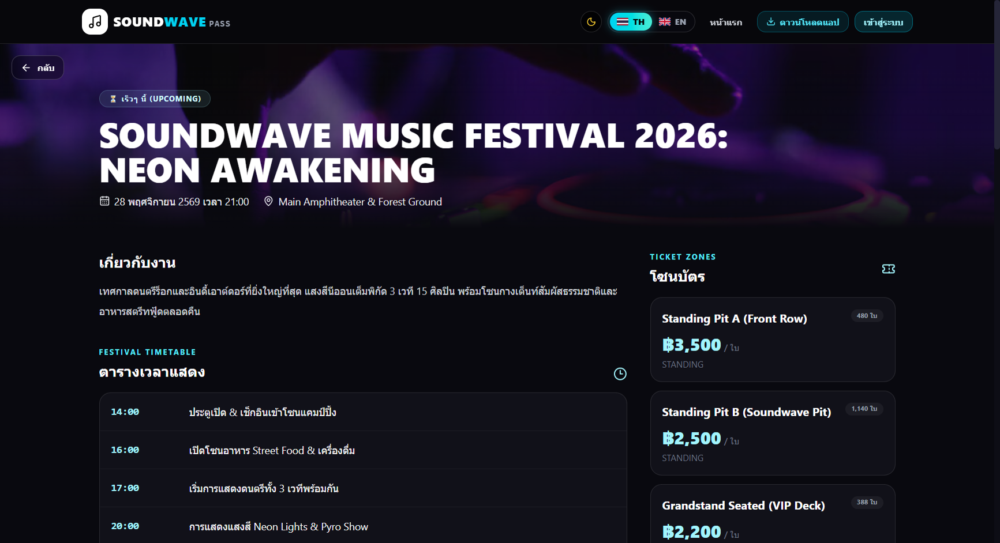
<!-- slide -->
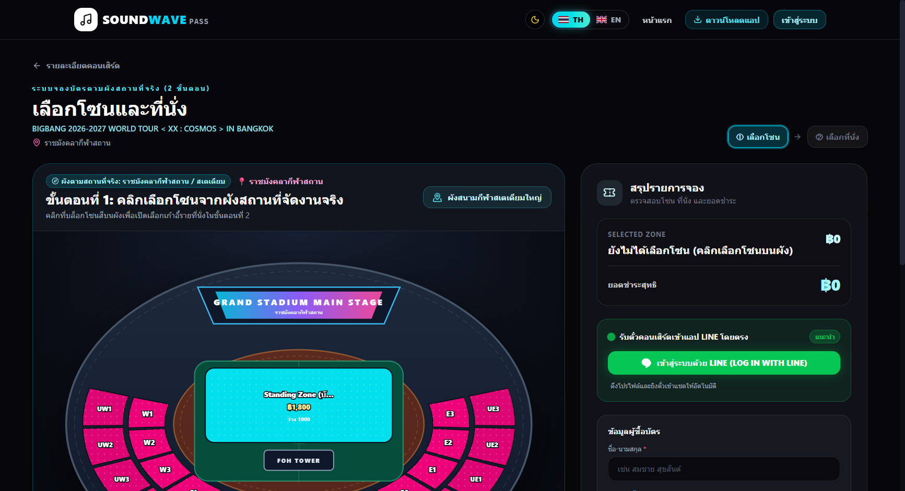
<!-- slide -->
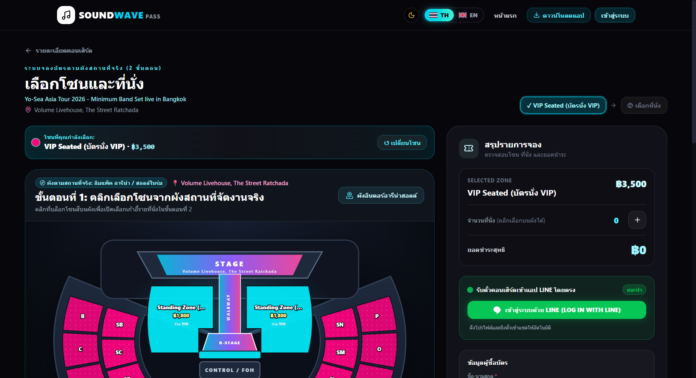
````

### 3.1 หน้าแรก (`/`) และหน้ารายละเอียดคอนเสิร์ต (`/concerts/:id`)

| ชื่อปุ่ม / องค์ประกอบ | หน้าจอ | หน้าที่การทำงาน | ผลลัพธ์เมื่อกด |
| :--- | :--- | :--- | :--- |
| **ช่องค้นหาคอนเสิร์ต (`Search`)** | หน้าแรก (`/`) | ค้นหาชื่อคอนเสิร์ต ศิลปิน หรือสถานที่จัดงานแบบเรียลไทม์ | กรองการ์ดคอนเสิร์ตด้านล่างทันทีตามคำที่พิมพ์ |
| **ปุ่มหมวดหมู่ (`ทั้งหมด`, `Festival`, `Rock / Indie`, `Pop / Live`, `International`)** | หน้าแรก (`/`) | กรองคอนเสิร์ตตามแนวดนตรี | แสดงเฉพาะคอนเสิร์ตในหมวดหมู่ที่เลือก |
| **ปุ่ม `จองบัตรทันที` / การ์ดคอนเสิร์ต** | หน้าแรก (`/`) | เข้าดูรายละเอียดคอนเสิร์ตและราคาบัตรแต่ละโซน | นำทางไปยัง `/concerts/:id` |
| **ปุ่ม `📍 ดูแผนที่ Google Maps`** | หน้ารายละเอียดงาน (`/concerts/:id`) | เปิดพิกัดสถานที่จัดงานบน Google Maps | เปิดแท็บใหม่แสดงแผนที่นำทางไปยังฮอลล์จัดงาน |
| **การ์ดโซนที่นั่ง + ปุ่ม `เลือกโซนนี้`** | แถบขวาของหน้า `/concerts/:id` | เลือกโซนที่ต้องการจอง | นำทางไปยังหน้า `/booking/zone-select` พร้อมล็อกโซนที่เลือกไว้ |

### 3.2 หน้าเลือกโซนและเก้าอี้ (`/booking/zone-select`) — ระบบ 2 ขั้นตอน

#### ขั้นตอนที่ 1 (Step 1): เลือกโซนจากผังฮอลล์ ([StadiumZoneMap.jsx](file:///C:/Users/USER/Documents/GitHub/SoundWave-Pas/frontend/src/pages/booking/StadiumZoneMap.jsx))
- **บล็อกโซนสีบนผังฮอลล์ (`VIP`, `Standing Pit`, `Standard Bowl`)**: คลิกที่บล็อกโซนบนผังเวที หรือการ์ดโซนด้านล่างเพื่อเข้าสู่ขั้นตอนเลือกเก้าอี้ (หากโซนเต็มจะขึ้นป้าย `SOLD OUT` และกดไม่ได้)

#### ขั้นตอนที่ 2 (Step 2): เลือกที่นั่งรายตัวและกรอกข้อมูล ([ZoneSelectPage.jsx](file:///C:/Users/USER/Documents/GitHub/SoundWave-Pas/frontend/src/pages/booking/ZoneSelectPage.jsx))

| ชื่อปุ่ม / องค์ประกอบ | ตำแหน่งบนหน้าจอ | หน้าที่การทำงาน | ผลลัพธ์เมื่อกด |
| :--- | :--- | :--- | :--- |
| **ปุ่ม `← เปลี่ยนโซนที่นั่ง`** | มุมซ้ายบนของผังเก้าอี้ | ย้อนกลับไปหน้าผังฮอลล์รวม (Step 1) | กลับไปเลือกโซนอื่นได้ทันที |
| **ปุ่มควบคุมมุมมอง `🔍 -` / `100%` / `🔍 +` / `รีเซ็ต`** | มุมขวาบนของผังเก้าอี้ | ย่อ/ขยายผังที่นั่ง (`70%` – `150%`) สำหรับหน้าจอมือถือหรือโซนใหญ่ | ปรับขนาดผังเก้าอี้ให้กดเลือกได้สะดวกขึ้น |
| **ปุ่มเก้าอี้รายตัว (`A-01` ถึง `G-14`)** | กลางผังเก้าอี้ 3 ปีก (`LEFT` / `CENTER` / `RIGHT`) | คลิกเลือกหรือยกเลิกที่นั่ง (สูงสุด **6 ที่นั่ง/ครั้ง**) | - **เก้าอี้ว่าง**: กดแล้วเปลี่ยนเป็นสีนีออนพร้อมเครื่องหมาย `✓`<br>- **เก้าอี้สีเทา (`✕`)**: มีผู้จองแล้ว กดไม่ได้ |
| **ปุ่ม `สุ่มเลือกที่นั่งว่างใกล้เวทีให้ฉัน`** | แถบด้านล่างผังเก้าอี้ | ระบบเลือกเก้าอี้ว่างที่ติดกันและใกล้เวทีที่สุดให้อัตโนมัติ | เลือกเก้าอี้ให้อัตโนมัติทันทีตามจำนวนที่ต้องการ |
| **ปุ่ม `-` / `+` และปุ่มด่วน `1 ใบ`..`6 ใบ`** | โซนบัตรยืน (`Standing Pit`) | กำหนดจำนวนบัตรยืนที่ต้องการซื้อ | ระบบสร้างรหัสคิวเข้างานอัตโนมัติ (เช่น `STD-001`, `STD-002`) |
| **ปุ่ม `เชื่อมบัญชี LINE รับตั๋วอัตโนมัติ`** | การ์ดสีเขียวด้านขวา ([LineConnectCard.jsx](file:///C:/Users/USER/Documents/GitHub/SoundWave-Pas/frontend/src/components/booking/LineConnectCard.jsx)) | ล็อกอิน LINE เพื่อผูก LINE User ID กับใบจอง | เมื่อชำระเงินเสร็จ ระบบจะส่งตั๋ว Flex Message เข้าแชท LINE ทันที |
| **ปุ่ม `+ เพิ่มเพื่อน LINE OA (@soundwavepass)`** | การ์ดสีเขียวด้านขวา | เปิด QR / ลิงก์เพิ่มเพื่อนบอทของระบบ | เพื่อให้บอทส่งบัตรคอนเสิร์ตเข้าแชท LINE ของลูกค้าได้ |
| **ช่อง `ชื่อ-นามสกุล` และ `เบอร์โทรศัพท์`** | ฟอร์มสรุปรายการด้านขวา | ระบุชื่อผู้ถือบัตรและเบอร์โทรติดต่อ (10 หลัก) | ใช้พิมพ์ลงบนหน้าตั๋วและใช้ค้นหาตั๋วภายหลัง |
| **ปุ่ม `ยืนยันการจองและไปหน้าชำระเงิน →`** | ปุ่มใหญ่ด้านล่างขวาสุด | ล็อกที่นั่งที่เลือกไว้เป็นเวลา **10 นาที** และสร้างใบจอง | เปลี่ยนหน้าไปยัง `/booking/payment/:bookingCode` |

---

## บทที่ 4: การชำระเงิน ตั๋วดิจิทัล E-Ticket และพิมพ์บัตรที่ระลึก A4

````carousel
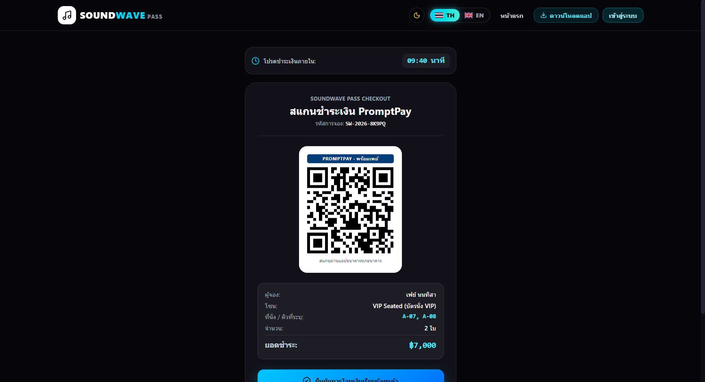
<!-- slide -->
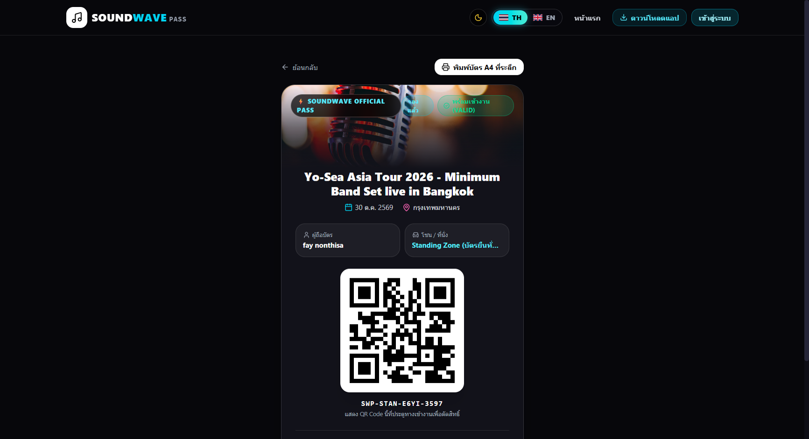
<!-- slide -->
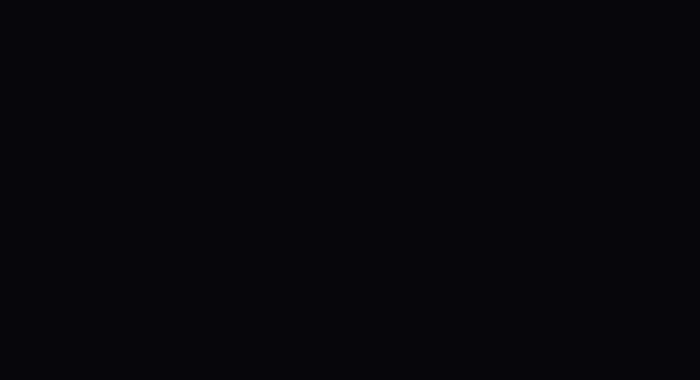
````

### 4.1 ตารางปุ่มในหน้าชำระเงิน ([PaymentPage.jsx](file:///C:/Users/USER/Documents/GitHub/SoundWave-Pas/frontend/src/pages/booking/PaymentPage.jsx))

| ชื่อปุ่ม / องค์ประกอบ | ตำแหน่งบนหน้าจอ | หน้าที่การทำงาน | ผลลัพธ์เมื่อกด |
| :--- | :--- | :--- | :--- |
| **กล่องเวลา `⏱️ เวลาคงเหลือในการชำระเงิน 09:42`** | ด้านบนของการ์ดชำระเงิน | นับถอยหลังเวลาล็อกที่นั่ง 10 นาที | หากหมดเวลา `00:00` ระบบจะคืนที่นั่งกลับเข้าผังกลางอัตโนมัติ |
| **ปุ่ม `✅ ยืนยันการชำระเงิน (จำลองจ่ายสำเร็จ)`** | ปุ่มสีเขียวขนาดใหญ่ด้านล่าง QR | ยืนยันการชำระเงินและออกรหัสตั๋วจริง | 1. เปลี่ยนสถานะใบจองเป็น `PAID`<br>2. ออกตั๋ว QR Code รายใบ<br>3. ส่งตั๋วเข้า LINE OA ทันที |
| **ปุ่ม `✕ ยกเลิกรายการจองนี้และคืนที่นั่ง`** | ปุ่มขอบสีแดงด้านล่างสุด | ยกเลิกใบจองและปลดล็อกที่นั่งทันที | คืนที่นั่งให้ว่างทันทีและพากลับไปหน้าเลือกที่นั่งใหม่ |

### 4.2 ตารางปุ่มในหน้าตั๋วดิจิทัล ([MyTicketPage.jsx](file:///C:/Users/USER/Documents/GitHub/SoundWave-Pas/frontend/src/pages/tickets/MyTicketPage.jsx)) และหน้าพิมพ์บัตรที่ระลึก ([SouvenirPrintPage.jsx](file:///C:/Users/USER/Documents/GitHub/SoundWave-Pas/frontend/src/pages/tickets/SouvenirPrintPage.jsx))

| ชื่อปุ่ม / องค์ประกอบ | หน้าจอ | หน้าที่การทำงาน | ผลลัพธ์เมื่อกด |
| :--- | :--- | :--- | :--- |
| **ปุ่มหมายเลขใบตั๋ว `1`, `2`, `3`...** | ด้านบนการ์ดตั๋ว (`/tickets/:ticketCode`) | สลับดูตั๋วใบอื่นๆ ที่อยู่ในใบจองเดียวกัน | เปลี่ยน QR Code และเลขที่นั่งเป็นของตั๋วใบที่เลือกทันที |
| **ปุ่ม `🖨️ พิมพ์บัตรที่ระลึก (Souvenir Ticket)`** | ใต้การ์ดตั๋วดิจิทัล | เปิดหน้าจัดอาร์ตเวิร์กบัตรสะสมขนาด A4 | นำทางไปยัง `/tickets/:ticketCode/print` |
| **ปุ่ม `🔗 คัดลอกลิงก์ตั๋ว / แชร์ให้เพื่อน`** | ใต้การ์ดตั๋วดิจิทัล | คัดลอก URL ของตั๋วใบนั้นส่งให้เพื่อนที่ไปด้วยกัน | คัดลอกลิงก์ลงคลิปบอร์ดพร้อมแจ้งเตือนสำเร็จ |
| **ปุ่ม `🖨️ สั่งพิมพ์ / บันทึกเป็น PDF (A4)`** | มุมขวาบนของหน้า `/tickets/:ticketCode/print` | สั่งพิมพ์บัตรสะสมออกเครื่องปริ้นเตอร์ หรือ Save as PDF | เปิดหน้าต่าง Print ของระบบปฏิบัติการ (ซ่อนแถบเมนูอัตโนมัติเวลาพิมพ์จริง) |

---

## บทที่ 5: ระบบทีมงานและเครื่องสแกนตรวจตั๋วหน้าประตู

````carousel
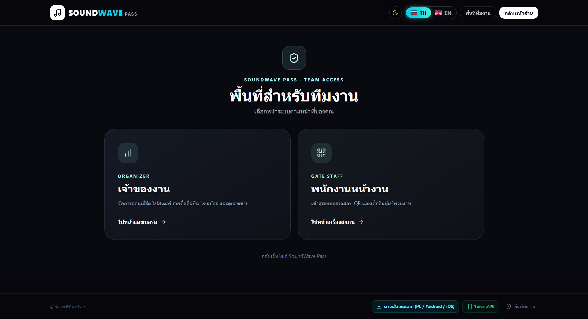
<!-- slide -->
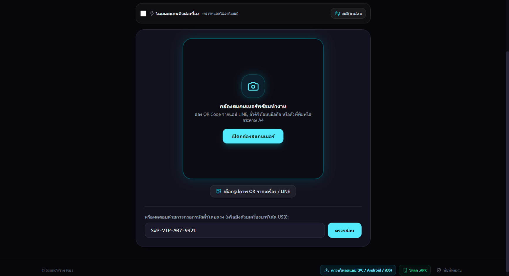
````

### 5.1 หน้าทางเข้าทีมงาน ([TeamPortalPage.jsx](file:///C:/Users/USER/Documents/GitHub/SoundWave-Pas/frontend/src/pages/TeamPortalPage.jsx)) และเครื่องสแกนประตู ([GateScannerPage.jsx](file:///C:/Users/USER/Documents/GitHub/SoundWave-Pas/frontend/src/pages/scanner/GateScannerPage.jsx))

| ชื่อปุ่ม / ช่องกรอก | หน้าจอ / ตำแหน่ง | หน้าที่การทำงาน | ผลลัพธ์เมื่อกด |
| :--- | :--- | :--- | :--- |
| **ปุ่มด่วนบัญชีสาธิต (`nam`, `faye`, `gate01`, `owner`)** | การ์ดด้านล่างในหน้า `/team` หรือ `/scanner` | กรอก Username และ Password (`1234`) ให้อัตโนมัติในคลิกเดียว | กรอกข้อมูลลงช่องล็อกอินทันที พร้อมกดเข้าสู่ระบบได้เลย |
| **ปุ่ม `📷 เปิดกล้องสแกน QR Code` / `⏹️ ปิดกล้อง`** | ครึ่งบนของหน้า `/scanner` | เปิดหรือปิดกล้องสมาร์ตโฟน/เว็บแคมเพื่อสแกน QR ตั๋วลูกค้า | แสดงภาพจากกล้องสดและอ่าน QR Code อัตโนมัติทันทีที่อยู่ในกรอบ |
| **ปุ่ม `🔄 สลับกล้อง (หน้า/หลัง)`** | มุมกรอบกล้องในหน้า `/scanner` | สลับระหว่างกล้องหลังและกล้องหน้าของมือถือ/แท็บเล็ต | เปลี่ยนเลนส์กล้องที่ใช้สแกนทันที |
| **สวิตช์ `⚡ โหมดสแกนคิวต่อเนื่อง (Continuous Scan)`** | แถบควบคุมใต้กรอบกล้อง | เปิดโหมดสแกนรัวสำหรับช่วงคนเข้าคิวหน้าประตูเยอะ | เมื่อสแกนผ่าน 1 ใบ ระบบจะแสดงผล 1.8 วินาทีแล้วเปิดกล้องรอสแกนคนถัดไปอัตโนมัติโดยไม่ต้องกดปุ่มซ้ำ |
| **ปุ่ม `🖼️ อัปโหลดรูปภาพ QR Code`** | แถบเครื่องมือใต้กล้อง | เลือกไฟล์ภาพแคปหน้าจอตั๋วจากเครื่องเพื่อตรวจแทนกล้อง | ถอดรหัส QR จากไฟล์รูปภาพและส่งตรวจสถานะตั๋วทันที |
| **ช่อง `กรอกรหัสตั๋ว (เช่น SWP-VIP-...)` + ปุ่ม `ตรวจสอบตั๋ว`** | ครึ่งล่างของหน้า `/scanner` | พิมพ์รหัสตั๋วด้วยมือ หรือเสียบ **เครื่องยิงบาร์โค้ด USB (Handheld Scanner)** | ตรวจสอบตั๋วและแสดงป้ายสถานะสีขนาดใหญ่พร้อมเสียงสัญญาณ:<br>- 🟢 **สีเขียว (`VALID`)**: บัตรถูกต้อง อนุญาตให้เข้างาน<br>- 🟡 **สีเหลือง (`ALREADY USED`)**: บัตรถูกสแกนใช้ไปแล้ว (แจ้งเวลาและชื่อสตาฟฟ์ที่เคยสแกน)<br>- 🔴 **สีแดง (`INVALID / REFUNDED`)**: ไม่พบบัตร หรือบัตรถูกยกเลิก/คืนเงินแล้ว |

---

## บทที่ 6: ระบบหลังบ้านสำหรับผู้จัดงานและผู้ดูแลระบบ

````carousel

<!-- slide -->

<!-- slide -->
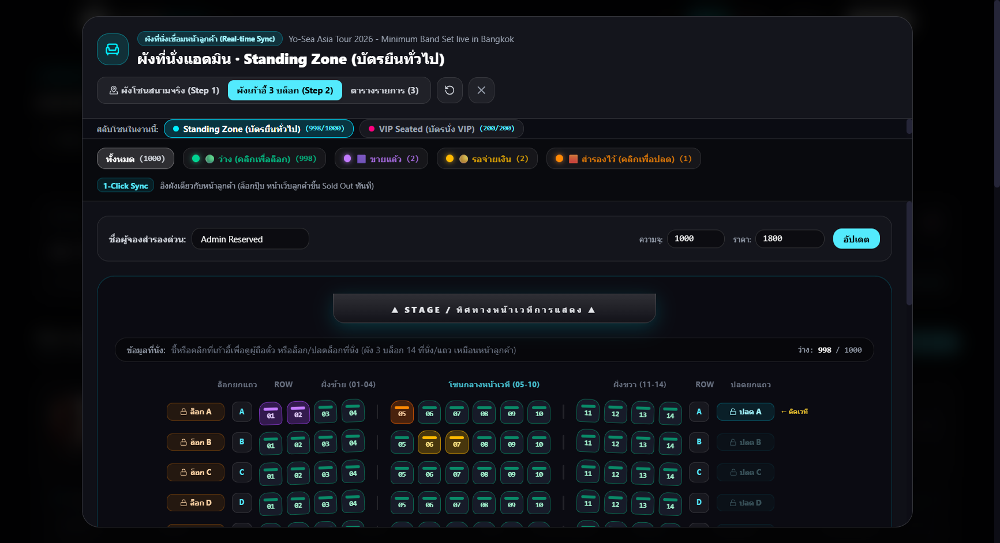
<!-- slide -->
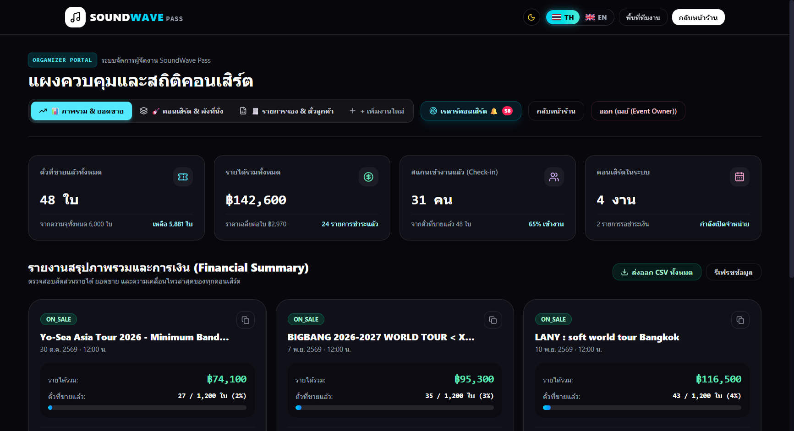
<!-- slide -->
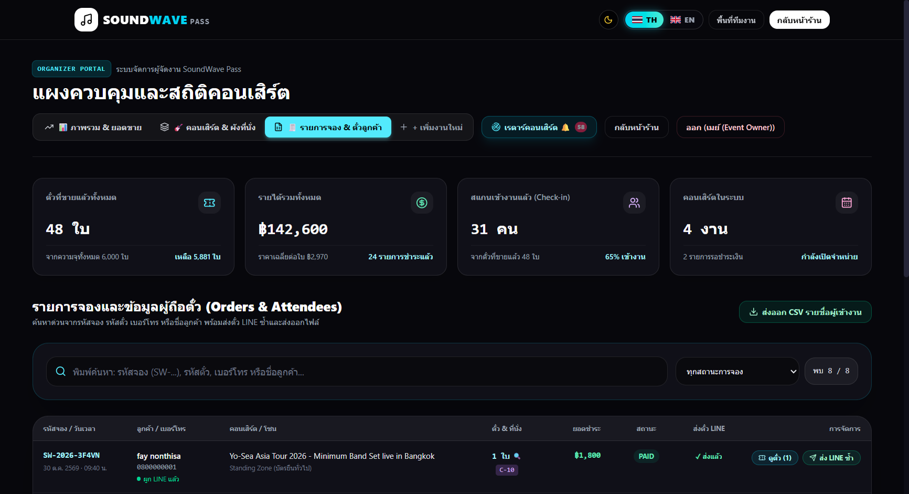
<!-- slide -->
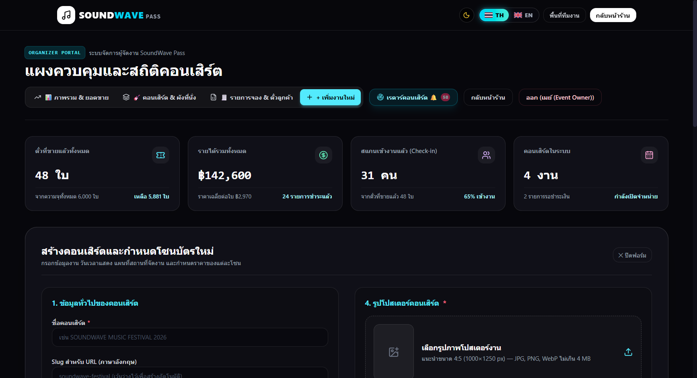
````

### 6.1 แถบส่วนหัว การ์ด KPI 4 ใบ และเรดาร์คอนเสิร์ต ([AdminPage.jsx](file:///C:/Users/USER/Documents/GitHub/SoundWave-Pas/frontend/src/pages/admin/AdminPage.jsx))

| ชื่อปุ่ม / การ์ด | ตำแหน่งบนหน้า `/admin` | หน้าที่การทำงาน | ผลลัพธ์เมื่อกด |
| :--- | :--- | :--- | :--- |
| **ปุ่ม `📡 เรดาร์คอนเสิร์ต 🔔`** | แถบขวาบนของหน้า `/admin` | เปิดระบบเรดาร์ตรวจจับคอนเสิร์ตใหม่ในไทยจาก ThaiTicketMajor | เปิดป๊อปอัพ [ConcertDiscoveryModal.jsx](file:///C:/Users/USER/Documents/GitHub/SoundWave-Pas/frontend/src/components/ConcertDiscoveryModal.jsx) พร้อมปุ่ม **`+ นำเข้างานนี้ใน 1 คลิก`** |
| **ปุ่ม `🔄 รีเฟรชข้อมูล`** | แถบขวาบนของหน้า `/admin` | ดึงตัวเลขยอดขาย สถานะที่นั่ง และรายการจองล่าสุดจากเซิร์ฟเวอร์ | อัปเดตข้อมูลทั้งหน้าโดยไม่ต้องโหลดเว็บใหม่ |
| **การ์ด KPI ทั้ง 4 ใบ (`ตั๋วที่ขายแล้ว`, `สแกนเข้างานแล้ว`, `รายได้สุทธิ`, `คอนเสิร์ตทั้งหมด`)** | แถวบนสุดของแดชบอร์ด | คลิกที่การ์ดใบใดก็ได้เพื่อดูรายงานเชิงลึกของหัวข้อนั้น | นำทางไปยังหน้า `/admin/insights/:type` ([AdminInsightPage.jsx](file:///C:/Users/USER/Documents/GitHub/SoundWave-Pas/frontend/src/pages/admin/AdminInsightPage.jsx)) |
| **ช่อง `🔍 ค้นหาด่วน (รหัสจอง, ชื่อลูกค้า, เบอร์โทร, เลขที่นั่ง)`** | เหนือแถบแท็บเมนู | ค้นหาข้อมูลลูกค้าหรือตั๋วใบใดก็ได้จากทุกคอนเสิร์ตทันที | แสดงผลลัพธ์ใบจองและตั๋วที่ตรงกันแบบเรียลไทม์ |

### 6.2 แท็บที่ 2 (`🎸 คอนเสิร์ต & ผังที่นั่ง`) และป๊อปอัพผังที่นั่ง ([AdminSeatMapModal.jsx](file:///C:/Users/USER/Documents/GitHub/SoundWave-Pas/frontend/src/components/AdminSeatMapModal.jsx))

| ชื่อปุ่ม / องค์ประกอบ | ตำแหน่ง | หน้าที่การทำงาน | ผลลัพธ์เมื่อกด |
| :--- | :--- | :--- | :--- |
| **ปุ่มสถานะงาน `🟢 เปิดขาย` / `🟡 พักการขาย` / `🔴 ปิดขาย`** | มุมขวาของการ์ดคอนเสิร์ตแต่ละงาน | เปิด/พัก/ปิดการจำหน่ายบัตรของคอนเสิร์ตนั้นทั้งงานทันที | อัปเดตสถานะหน้าเว็บลูกค้าทันที (หากพักหรือปิดขาย ลูกค้าจะกดจองไม่ได้) |
| **ปุ่ม `✏️ แก้ไขข้อมูลงาน`** | บนการ์ดคอนเสิร์ต | เปิดหน้าต่างแก้ไขชื่อ วันเวลา สถานที่ โปสเตอร์ และตารางศิลปิน | เปิดป๊อปอัพ [EditConcertModal.jsx](file:///C:/Users/USER/Documents/GitHub/SoundWave-Pas/frontend/src/components/EditConcertModal.jsx) |
| **ปุ่ม `🪑 ผังที่นั่ง (Seat Map)`** | ท้ายแถวของแต่ละโซนที่นั่ง | เปิดผังควบคุมเก้าอี้รายตัวและโควตาของโซนนั้น | เปิดป๊อปอัพ [AdminSeatMapModal.jsx](file:///C:/Users/USER/Documents/GitHub/SoundWave-Pas/frontend/src/components/AdminSeatMapModal.jsx) |
| **ปุ่ม `🔒 ล็อกทั้งแถว` / `🔓 ปลดล็อกแถว`** | ท้ายแถวเก้าอี้ `A`–`G` ใน `AdminSeatMapModal` | ล็อกที่นั่งว่างทั้งแถวให้เป็นโควตา VIP / สปอนเซอร์ หรือปลดล็อกคืน | ที่นั่งทั้งแถวเปลี่ยนเป็นสีม่วง (`RESERVED`) หรือกลับมาว่างพร้อมขายทันที |
| **ปุ่ม `🔒 ล็อกที่นั่งนี้` (เมื่อคลิกเก้าอี้ว่าง)** | แผงรายละเอียดด้านขวาใน `AdminSeatMapModal` | ล็อกเก้าอี้ตัวที่เลือกพร้อมระบุชื่อผู้ถือสิทธิ์ (เช่น `VIP Sponsor`) | สร้างรายการสำรองที่นั่งและตัดโควตาไม่ให้ลูกค้าทั่วไปกดแย่งได้ |
| **ปุ่ม `💸 คืนเงินและยกเลิกตั๋ว (Refund)` (เมื่อคลิกเก้าอี้ที่ขายแล้ว)** | แผงรายละเอียดด้านขวาใน `AdminSeatMapModal` | ยกเลิกตั๋วใบนั้น บันทึกยอดเงินคืน และคืนเก้าอี้กลับเป็นสถานะว่าง | ตั๋วเดิมถูกยกเลิก (`CANCELLED`) ใช้สแกนเข้างานไม่ได้อีก และเก้าอี้กลับมาเปิดขายใหม่ |
| **ช่อง `ความจุรวม` + `ราคาบัตร` + ปุ่ม `บันทึก`** | แถบด้านบนใน `AdminSeatMapModal` | ปรับเพิ่ม/ลดความจุที่นั่งรวม หรือแก้ไขราคาบัตรของโซนนั้น | อัปเดตความจุและราคาโซนทันที |

### 6.3 แท็บที่ 3 (`🧾 รายการจอง & ตั๋วลูกค้า`) และแท็บที่ 4 (`+ เพิ่มงานใหม่`)

| ชื่อปุ่ม / องค์ประกอบ | แท็บ | หน้าที่การทำงาน | ผลลัพธ์เมื่อกด |
| :--- | :--- | :--- | :--- |
| **ปุ่มกรองสถานะ (`ทั้งหมด`, `ชำระแล้ว`, `รอชำระ`, `คืนเงิน/ยกเลิก`)** | แท็บ `รายการจอง & ตั๋วลูกค้า` | กรองตารางใบจองตามสถานะการชำระเงิน | แสดงเฉพาะรายการจองในสถานะที่เลือก |
| **ปุ่ม `📥 ส่งออกรายชื่อผู้เข้างาน (Export CSV)`** | มุมขวาบนของแท็บ `รายการจอง` | ดาวน์โหลดรายชื่อผู้ถือบัตรทั้งหมดเป็นไฟล์ Excel / CSV (รองรับภาษาไทย UTF-8 BOM) | ดาวน์โหลดไฟล์ `.csv` ลงเครื่องคอมพิวเตอร์ทันที |
| **ปุ่ม `🎫 ดูตั๋วรายใบ (X ใบ)`** | ในแต่ละแถวของตารางใบจอง | เปิดดูรายการตั๋วทุกใบในคำสั่งซื้อนั้น พร้อมปุ่มคืนเงินรายใบ | เปิดป๊อปอัพ [BookingTicketsModal.jsx](file:///C:/Users/USER/Documents/GitHub/SoundWave-Pas/frontend/src/components/BookingTicketsModal.jsx) |
| **ปุ่ม `💬 ส่งตั๋วเข้า LINE ซ้ำ`** | ในแถวใบจองที่ผูก LINE แล้ว | ส่งการ์ดตั๋ว Flex Message เข้าแชท LINE ของลูกค้าอีกครั้ง | ส่งตั๋วเข้า LINE ของลูกค้าใหม่ทันทีและอัปเดตสถานะเป็น `ส่งสำเร็จ` |
| **ปุ่ม `🖼️ อัปโหลดและครอปโปสเตอร์`** | แท็บ `+ เพิ่มงานใหม่` | เลือกไฟล์ภาพโปสเตอร์และจัดกรอบภาพอัตราส่วนมาตรฐาน | เปิดหน้าต่าง [CropImageModal.jsx](file:///C:/Users/USER/Documents/GitHub/SoundWave-Pas/frontend/src/components/CropImageModal.jsx) เพื่อซูม/ลากจัดตำแหน่งภาพ |
| **ปุ่ม `📍 ค้นหาพิกัดสถานที่จัดงาน`** | แท็บ `+ เพิ่มงานใหม่` | ค้นหาชื่อฮอลล์/สถานที่เพื่อดึงพิกัด Latitude/Longitude อัตโนมัติ | แสดงรายการสถานที่จากระบบแผนที่ ([LocationPicker.jsx](file:///C:/Users/USER/Documents/GitHub/SoundWave-Pas/frontend/src/components/LocationPicker.jsx)) |
| **ปุ่ม `+ เพิ่มโซนที่นั่ง` / ปุ่มแม่แบบโซนด่วน** | แท็บ `+ เพิ่มงานใหม่` | เพิ่มโซนบัตรใหม่ กำหนดประเภท (`SEATED` / `VIP` / `STANDING`) ราคา สี และความจุ | เพิ่มแถวตั้งค่าโซนในฟอร์มสร้างคอนเสิร์ต |
| **ปุ่ม `🚀 บันทึกและเปิดขายคอนเสิร์ต`** | ล่างสุดของแท็บ `+ เพิ่มงานใหม่` | บันทึกคอนเสิร์ตและสร้างโซนที่นั่งทั้งหมดขึ้นหน้าเว็บไซต์ | สร้างคอนเสิร์ตสำเร็จและแสดงบนหน้าแรกให้ลูกค้าจองได้ทันที |

---

## บทที่ 7: การแก้ไขปัญหาเบื้องต้นและคำถามที่พบบ่อย (Troubleshooting & FAQ)

> [!TIP]
> **1. ลูกค้าเลือกที่นั่งแล้วแต่กดปุ่มไปหน้าชำระเงินไม่ได้?**
> - ตรวจสอบว่าได้ **เข้าสู่ระบบลูกค้า** แล้วหรือยัง (หากยังไม่ล็อกอิน ระบบจะเปิดหน้าต่างให้ล็อกอินก่อนอัตโนมัติ)
> - ตรวจสอบว่ากรอก **ชื่อ-นามสกุล** และ **เบอร์โทรศัพท์ครบ 10 หลัก** ในฟอร์มด้านขวาครบถ้วนแล้ว
>
> **2. ลูกค้าชำระเงินแล้วแต่ไม่ได้รับตั๋วในแชท LINE?**
> - ลูกค้ายังสามารถเปิดดูและดาวน์โหลดตั๋ว QR Code ได้ทันทีจากปุ่ม **`🎫 ตั๋วของฉัน`** บนแถบเมนูด้านบนของเว็บ
> - หากต้องการรับใน LINE ให้ลูกค้ากดเพิ่มเพื่อนบอท `@soundwavepass` ก่อน จากนั้นผู้จัดงานสามารถกดปุ่ม **`💬 ส่งตั๋วเข้า LINE ซ้ำ`** ในหน้า `/admin` แท็บ `รายการจอง & ตั๋วลูกค้า` ได้ทันที
>
> **3. กล้องสแกน QR Code ในหน้า `/scanner` ไม่ทำงานบนมือถือหรือคอมพิวเตอร์?**
> - ตรวจสอบว่าได้กด **`อนุญาต (Allow)`** ให้เบราว์เซอร์เข้าถึงกล้องแล้ว
> - หากกล้องของอุปกรณ์มีปัญหา สามารถใช้ปุ่ม **`🖼️ อัปโหลดรูปภาพ QR Code`** หรือพิมพ์รหัสตั๋ว (`SWP-...`) ลงในช่องตรวจตั๋วด้านล่างแทนได้ตลอดเวลา


---

# 📘 เอกสารคู่มือผู้ใช้งานฉบับสมบูรณ์ (Comprehensive User Manual)
**ระบบจองบัตรคอนเสิร์ตตามผังสถานที่จริง ออกตั๋วดิจิทัลผ่าน LINE และสแกนเนอร์ตรวจตั๋วหน้างาน**  
**ชื่อระบบ:** SoundWave Pass (Concert Ticketing & Event Radar System)  
**เวอร์ชันเอกสาร:** 2026.1 (ฉบับละเอียดครบทุกปุ่มและทุกหน้าจอ)  
**รองรับการใช้งาน:** เว็บไซต์บนคอมพิวเตอร์ (PC/Mac), เบราว์เซอร์บนสมาร์ทโฟน, แอปพลิเคชัน Android (`.APK`), และ iOS Web App (`PWA`)

---

## 📑 สารบัญ (Table of Contents)

1. [บทนำและภาพรวมของระบบ (System Overview)](#1-บทนำและภาพรวมของระบบ-system-overview)
2. [สิทธิ์การใช้งานและประเภทผู้ใช้งาน 3 กลุ่ม (User Roles)](#2-สิทธิ์การใช้งานและประเภทผู้ใช้งาน-3-กลุ่ม-user-roles)
3. [แถบเมนูหลักส่วนกลาง (Global Navigation Bar & Footer)](#3-แถบเมนูหลักส่วนกลาง-global-navigation-bar--footer)
   - 3.1 แถบเมนูด้านบนสำหรับคอมพิวเตอร์ (Desktop Top Navbar)
   - 3.2 แถบเมนูด้านบนและด้านล่างสำหรับมือถือ (Mobile Top & Bottom Navigation)
   - 3.3 แถบส่วนท้ายเว็บไซต์ (Global Footer)
   - 3.4 หน้าต่างดาวน์โหลดแอปพลิเคชัน (Download App Modal)
4. [ส่วนที่ 1: คู่มือสำหรับลูกค้าผู้ซื้อบัตร (Customer Storefront & Booking Flow)](#4-ส่วนที่-1-คู่มือสำหรับลูกค้าผู้ซื้อบัตร-customer-storefront--booking-flow)
   - 4.1 หน้าต่างเข้าสู่ระบบ / สมัครสมาชิก / ลืมรหัสผ่าน (Auth Modal)
   - 4.2 หน้าแรกและตารางไลน์อัปศิลปิน (`/` — HomePage)
   - 4.3 หน้ารายละเอียดคอนเสิร์ตและแผนที่จัดงาน (`/concerts/:id` — ConcertDetailPage)
   - 4.4 หน้าเลือกโซนและเลือกที่นั่ง 2 ขั้นตอน (`/booking/zone-select` — ZoneSelectPage)
   - 4.5 หน้าชำระเงินด้วย QR PromptPay (`/booking/payment/:bookingCode` — PaymentPage)
   - 4.6 หน้าต่างประวัติการซื้อตั๋วและกู้คืนตั๋ว (Purchase History Modal)
   - 4.7 หน้าบัตรคอนเสิร์ตดิจิทัล (`/tickets/:ticketCode` — MyTicketPage)
   - 4.8 หน้าพิมพ์บัตรที่ระลึกขนาด A4 (`/tickets/:ticketCode/print` — SouvenirPrintPage)
5. [ส่วนที่ 2: คู่มือสำหรับพื้นที่ทีมงานและเจ้าหน้าที่สแกนบัตรหน้างาน (Team Portal & Gate Scanner)](#5-ส่วนที่-2-คู่มือสำหรับพื้นที่ทีมงานและเจ้าหน้าที่สแกนบัตรหน้างาน-team-portal--gate-scanner)
   - 5.1 หน้าทางเข้าพื้นที่ทีมงาน (`/team` — TeamPortalPage)
   - 5.2 หน้าเข้าสู่ระบบเจ้าหน้าที่ตรวจบัตร (`/scanner` — Staff Login)
   - 5.3 หน้าเครื่องสแกนตรวจตั๋วหน้างาน (`/scanner` — Gate Scanner Console)
6. [ส่วนที่ 3: คู่มือสำหรับผู้จัดงาน / แอดมิน (Organizer / Admin Backoffice)](#6-ส่วนที่-3-คู่มือสำหรับผู้จัดงาน--แอดมิน-organizer--admin-backoffice)
   - 6.1 หน้าเข้าสู่ระบบเจ้าของงาน (`/admin` — Organizer Login)
   - 6.2 แถบควบคุมหลักและการ์ดสรุปสถิติ KPI 4 ด้าน (Top Header & Executive KPI Cards)
   - 6.3 แท็บที่ 1: `📊 ภาพรวม & ยอดขาย` (Overview & Financial Summary)
   - 6.4 แท็บที่ 2: `🎸 คอนเสิร์ต & ผังที่นั่ง` (Events & Seat Inventory)
   - 6.5 แท็บที่ 3: `🧾 รายการจอง & ตั๋วลูกค้า` (Orders & Attendees)
   - 6.6 แท็บที่ 4: `+ เพิ่มงานใหม่` (Create New Concert Form)
   - 6.7 หน้าต่างผังที่นั่งแอดมินแบบ Interactive (Admin Seat Map Modal)
   - 6.8 หน้าต่างเรดาร์ตรวจจับคอนเสิร์ตใหม่ในไทย (Concert Discovery Radar Modal)
   - 6.9 หน้าต่างแก้ไขข้อมูลคอนเสิร์ต (Edit Concert Modal)
   - 6.10 หน้าต่างจัดการรายชื่อศิลปิน (Artist Studio Modal)
   - 6.11 หน้าต่างดูตั๋วรายใบในคำสั่งซื้อ (Booking Tickets Modal)
   - 6.12 หน้าต่างปรับแต่งและตัดขอบรูปภาพ (Image Framing & Crop Studio Modal)
   - 6.13 เครื่องมือเลือกวัน-เวลาแสดง (Concert Date & Time Picker) และเครื่องมือค้นหาพิกัดสถานที่ (Location Picker)
   - 6.14 หน้ารายงานเชิงลึกเต็มหน้า (`/admin/insights/:type` — AdminInsightPage)
7. [การแก้ไขปัญหาเบื้องต้นและคำถามที่พบบ่อย (Troubleshooting & FAQ)](#7-การแก้ไขปัญหาเบื้องต้นและคำถามที่พบบ่อย-troubleshooting--faq)

---

## 1. บทนำและภาพรวมของระบบ (System Overview)

**SoundWave Pass** คือแพลตฟอร์มจำหน่ายบัตรคอนเสิร์ตและเทศกาลดนตรีครบวงจรที่จำลองประสบการณ์การกดบัตรตามผังสถานที่จัดงานจริงในประเทศไทย (เช่น ราชมังคลากีฬาสถาน, อิมแพ็ค อารีน่า เมืองทองธานี, หรือลานเทศกาลดนตรีกลางแจ้งและแคมป์ปิ้ง)

### จุดเด่นของระบบ
- **ระบบจองบัตร 2 ขั้นตอนตามผังจริง (2-Step Venue & Seat Selection):** เลือกโซนจากผังสถานที่จัดงานจริง (ขั้นตอนที่ 1) แล้วเจาะลึกเลือกเก้าอี้รายที่นั่งแบบ 3 ปีกอัฒจันทร์ หรือรับหมายเลขคิวเข้าฮอลล์สำหรับบัตรยืน (ขั้นตอนที่ 2) พร้อมล็อกที่นั่งแบบเรียลไทม์นาน 10 นาที
- **เชื่อมต่อและส่งตั๋วเข้าแอป LINE อัตโนมัติ (LINE Login & Flex Message Ticket):** ลูกค้าสามารถล็อกอินด้วย LINE เพื่อดึงชื่อโปรไฟล์และรับตั๋วดิจิทัลพร้อม QR Code เข้าแชท LINE ทันทีหลังชำระเงิน
- **ระบบพิมพ์บัตรสะสมที่ระลึกขนาด A4 (A4 Souvenir Collectible Ticket):** มีเส้นประรอยปรุสำหรับตัดเก็บสะสม พร้อมหางตั๋ว (Tear-off Stub) บาร์โค้ด และ QR Code
- **ระบบสแกนตรวจตั๋วหน้าประตู (Gate Scanner Terminal):** รองรับการสแกนด้วยกล้องสมาร์ทโฟน/เว็บแคม, โหมดสแกนคิวต่อเนื่องอัตโนมัติ, การอัปโหลดรูป QR จากเครื่อง, และการพิมพ์รหัสตั๋วหรือยิงด้วยเครื่องอ่านบาร์โค้ด USB พร้อมเสียงสัญญาณเตือนแยกตามสถานะบัตร
- **ระบบหลังบ้านสำหรับผู้จัดงาน (Organizer Dashboard & Event Radar):** ดูยอดขายเรียลไทม์, เปิด/พัก/ปิดการขายรายคอนเสิร์ตหรือรายโซน, ล็อกที่นั่ง VIP รายตัวหรือยกแถว, ส่งตั๋วเข้า LINE ซ้ำ, ส่งออกไฟล์ CSV และมี **เรดาร์ตรวจจับคอนเสิร์ตจริงในไทย (Auto-Discovery Radar)** ที่นำเข้าข้อมูลงานพร้อมโซนและศิลปินได้ใน 1 คลิก

---

## 2. สิทธิ์การใช้งานและประเภทผู้ใช้งาน 3 กลุ่ม (User Roles)

ระบบแบ่งผู้ใช้งานออกเป็น 3 กลุ่มแยกจากกันอย่างชัดเจนเพื่อความปลอดภัย:

| กลุ่มผู้ใช้งาน | หน้าจอที่เข้าถึงได้ | บัญชีทดสอบเริ่มต้น (Demo Credentials) |
| :--- | :--- | :--- |
| **1. ลูกค้าผู้ซื้อบัตร (Customer)** | หน้าแรก (`/`), รายละเอียดงาน (`/concerts/:id`), หน้าเลือกโซน/ที่นั่ง (`/booking/zone-select`), หน้าชำระเงิน (`/booking/payment/:code`), หน้าตั๋ว (`/tickets/:code`), หน้าพิมพ์ A4 (`/tickets/:code/print`) | สมัครสมาชิกใหม่หน้าเว็บ หรือคลิก **"เข้าสู่ระบบด้วย Google"** / **"เข้าสู่ระบบด้วย LINE"** |
| **2. เจ้าหน้าที่หน้างาน (Gate Staff / Supervisor)** | หน้าทางเข้าทีมงาน (`/team`), หน้าสแกนตั๋วเข้างาน (`/scanner`) | - **น้ำ (Gate Staff):** Username `nam` / รหัสผ่าน `1234`<br>- **เฟย์ (Supervisor):** Username `faye` / รหัสผ่าน `1234`<br>- **ประตู 1 (Gate Staff):** Username `gate01` / รหัสผ่าน `1234` |
| **3. เจ้าของงาน / ผู้จัดงาน (Organizer / Admin)** | หน้าทางเข้าทีมงาน (`/team`), หน้าแดชบอร์ดผู้จัดงาน (`/admin`), หน้ารายงานเชิงลึก (`/admin/insights/:type`) | - **เจ้าของงาน (Organizer):** Username `owner` / รหัสผ่าน `1234` |

---

## 3. แถบเมนูหลักส่วนกลาง (Global Navigation Bar & Footer)

แถบเมนูส่วนกลางจะแสดงอยู่ด้านบนสุดและด้านล่างสุดของทุกหน้าจอ โดยปุ่มที่แสดงผลจะปรับเปลี่ยนตามอุปกรณ์ (คอมพิวเตอร์ vs มือถือ) และพื้นที่ที่กำลังใช้งาน (หน้าร้านค้า vs หน้าทีมงาน)

### 3.1 แถบเมนูด้านบนสำหรับคอมพิวเตอร์ (Desktop Top Navbar)

#### ก. เมื่ออยู่ในหน้าร้านค้าของลูกค้า (`/`, `/concerts/...`, `/booking/...`, `/tickets/...`)

| ลำดับ | ชื่อปุ่ม / สัญลักษณ์บนหน้าจอ | ตำแหน่ง | หน้าที่การทำงาน (เมื่อคลิกได้) | ผลลัพธ์หลังกด (System Response) |
| :---: | :--- | :--- | :--- | :--- |
| 1 | **โลโก้ `🎵 SOUNDWAVE PASS`** | มุมซ้ายบนสุด | ปุ่มลิงก์กลับสู่หน้าแรกของเว็บไซต์ (กดได้ตลอดเวลา) | เปลี่ยนหน้าไปยังหน้าแรก (`/`) ทันทีโดยไม่รีเฟรชหน้าเว็บ |
| 2 | **ปุ่มสลับโหมดสี `🌙` / `☀️` (Theme Toggle)** | ด้านขวาบน | สลับโทนสีของระบบระหว่าง **โหมดมืด (Dark Neon Mode)** และ **โหมดสว่าง (Light Mode)** | สีพื้นหลัง กรอบการ์ด และตัวอักษรทั่วทั้งเว็บไซต์จะเปลี่ยนโทนสีทันที และบันทึกค่าไว้ในเครื่องอัตโนมัติ |
| 3 | **ปุ่มสลับภาษา `🇹🇭 TH` \| `🇬🇧 EN` (Language Switch)** | ด้านขวาบน ถัดจากปุ่มโหมดสี | สลับภาษาของระบบระหว่าง **ภาษาไทย (TH)** และ **ภาษาอังกฤษ (EN)** | ข้อความบนปุ่ม หัวข้อ สถานะบัตร ชื่อจังหวัด และคำอธิบายทั้งหมดจะเปลี่ยนภาษาทันทีแบบเรียลไทม์ |
| 4 | **ปุ่ม `หน้าแรก` (`Home`)** | ด้านขวาบน | นำทางกลับไปยังหน้าแรกของเว็บไซต์ | เปลี่ยนหน้าไปยัง `/` และปุ่มจะมีกรอบไฮไลท์สีขาวเมื่ออยู่ที่หน้าแรก |
| 5 | **ปุ่ม `📥 ดาวน์โหลดแอป` (`Download App`)** | ด้านขวาบน (กรอบสีฟ้า Cyan) | เปิดหน้าต่างติดตั้งแอปพลิเคชันลงบนคอมพิวเตอร์หรือมือถือ *(ซ่อนอัตโนมัติหากเปิดใช้งานผ่านตัวแอปอยู่แล้ว)* | เปิดหน้าต่างป๊อปอัป **Download App Modal** ให้เลือกแพลตฟอร์ม (PC / Android `.APK` / iPhone iOS) |
| 6 | **ปุ่ม `🎫 ประวัติการซื้อบัตร` (`My Tickets`)** | ด้านขวาบน *(แสดงเฉพาะเมื่อลูกค้าเข้าสู่ระบบแล้ว)* | เปิดดูรายการบัตรคอนเสิร์ตทั้งหมดที่เคยสั่งซื้อในเครื่องนี้ หรือค้นหากู้คืนตั๋วด้วยรหัสจอง | เปิดหน้าต่างป๊อปอัป **Purchase History Modal** แสดงรายการจองและปุ่มเปิดดูตั๋ว/พิมพ์ตั๋ว |
| 7 | **ปุ่ม `เข้าสู่ระบบ` (`Sign In`)** | มุมขวาบนสุด *(แสดงเมื่อยังไม่ได้ล็อกอิน)* | เปิดหน้าต่างเข้าสู่ระบบหรือสมัครสมาชิกสำหรับลูกค้า | เปิดหน้าต่างป๊อปอัป **Auth Modal** |
| 8 | **ป้ายชื่อผู้ใช้ + ปุ่ม `ออกจากระบบ` (`Logout`)** | มุมขวาบนสุด *(แสดงเมื่อล็อกอินแล้ว)* | แสดงรูปโปรไฟล์/ชื่อผู้ใช้ในกรอบสีเขียว และมีปุ่มสีแดง `ออกจากระบบ` อยู่ด้านใน | เมื่อคลิกปุ่ม `ออกจากระบบ` ระบบจะล้างเซสชันการล็อกอินและเปลี่ยนปุ่มกลับเป็น `เข้าสู่ระบบ` |

#### ข. เมื่ออยู่ในพื้นที่ทีมงาน (`/team`, `/scanner`, `/admin`) บนคอมพิวเตอร์

| ลำดับ | ชื่อปุ่ม / สัญลักษณ์บนหน้าจอ | ตำแหน่ง | หน้าที่การทำงาน | ผลลัพธ์หลังกด |
| :---: | :--- | :--- | :--- | :--- |
| 1 | **ปุ่ม `🌙` / `☀️` และ `🇹🇭 TH` \| `🇬🇧 EN`** | ด้านขวาบน | สลับโหมดมืด/สว่าง และสลับภาษาไทย/อังกฤษในหน้าทีมงาน | เปลี่ยนธีมสีและภาษาในหน้าสแกนเนอร์และหน้าแอดมินทันที |
| 2 | **ปุ่ม `พื้นที่ทีมงาน` (`Team Portal`)** | ด้านขวาบน | กลับไปยังหน้าเลือกบทบาททีมงาน | นำทางไปยังหน้า `/team` |
| 3 | **ปุ่ม `กลับหน้าร้าน` (`Back to Store`)** | มุมขวาบนสุด (ปุ่มสีขาวตัวหนังสือดำ) | ออกจากโหมดทีมงานเพื่อกลับไปยังหน้าเว็บจำหน่ายบัตรของลูกค้า | นำทางไปยังหน้าแรก `/` |

---

### 3.2 แถบเมนูด้านบนและด้านล่างสำหรับมือถือ (Mobile Navigation Bars)

เมื่อเปิดใช้งานบนหน้าจอมือถือ ระบบจะแยกปุ่มเครื่องมือไว้ด้านบน และแสดง **แถบเมนูนำทางด้านล่างหน้าจอ (Bottom Navigation Bar)** เพื่อให้ใช้นิ้วโป้งกดสลับหน้าได้สะดวกเหมือนแอปมือถือ

#### ก. มุมขวาบนของจอมือถือ (Mobile Top Right)
- **ปุ่ม `📥 แอป` (`App`):** กดเพื่อเปิดหน้าต่างดาวน์โหลดแอป (PC / Android `.APK` / iOS)
- **ปุ่มไอคอนโล่ `🛡️` (`Team Portal`):** ปุ่มลัดสำหรับสตาฟฟ์และแอดมิน กดเพื่อเข้าสู่หน้า `/team`
- **ปุ่ม `🌙`/`☀️` และ `TH`/`EN`:** กดสลับโหมดมืด/สว่าง และภาษาไทย/อังกฤษ

#### ข. แถบนำทางด้านล่างของจอมือถือ — โหมดลูกค้า (Customer Bottom Bar)
| ลำดับ | ชื่อปุ่ม / ไอคอน | ตำแหน่ง | หน้าที่และผลลัพธ์หลังกด |
| :---: | :--- | :--- | :--- |
| 1 | **`🏠 หน้าแรก` (`Home`)** | ล่างซ้าย | กดเพื่อกลับสู่หน้าแรก (`/`) ทันที (เมื่ออยู่หน้าแรก ไอคอนจะเรืองแสงสีฟ้า) |
| 2 | **`🎫 ประวัติบัตร` (`My Tickets`)** | ล่างกลาง | หากล็อกอินแล้วจะเปิดหน้าต่าง **ประวัติการซื้อตั๋ว** ทันที / หากยังไม่ได้ล็อกอินจะเปิดหน้าต่าง **เข้าสู่ระบบ** |
| 3 | **`👤 เข้าสู่ระบบ` (`Sign In`)** หรือ **ป้ายชื่อ + ปุ่ม `ออก` (`Exit`)** | ล่างขวา | กดเพื่อเข้าสู่ระบบ หรือหากล็อกอินอยู่จะแสดงชื่อบัญชีพร้อมปุ่มสีแดง `ออก` สำหรับล็อกเอาต์ |

#### ค. แถบนำทางด้านล่างของจอมือถือ — โหมดทีมงาน (Team Surface Bottom Bar)
แสดงเฉพาะเมื่ออยู่ในหน้า `/team`, `/scanner`, หรือ `/admin`:
1. **`🏪 กลับหน้าร้าน` (`Store`):** กดเพื่อกลับไปหน้าเว็บลูกค้า (`/`)
2. **`👥 ทีมงาน` (`Team`):** กดเพื่อไปหน้าเลือกหน้าที่ทีมงาน (`/team`)
3. **`📷 สแกนบัตร` (`Scanner`):** กดเพื่อเปิดหน้าเครื่องสแกนตรวจตั๋ว (`/scanner`)
4. **`🛡️ ผู้จัดงาน` (`Organizer`):** กดเพื่อเปิดหน้าแดชบอร์ดแอดมิน (`/admin`)

---

### 3.3 แถบส่วนท้ายเว็บไซต์ (Global Footer)

อยู่ด้านล่างสุดของทุกหน้าเว็บ มีปุ่มที่กดได้ดังนี้:
1. **ปุ่ม `📥 ดาวน์โหลดแอป (PC / Android / iOS)`:** กดเพื่อเปิดหน้าต่างเลือกติดตั้งแอปพลิเคชันลงเครื่อง
2. **ปุ่ม `📱 โหลด .APK` (`Direct .APK`):** ปุ่มสีเขียว กดเพื่อดาวน์โหลดไฟล์ติดตั้ง `SoundWave-Pass.apk` ลงเครื่องมือถือ Android โดยตรงในคลิกเดียว
3. **ปุ่ม `🛡️ พื้นที่ทีมงาน` (`Team Portal`):** ลิงก์สำหรับเจ้าหน้าที่และเจ้าของงานเพื่อเข้าสู่หน้า `/team`

---

### 3.4 หน้าต่างดาวน์โหลดแอปพลิเคชัน (Download App Modal)

ปรากฏเมื่อกดปุ่ม `ดาวน์โหลดแอป` จากแถบด้านบนหรือส่วนท้ายเว็บ มีปุ่มที่กดได้ดังนี้:

| ชื่อปุ่มบนหน้าจอ | ตำแหน่ง | หน้าที่การทำงาน | ผลลัพธ์หลังกด |
| :--- | :--- | :--- | :--- |
| **ปุ่ม `✕` (ปิดหน้าต่าง)** | มุมขวาบนของป๊อปอัป | ปิดหน้าต่างดาวน์โหลดแอป | ป๊อปอัปหายไป (หรือคลิกพื้นที่สีดำนอกกรอบเพื่อปิดได้เช่นกัน) |
| **ปุ่ม `💻 ติดตั้งลงคอมพิวเตอร์` (`Install for Desktop`)** | การ์ดใบที่ 1 (สีฟ้า PC / Mac) | ติดตั้งเว็บแอปลงบน Windows / macOS | หากเบราว์เซอร์รองรับ PWA จะเด้งหน้าต่างติดตั้งแอปเต็มจอทันที หรือดาวน์โหลดไฟล์ทางลัด `SoundWave Pass (Desktop).url` ลงเครื่องพร้อมแสดงกล่องคำแนะนำด้านล่าง |
| **ปุ่ม `📥 ดาวน์โหลดไฟล์ .APK` (`Download .APK`)** | การ์ดใบที่ 2 (สีเขียว Android) | ดาวน์โหลดไฟล์ติดตั้งแอป Android | เบราว์เซอร์เริ่มดาวน์โหลดไฟล์ `SoundWave-Pass.apk` ลงในโทรศัพท์มือถือทันที |
| **ปุ่ม `🍎 ติดตั้งบน iPhone (ฟรี)` (`Install on iOS`)** | การ์ดใบที่ 3 (สีม่วง iOS) | แสดงวิธีติดตั้งแอปลงบนหน้าจอโฮมของ iPhone / iPad | เปิด/ซ่อนกล่องคู่มือ 3 ขั้นตอนด้านล่าง (การกดปุ่ม `Share` > `Add to Home Screen` บน Safari) |
| **ปุ่ม `ซ่อน` (`Hide`)** | มุมขวาบนของกล่องคู่มือด้านล่าง | ซ่อนกล่องคำแนะนำการติดตั้ง iOS หรือ Desktop | กล่องคำแนะนำพับเก็บลง |

---

## 4. ส่วนที่ 1: คู่มือสำหรับลูกค้าผู้ซื้อบัตร (Customer Storefront & Booking Flow)

### 4.1 หน้าต่างเข้าสู่ระบบ / สมัครสมาชิก / ลืมรหัสผ่าน (Auth Modal)

เปิดได้จากการกดปุ่ม `เข้าสู่ระบบ` บนแถบเมนู หรือเมื่อกดยืนยันจองตั๋วโดยที่ยังไม่ได้ล็อกอิน

| ลำดับ | ชื่อปุ่ม / ช่องกรอกข้อมูล | ตำแหน่ง | หน้าที่การทำงาน | ผลลัพธ์หลังกด / กรอก |
| :---: | :--- | :--- | :--- | :--- |
| 1 | **ปุ่ม `✕` (ปิด)** | มุมขวาบนของหน้าต่าง | ปิดหน้าต่างเข้าสู่ระบบ | ปิด Modal กลับสู่หน้าเดิม |
| 2 | **ปุ่ม `เข้าสู่ระบบด้วย Google` (`Sign in with Google`)** | ด้านบนสุดของฟอร์ม | ล็อกอินด่วนด้วยบัญชี Google โดยไม่ต้องกรอกรหัสผ่าน | บนคอมพิวเตอร์จะเปิดหน้าต่างเลือกบัญชี Google / บนมือถือจะสลับไปหน้ายืนยันตัวตน Google แล้วพากลับมาหน้าเดิมพร้อมเข้าสู่ระบบอัตโนมัติ |
| 3 | **ช่องกรอก `ชื่อผู้ใช้ หรือ อีเมล` (`Username`)** | ช่องกรอกที่ 1 | พิมพ์ชื่อผู้ใช้ (ความยาว 3–64 ตัวอักษร) หรืออีเมล | รับข้อความสำหรับใช้ตรวจสอบบัญชี |
| 4 | **ช่องกรอก `LINE User ID (ไม่บังคับ)`** | ช่องกรอกที่ 2 *(แสดงเฉพาะโหมดสมัครสมาชิก หรือ ลืมรหัสผ่าน)* | ระบุรหัส LINE User ID (ขึ้นต้นด้วย `U...`) เพื่อผูกบัญชีรับตั๋วหรือใช้ยืนยันตัวตน | ผูกบัญชีลูกค้าเข้ากับ LINE หรือใช้ตรวจสอบสิทธิ์เมื่อต้องการรีเซ็ตรหัสผ่าน |
| 5 | **ช่องกรอก `รหัสผ่าน` / `รหัสผ่านใหม่` (`Password`)** | ช่องกรอกถัดมา | กรอกรหัสผ่าน (อย่างน้อย 8 ตัวอักษร) | แสดงเป็นจุดซ่อนรหัสผ่านเป็นค่าเริ่มต้น |
| 6 | **ปุ่มไอคอนรูปตา `👁️` / `🙈`** | ด้านขวาในช่องรหัสผ่าน | กดเพื่อแสดงรหัสผ่านเป็นตัวอักษรจริง หรือซ่อนเป็นจุด | สลับการมองเห็นรหัสผ่านเพื่อเช็คความถูกต้องก่อนกดส่ง |
| 7 | **ปุ่มหลัก `เข้าสู่ระบบ` / `สมัครสมาชิก` / `ตั้งรหัสผ่านใหม่`** | ปุ่มสีฟ้าขนาดใหญ่ด้านล่างฟอร์ม | ส่งข้อมูลเพื่อเข้าสู่ระบบ, สร้างบัญชีใหม่, หรือเปลี่ยนรหัสผ่านตามโหมดที่เลือกอยู่ | - หากสำเร็จ: ปิดหน้าต่างและแสดงชื่อผู้ใช้บนแถบเมนูทันที (หรือสลับกลับมาหน้าล็อกอินหากเพิ่งรีเซ็ตรหัสผ่านเสร็จ)<br>- หากข้อมูลไม่ครบ/ผิด: แสดงกล่องแจ้งเตือนสีแดงระบุสาเหตุชัดเจน |
| 8 | **ลิงก์ `ลืมรหัสผ่าน?` (`Forgot password?`)** | ด้านล่างซ้ายใต้ปุ่มหลัก *(แสดงในโหมดเข้าสู่ระบบ)* | สลับฟอร์มเป็นโหมดตั้งรหัสผ่านใหม่ | เปลี่ยนหัวข้อเป็น "ลืมรหัสผ่าน" และแสดงช่องกรอก Username + LINE User ID + รหัสผ่านใหม่ |
| 9 | **ลิงก์ `สมัครสมาชิกใหม่` (`Create Account`) / `เข้าสู่ระบบ` (`Sign In`)** | ด้านล่างขวาใต้ปุ่มหลัก | สลับไปมาระหว่างหน้า **"เข้าสู่ระบบ"** กับหน้า **"สมัครสมาชิก"** | เปลี่ยนรูปแบบฟอร์มและปุ่มกดตามโหมดที่เลือกทันที |

---

### 4.2 หน้าแรกและตารางไลน์อัปศิลปิน (`/` — HomePage)

หน้าแรกประกอบด้วย 4 โซนหลัก ได้แก่: **1) แบนเนอร์ใหญ่ด้านบน (Hero Banner)**, **2) แถบสลับคอนเสิร์ตและทัพศิลปิน (Interactive Concert Switcher & Lineup)**, **3) ตารางเวลากิจกรรม (Timetable)**, และ **4) รายการคอนเสิร์ตทั้งหมดและแบนเนอร์กระตุ้นการจองด้านล่าง (All Live Events & CTA)**

```
+-----------------------------------------------------------------------+
| [🎵 SOUNDWAVE PASS]                [🌙] [TH|EN] [หน้าแรก] [เข้าสู่ระบบ] |
+-----------------------------------------------------------------------+
|                       HERO BANNER (คอนเสิร์ตที่เลือก)                   |
|        [ ⚡ เลือกโซนและจองบัตร -> ]   [ ดูทัพศิลปินแต่ละงาน ↓ ]          |
+-----------------------------------------------------------------------+
| เลือกคอนเสิร์ตเพื่อดูไลน์อัป: [ การ์ดงานที่ 1 ] [ การ์ดงานที่ 2 ] [ งานที่ 3 ] |
| +-----------------------------------+-------------------------------+ |
| | รูปศิลปินไฮไลท์ (หมุนอัตโนมัติ 4.5s) | ชื่อวง / แนวเพลง / วัน-เวลาแสดง | |
| |                                   | [ จองบัตรดู (ชื่อศิลปิน) -> ]     | |
| +-----------------------------------+-------------------------------+ |
| [ การ์ดย่อยศิลปิน 1 ] [ การ์ดย่อยศิลปิน 2 ] [ ศิลปิน 3 ] [ ศิลปิน 4 ]      |
+-----------------------------------------------------------------------+
```

#### ตารางปุ่มทั้งหมดในหน้าแรก (`HomePage`)

| โซนหน้าจอ | ชื่อปุ่ม / การ์ดที่กดได้ | ตำแหน่ง | หน้าที่การทำงาน | ผลลัพธ์หลังกด |
| :--- | :--- | :--- | :--- | :--- |
| **1. โซนแบนเนอร์บนสุด (Hero Section)** | **ปุ่ม `⚡ เลือกโซนและจองบัตร →`** (`Select Zone & Book Tickets`) | ตรงกลางแบนเนอร์ (ปุ่มสีฟ้า Cyan) | พาเข้าสู่หน้าเลือกโซนและที่นั่งของคอนเสิร์ตที่กำลังแสดงอยู่บนแบนเนอร์ | เปลี่ยนหน้าไปยัง `/booking/zone-select?concertId=...` ทันที *(หมายเหตุ: หากคอนเสิร์ตถูกพักการขาย ปุ่มจะเปลี่ยนเป็นป้ายสีเหลือง `⏸️ พักการจำหน่ายชั่วคราว` และหากปิดขายแล้วจะเป็นป้ายสีเทา `🔴 ปิดการจำหน่ายบัตรแล้ว` ซึ่งกดไม่ได้)* |
| **1. โซนแบนเนอร์บนสุด (Hero Section)** | **ปุ่ม `ดูทัพศิลปินแต่ละงาน ↓`** หรือ **`ดูข้อมูลศิลปินและรอบแสดง ↓`** | ข้างปุ่มจองบัตร (กรอบโปร่งแสง) | เลื่อนหน้าจอลงไปยังส่วนแสดงรายชื่อศิลปินและเวลาขึ้นแสดง | หน้าจอเลื่อนแบบนุ่มนวล (Smooth Scroll) ลงมายังส่วน `#artists-section` |
| **2. แถบเลือกคอนเสิร์ต (Concert Switcher Bar)** | **การ์ดเลือกคอนเสิร์ตแต่ละงาน** (มีรูปโปสเตอร์เล็ก + ชื่องาน + วันที่ + จำนวนศิลปิน) | เรียงเป็นแถว 3 คอลัมน์ในกล่อง "เลือกคอนเสิร์ตเพื่อดูไลน์อัป" | สลับคอนเสิร์ตที่ต้องการดูข้อมูลบนหน้าแรก | เมื่อคลิกการ์ดงานใด: การ์ดนั้นจะขึ้นกรอบเรืองแสงสีฟ้าพร้อมจุดไฟกะพริบ, แบนเนอร์บนสุดเปลี่ยนตามงานที่เลือก, รายชื่อศิลปินด้านล่างเปลี่ยนเป็นของงานนั้น และตารางเวลา Timetable เปลี่ยนตามทันที |
| **3. โซนไฮไลท์ศิลปิน (Featured Artist Card)** | **ปุ่ม `จองบัตรดู [ชื่อศิลปิน] →`** (`Book Tickets for ...`) | มุมขวาล่างของการ์ดศิลปินขนาดใหญ่ (ปุ่มสีขาวตัวหนังสือดำ) | ลัดไปหน้าจองบัตรของคอนเสิร์ตที่ศิลปินวงนั้นขึ้นแสดง | เปลี่ยนหน้าไปยังหน้าเลือกโซน `/booking/zone-select?concertId=...` ของงานนั้นทันที |
| **3. โซนไฮไลท์ศิลปิน (Artist Selector Grid)** | **การ์ดย่อยรายชื่อศิลปินแต่ละวง** (แสดงเมื่อมีศิลปินมากกว่า 1 วง) | เรียง 2–4 คอลัมน์ใต้การ์ดศิลปินใบใหญ่ | คลิกเลือกดูประวัติ เวที และเวลาขึ้นแสดงของศิลปินวงที่สนใจ | การ์ดศิลปินใบใหญ่ด้านบนจะเปลี่ยนรูปภาพ คำอธิบาย ชื่อเวที วันที่ และเวลาแสดงเป็นของวงที่คลิกทันที (ปกติจะสลับอัตโนมัติทุก 4.5 วินาที) |
| **4. โซนคอนเสิร์ตทั้งหมด (Live Events List)** | **การ์ดคอนเสิร์ตในหมวด `คอนเสิร์ตทั้งหมดในระบบ`** | ด้านล่างตารางเวลาแสดง (เรียง 3 คอลัมน์) | เลือกคอนเสิร์ตและเลื่อนขึ้นไปดูไลน์อัปของงานนั้น | ระบบสลับข้อมูลเป็นคอนเสิร์ตที่คลิก และเลื่อนหน้าจอกลับขึ้นไปยังโซนแสดงศิลปิน (`#artists-section`) อัตโนมัติ |
| **5. โซนแบนเนอร์ท้ายหน้า (Bottom CTA Banner)** | **ปุ่ม `เลือกโซนและซื้อบัตรเลย →`** (`Select Zone & Book Now`) | ตรงกลางกล่องด้านล่างสุดของหน้าแรก (ปุ่มสีขาว) | ปุ่มกระตุ้นการตัดสินใจจองบัตรหลังจากอ่านข้อมูลจบ | เปลี่ยนหน้าไปยัง `/booking/zone-select?concertId=...` ของคอนเสิร์ตที่เลือกอยู่ |

---

### 4.3 หน้ารายละเอียดคอนเสิร์ตและแผนที่จัดงาน (`/concerts/:id` — ConcertDetailPage)

หน้านี้แสดงข้อมูลเชิงลึกของคอนเสิร์ต ประกอบด้วยคำอธิบายงาน, ตารางเวลาแสดง (Show Timetable), การ์ดรายชื่อศิลปิน (Artist Lineup), แผนที่สถานที่จัดงานแบบโต้ตอบได้ (OpenStreetMap / Google Maps), และแผงโซนบัตรด้านขวา

#### ตารางปุ่มทั้งหมดในหน้ารายละเอียดคอนเสิร์ต (`ConcertDetailPage`)

| ชื่อปุ่ม / ส่วนที่กดได้ | ตำแหน่ง | หน้าที่การทำงาน | ผลลัพธ์หลังกด |
| :--- | :--- | :--- | :--- |
| **ปุ่ม `← กลับ` (`Back`)** | มุมซ้ายบนของภาพปกคอนเสิร์ต | ย้อนกลับไปยังหน้าแรกของเว็บไซต์ | เปลี่ยนหน้ากลับไปยัง `/` |
| **แผนที่จัดงาน (Interactive Map Iframe)** | ด้านล่างสุดของคอลัมน์ซ้าย | เลื่อนดูแผนที่ ซูมเข้า-ออก เพื่อดูตำแหน่งสถานที่จัดงานจริง | สามารถลากแผนที่และกดปุ่ม `+` / `-` บนแผนที่เพื่อดูเส้นทางรอบสนามจัดงานได้ |
| **ปุ่ม `เลือกโซนจากผังคอนเสิร์ต →`** (`Select Zone on Venue Map`) | ด้านล่างสุดของแถบโซนบัตรทางด้านขวา (Sticky Sidebar) | ไปยังหน้าผังสนามเพื่อเลือกโซนและที่นั่งของคอนเสิร์ตนี้ | เปลี่ยนหน้าไปยัง `/booking/zone-select?concertId=:id` *(หากงานอยู่ในสถานะ `PAUSED` หรือ `CLOSED` ปุ่มจะเปลี่ยนเป็นข้อความแจ้งสถานะและไม่สามารถกดจองได้)* |
| **ปุ่ม `กลับหน้าแรก` (`Back to Home`)** | ตรงกลางหน้าจอ *(แสดงเฉพาะกรณีพิมพ์ URL รหัสคอนเสิร์ตที่ไม่มีในระบบ)* | พากลับหน้าแรกเมื่อไม่พบข้อมูลงาน | เปลี่ยนหน้ากลับไปยัง `/` |

---

### 4.4 หน้าเลือกโซนและเลือกที่นั่ง 2 ขั้นตอน (`/booking/zone-select` — ZoneSelectPage)

นี่คือหน้าหัวใจหลักของการจองบัตร ออกแบบให้ทำงานเป็น **2 ขั้นตอน (2-Step Realistic Venue Booking)** เหมือนเว็บกดบัตรคอนเสิร์ตชั้นนำ:
- **ขั้นตอนที่ 1 (Step 1):** เลือกโซนจากผังสถานที่จัดงานจริง (รองรับ 3 รูปแบบผังอัตโนมัติตามสถานที่จริง: **ผังอินดอร์อารีน่าฮอลล์ + เวทีตัว T**, **ผังสนามกีฬาสเตเดียมใหญ่ + ลู่วิ่ง**, และ **ผังลานเทศกาลดนตรีกลางแจ้ง + โซนแคมป์ปิ้ง**) หรือแตะเลือกจากการ์ดโซน
- **ขั้นตอนที่ 2 (Step 2):**
  - หากเป็น **โซนบัตรนั่ง (Seated / VIP / VVIP):** จะเปิดผังเก้าอี้สนาม 3 บล็อก (ปีกซ้ายที่นั่ง `01–04`, โซนกลางหน้าเวที `05–10`, ปีกขวา `11–14`, แถว `A` ถึง `G`) ให้คลิกเลือกเก้าอี้รายตัวได้สูงสุด 6 ที่นั่ง
  - หากเป็น **โซนบัตรยืน (Standing Pit) หรือแคมป์ปิ้ง:** จะเปิดกล่องกดเลือกจำนวนบัตร (`-` / `+`) เพื่อรันหมายเลขคิวเข้าฮอลล์อัตโนมัติ (เช่น `STD-001`, `STD-002`)

```
+-------------------------------------------------------------------------------+
| [← รายละเอียดคอนเสิร์ต]                     [① เลือกโซน] -> [② เลือกที่นั่ง/บัตรยืน] |
+--------------------------------------------------+----------------------------+
| คอลัมน์ซ้าย: ผังสถานที่ & ผังที่นั่ง                    | คอลัมน์ขวา: สรุปรายการจอง    |
| 1. แถบยืนยันโซนที่กำลังเลือก + ปุ่ม [↺ เปลี่ยนโซน]   | - โซนและรหัสที่นั่งที่เลือก     |
| 2. (บนมือถือ) แท็บสลับ [🎫 รายการโซน] [📍 ผังสถานที่] | - ปุ่ม [-][จำนวน][+]         |
| 3. ผังสถานที่จริง SVG (คลิกที่บล็อกสีเพื่อเลือกโซน)     | - ยอดชำระสุทธิ (฿)          |
| 4. การ์ดโซนทั้งหมด + ปุ่ม [↺ ล้างโซน]                | - กล่องเชื่อมต่อ LINE:        |
| 5. ผังเลือกที่นั่ง (Step 2):                        |   [ เข้าสู่ระบบด้วย LINE ]    |
|    - ปุ่ม [📱 พอดีจอ] [🔍 ซูมใหญ่] [🔄 รีเฟรช]      | - ฟอร์มข้อมูลผู้ซื้อ:          |
|    - เก้าอี้รายตัว A-01 ถึง G-14 (คลิกเลือก/ยกเลิก) |   [ ชื่อ-นามสกุล * ]         |
|    - แถบป้ายที่นั่งที่เลือก [A-05 ✕] [ล้างทั้งหมด]     |   [ เบอร์โทรศัพท์ 10 หลัก * ] |
|                                                  | [ ยืนยันการจองและไปชำระเงิน ]|
+--------------------------------------------------+----------------------------+
```

#### ตารางปุ่มทั้งหมดในหน้าเลือกโซนและที่นั่ง (`ZoneSelectPage`)

##### ก. ส่วนหัวหน้าจอและขั้นตอนที่ 1: การเลือกโซนบัตร (Step 1 Controls)

| ลำดับ | ชื่อปุ่ม / ส่วนที่กดได้ | ตำแหน่ง | หน้าที่การทำงาน | ผลลัพธ์หลังกด |
| :---: | :--- | :--- | :--- | :--- |
| 1 | **ลิงก์ `← รายละเอียดคอนเสิร์ต`** | มุมซ้ายบนสุด | ย้อนกลับไปดูข้อมูลรายละเอียดและตารางเวลาของคอนเสิร์ต | เปลี่ยนหน้าไปยัง `/concerts/:id` |
| 2 | **ปุ่ม `↺ เปลี่ยนโซน` (`↺ Change Zone`)** | ด้านขวาของแถบลอยยืนยันโซนสีฟ้า *(แสดงเมื่อเลือกโซนแล้ว)* | ยกเลิกโซนที่กำลังเลือกอยู่เพื่อกลับไปเลือกโซนใหม่ | ล้างโซนและที่นั่งที่เลือกไว้ทั้งหมดเป็น 0 และปิดผังเก้าอี้ขั้นตอนที่ 2 |
| 3 | **ปุ่มแท็บ `🎫 รายการโซนบัตร` / `📍 ผังสถานที่จริง`** | ด้านบนคอลัมน์ซ้าย *(แสดงเฉพาะบนหน้าจอมือถือ)* | สลับมุมมองบนมือถือระหว่างการดูเป็น **การ์ดรายการโซน** กับการดู **ภาพผังสนามจัดงานจริง** | สลับการแสดงผลทันทีโดยไม่ต้องเลื่อนหน้าจอยาวเกินไปบนมือถือ |
| 4 | **บล็อกโซนสีต่างๆ บนผังสถานที่จริง (`StadiumZoneMap` SVG)** | กลางผังจำลองสนาม (เช่น `STANDING A`, `STANDING B`, อัฒจันทร์ `SB–SN`, `B–P`, `W1–E3`, หรือ `⛺ โซนแคมป์ปิ้ง`) | คลิกเลือกโซนบัตรจากตำแหน่งจริงหน้าเวทีหรือบนอัฒจันทร์ | - เมื่อเอาเมาส์ชี้: แสดงแถบสรุปชื่อโซน ประเภท ราคา และจำนวนที่ว่างด้านล่างผัง<br>- เมื่อคลิก: เลือกโซนนั้นทันที, เปิดผังเลือกเก้าอี้/คิวในขั้นตอนที่ 2 ด้านล่าง และเลื่อนหน้าจอลงไปยังผังเก้าอี้อัตโนมัติ *(โซนที่บัตรหมด `SOLD OUT` หรือพักการขายจะขึ้นสีทึมและคลิกไม่ได้)* |
| 5 | **ปุ่ม `↺ ล้างโซน` (`↺ Clear`)** | มุมขวาบนของกล่อง "รายการโซนทั้งหมด" *(แสดงเมื่อมีการเลือกโซนอยู่)* | ล้างค่าโซนและที่นั่งที่เลือกไว้ทั้งหมด | ยกเลิกการเลือกโซนและรีเซ็ตจำนวนบัตรเป็น 0 |
| 6 | **การ์ดโซนบัตรแต่ละใบ (`zone-selection-card`)** | เรียง 2 คอลัมน์ในกล่อง "รายการโซนทั้งหมด" | แตะที่การ์ดเพื่อเลือกโซนบัตรแทนการกดบนผังภาพ | การ์ดที่ถูกเลือกจะขึ้นขอบเรืองแสงสีฟ้าและข้อความ `✓ เลือกอยู่` พร้อมเปิดผังที่นั่งขั้นตอนที่ 2 ด้านล่างทันที |

##### ข. ขั้นตอนที่ 2: การเลือกเก้าอี้รายที่นั่ง หรือ เลือกคิวบัตรยืน (Step 2 Controls)

| ลำดับ | ชื่อปุ่ม / ส่วนที่กดได้ | ตำแหน่ง | หน้าที่การทำงาน | ผลลัพธ์หลังกด |
| :---: | :--- | :--- | :--- | :--- |
| 7 | **ปุ่มสลับขนาดผังบนมือถือ `📱 พอดีจอ` (`Fit`) / `🔍 ซูมใหญ่` (`Zoom`)** | มุมขวาบนของกล่องขั้นตอนที่ 2 *(แสดงเฉพาะโซนบัตรนั่งบนจอมือถือ)* | สลับขนาดปุ่มเก้าอี้บนหน้าจอมือถือ | - `📱 พอดีจอ`: ย่อผังเก้าอี้ทั้ง 14 ตัวต่อแถวให้เห็นครบในหน้าจอเดียว<br>- `🔍 ซูมใหญ่`: ขยายปุ่มเก้าอี้ให้ใหญ่ขึ้นเพื่อกดง่าย และใช้นิ้วเลื่อนซ้าย-ขวาได้ |
| 8 | **ปุ่ม `🔄 รีเฟรช` (`Refresh`)** | มุมขวาบนของกล่องขั้นตอนที่ 2 | ดึงข้อมูลสถานะที่นั่งว่าง/ถูกจองแล้วล่าสุดจากเซิร์ฟเวอร์ทันที | ไอคอนหมุนและอัปเดตผังเก้าอี้ให้เป็นปัจจุบัน (ปกติระบบจะอัปเดตเองอัตโนมัติทุกๆ 2.5 วินาทีอยู่แล้ว) |
| 9 | **ปุ่มเก้าอี้แต่ละตัวบนผัง (`01` ถึง `14` ในแถว `A` ถึง `G`)** | ภายในผังอัฒจันทร์ 3 บล็อก *(แสดงเฉพาะโซนบัตรนั่ง)* | คลิกเพื่อเลือกที่นั่ง หรือคลิกซ้ำเพื่อยกเลิกที่นั่ง (เลือกได้สูงสุด 6 ที่นั่งต่อรายการ) | - **เก้าอี้ว่าง (สีกรมท่าขอบฟ้า):** เมื่อคลิกจะเปลี่ยนเป็น **สีฟ้าอมเขียวเรืองแสงพร้อมเครื่องหมาย `✓`** และเพิ่มรหัสที่นั่ง (เช่น `A-05`) ลงในตะกร้าทันที<br>- **เก้าอี้ที่เลือกอยู่ (`✓`):** เมื่อคลิกซ้ำจะยกเลิกการเลือกและลดจำนวนบัตรลง<br>- **เก้าอี้ที่จำหน่ายแล้ว (`–` สีมืดทึบ):** กดไม่ได้ |
| 10 | **ปุ่มป้ายรหัสที่นั่งที่เลือก เช่น `[A-05 ✕]`** | แถบสีฟ้าใต้ผังเก้าอี้ *(แสดงเมื่อเลือกที่นั่งอย่างน้อย 1 ที่)* | กดที่ป้ายรหัสที่นั่งใบใดใบหนึ่งเพื่อเอาที่นั่งนั้นออกจากการเลือก | ลบที่นั่งใบนั้นออกจากรายการที่เลือก และคืนสถานะปุ่มเก้าอี้บนผังให้กลับเป็นว่าง |
| 11 | **ปุ่ม `ล้างทั้งหมด` (`Clear All`)** | ด้านขวาสุดของแถบป้ายรหัสที่นั่งที่เลือก | ยกเลิกเก้าอี้ที่เลือกไว้ทั้งหมดในครั้งเดียว | ล้างที่นั่งทั้งหมดในตะกร้าเป็น 0 ที่นั่งทันที |
| 12 | **ปุ่ม `-` (ลดจำนวน) และปุ่ม `+` (เพิ่มจำนวน) ในกรอบ Standing Pit** | ตรงกลางการ์ดโซนบัตรยืน *(แสดงเฉพาะโซนบัตรยืน)* | เพิ่มหรือลดจำนวนบัตรยืนที่ต้องการซื้อ (1–6 ใบ) | เมื่อกด `+` ระบบจะรันหมายเลขคิวเข้าฮอลล์ที่ว่างอยู่ให้อัตโนมัติ เช่น `คิวที่ #1: STD-001`, `คิวที่ #2: STD-002` แสดงเป็นป้ายสีขาวด้านล่างทันที (กด `-` เพื่อลดจำนวนคิว) |

##### ค. คอลัมน์ขวา: สรุปรายการจอง เชื่อมต่อ LINE และฟอร์มผู้ซื้อ (Checkout Sidebar)

| ลำดับ | ชื่อปุ่ม / ช่องกรอกข้อมูล | ตำแหน่ง | หน้าที่การทำงาน | ผลลัพธ์หลังกด / กรอก |
| :---: | :--- | :--- | :--- | :--- |
| 13 | **ปุ่ม `-` และปุ่ม `+` ในกล่องสรุปรายการจอง** | ในการ์ด "สรุปรายการจอง" ด้านขวา | เพิ่ม/ลดจำนวนบัตรแบบรวดเร็ว | - หากเป็นบัตรยืน: เพิ่ม/ลดเลขคิว `STD-xxx`<br>- หากเป็นบัตรนั่ง: ระบบจะช่วยเลือกที่นั่งว่างถัดไปให้อัตโนมัติเมื่อกด `+` หรือตัดที่นั่งตัวท้ายออกเมื่อกด `-` |
| 14 | **ปุ่มสีเขียว `💬 เข้าสู่ระบบด้วย LINE (Log in with LINE)`** | ในกล่องสีเขียว "รับตั๋วคอนเสิร์ตเข้าแอป LINE โดยตรง" | เชื่อมต่อบัญชี LINE ของผู้ซื้อเข้ากับการจองนี้ | พาไปยังหน้ายืนยันตัวตนของ LINE Official เมื่ออนุญาตแล้วจะกลับมาหน้าเดิมพร้อมดึงชื่อโปรไฟล์และ LINE User ID มาใส่ให้อัตโนมัติ เพื่อส่งตั๋วเข้าแชท LINE ทันทีที่จ่ายเงินเสร็จ |
| 15 | **ปุ่ม `ยกเลิก` (`Disconnect`) ในกล่อง LINE** | ด้านขวาของกล่องโปรไฟล์ LINE *(แสดงเมื่อเชื่อมต่อ LINE แล้ว)* | ยกเลิกการผูกบัญชี LINE ออกจากรายการจองปัจจุบัน | ล้างข้อมูล LINE ที่เชื่อมต่อไว้ และแสดงปุ่มสีเขียว `เข้าสู่ระบบด้วย LINE` อีกครั้ง |
| 16 | **ช่องกรอก `ชื่อ-นามสกุล *` (`Full Name`)** | ในกล่อง "ข้อมูลผู้ซื้อบัตร" | กรอกชื่อ-นามสกุลจริงของผู้ซื้อที่จะพิมพ์ลงบนหน้าตั๋วคอนเสิร์ต | เมื่อพิมพ์แล้วจะมีป้ายชื่อสีเขียว `✓ [ชื่อ]` แสดงยืนยันที่มุมขวาบนของกล่อง |
| 17 | **ช่องกรอก `เบอร์โทรศัพท์ (10 หลัก) *` (`Phone Number`)** | ในกล่อง "ข้อมูลผู้ซื้อบัตร" | กรอกเบอร์โทรศัพท์มือถือ 10 หลักติดกัน (เช่น `0812345678`) | ระบบกรองเฉพาะตัวเลขให้อัตโนมัติ และแสดงตัวนับจำนวนหลักที่มุมขวาบน เมื่อครบ 10 หลักจะเปลี่ยนเป็นสีเขียว `✓ ครบ 10 หลัก` |
| 18 | **ปุ่มใหญ่ `ยืนยันการจองและไปชำระเงิน →` (`Confirm & Proceed to Payment`)** | ด้านล่างสุดของคอลัมน์ขวา | ยืนยันการล็อกที่นั่งและสร้างใบสั่งจองเพื่อไปหน้าสแกนจ่ายเงิน | - หากยังไม่ได้ล็อกอินบัญชีเว็บ: ระบบจะบันทึกโซนและที่นั่งที่เลือกเก็บไว้ให้ แล้วเด้งหน้าต่าง **เข้าสู่ระบบ** ขึ้นมา<br>- หากล็อกอินและกรอกข้อมูลครบ: ระบบจะตรวจสอบสถานะที่นั่งว่างแบบเรียลไทม์อีกครั้ง ล็อกที่นั่งไว้ให้ 10 นาที และเปลี่ยนหน้าไปยัง `/booking/payment/:bookingCode` ทันที |
| 19 | **ปุ่มแถบลอยด้านล่าง `กรอกข้อมูลผู้จอง →` (`Complete Booking`)** | แถบลอยติดขอบล่างหน้าจอ *(แสดงเฉพาะบนมือถือเมื่อเลือกที่นั่งแล้ว)* | เลื่อนหน้าจอมือถือลงไปยังฟอร์มกรอกชื่อและเบอร์โทรอย่างรวดเร็ว | หน้าจอเลื่อนลงไปยังการ์ด `#booking-form-card` ทันที |

---

### 4.5 หน้าชำระเงินด้วย QR PromptPay (`/booking/payment/:bookingCode` — PaymentPage)

หลังจากกดยืนยันการจอง ระบบจะพามาหน้าชำระเงิน ซึ่งมี **นาฬิกานับถอยหลัง 10:00 นาที** พร้อมแสดง QR Code พร้อมเพย์และสรุปรายการสั่งซื้อ

#### ตารางปุ่มทั้งหมดในหน้าชำระเงิน (`PaymentPage`)

| สถานะหน้าจอ | ชื่อปุ่มบนหน้าจอ | ตำแหน่ง | หน้าที่การทำงาน | ผลลัพธ์หลังกด |
| :--- | :--- | :--- | :--- | :--- |
| **1. ขณะรอชำระเงิน (Checkout Screen)** | **ปุ่มสีฟ้า `✅ ยืนยันการโอนเงินเรียบร้อยแล้ว`** (`Confirm Payment Completed`) | ด้านล่างสุดของการ์ดชำระเงิน | กดเพื่อยืนยันว่าได้สแกนโอนเงินแล้ว (ในโหมดสาธิตจะจำลองการตรวจสอบยอดเงินทันที) | ปุ่มเปลี่ยนข้อความเป็น `กำลังตรวจสอบยอดเงิน...` จากนั้นระบบจะออกรหัสตั๋ว (`SWP-...`) ตามจำนวนใบที่ซื้อ, ส่งตั๋วดิจิทัลเข้าแชท LINE ของผู้ซื้อทันที, บันทึกลงประวัติในเครื่อง และเปลี่ยนเป็น **หน้าจอชำระเงินสำเร็จ** |
| **1. ขณะรอชำระเงิน (กรณีเกิดข้อผิดพลาดที่นั่งชนกัน)** | **ปุ่ม `กลับไปเลือกหมายเลขที่นั่งใหม่ →`** (`Pick New Seat Number`) | ในกล่องแจ้งเตือนสีแดง *(แสดงเฉพาะกรณีเกิดปัญหาการชำระเงิน)* | กลับไปเลือกเก้าอี้ใหม่ในหน้าผังโซน | เปลี่ยนหน้ากลับไปยังหน้าเลือกโซนของคอนเสิร์ตนั้น |
| **2. เมื่อชำระเงินสำเร็จ (Payment Completed Screen)** | **ปุ่ม `🎫 เปิดดูตั๋ว` (`View Pass`)** | ด้านขวาของการ์ดตั๋วแต่ละใบที่ออกให้ | เปิดดูหน้าบัตรคอนเสิร์ตดิจิทัลพร้อม QR Code ของตั๋วใบนั้น | เปลี่ยนหน้าไปยัง `/tickets/:ticketCode` |
| **2. เมื่อชำระเงินสำเร็จ** | **ปุ่ม `🖨️ พิมพ์ A4` (`Print A4`)** | ด้านขวาของการ์ดตั๋วแต่ละใบ (ใต้ปุ่มเปิดดูตั๋ว) | เปิดหน้าพิมพ์บัตรที่ระลึกขนาด A4 ของตั๋วใบนั้น | เปลี่ยนหน้าไปยัง `/tickets/:ticketCode/print` |
| **2. เมื่อชำระเงินสำเร็จ** | **ปุ่มใหญ่สีขาว `เปิดหน้าตั๋วเข้างานทันที →`** (`Open Entry Ticket Now`) | ด้านล่างรายการตั๋ว | เปิดหน้าตั๋วดิจิทัลใบแรกในคำสั่งซื้อทันที | เปลี่ยนหน้าไปยัง `/tickets/:ticketCode` ของตั๋วใบแรก |
| **2. เมื่อชำระเงินสำเร็จ** | **ปุ่มสีฟ้า `🎫 ดูประวัติการซื้อตั๋วทั้งหมดในเครื่องนี้`** | ถัดลงมาจากปุ่มเปิดหน้าตั๋ว | เปิดหน้าต่างรวมประวัติการซื้อตั๋วทั้งหมด | เปิดหน้าต่างป๊อปอัป **Purchase History Modal** |
| **2. เมื่อชำระเงินสำเร็จ** | **ปุ่มลิงก์ `กลับสู่หน้าหลัก` (`Back to Home`)** | ล่างสุดของหน้าจอ | กลับไปยังหน้าแรกของเว็บไซต์ | เปลี่ยนหน้าไปยัง `/` |
| **3. เมื่อหมดเวลา 10 นาที (Reservation Expired)** | **ปุ่ม `ทำรายการใหม่อีกครั้ง` (`Book Again`)** | ตรงกลางหน้าจอแจ้งหมดเวลา | กลับไปเลือกโซนและที่นั่งเพื่อทำการจองใหม่ (หลังโควต้าเดิมถูกคืนเข้าระบบแล้ว) | เปลี่ยนหน้าไปยัง `/booking/zone-select` |

---

### 4.6 หน้าต่างประวัติการซื้อตั๋วและกู้คืนตั๋ว (Purchase History Modal)

เปิดได้จากปุ่ม `🎫 ประวัติการซื้อบัตร` บนแถบเมนูด้านบน, แถบด้านล่างบนมือถือ, หรือจากหน้าชำระเงินสำเร็จ

| ลำดับ | ชื่อปุ่ม / ช่องกรอกข้อมูล | ตำแหน่ง | หน้าที่การทำงาน | ผลลัพธ์หลังกด / กรอก |
| :---: | :--- | :--- | :--- | :--- |
| 1 | **ปุ่ม `✕` (ปิด)** | มุมขวาบนของหน้าต่าง | ปิดหน้าต่างประวัติการซื้อตั๋ว | ปิดป๊อปอัปกลับสู่หน้าเดิม |
| 2 | **ช่องกรอก `พิมพ์รหัสจอง เช่น SW-2026-...`** | ด้านบนสุดในกล่อง "ค้นหารายการจอง / กู้คืนตั๋ว" | พิมพ์รหัสการจอง (Booking Code) กรณีเปลี่ยนเครื่องหรือล้างประวัติเบราว์เซอร์แล้วต้องการดึงตั๋วกลับมา | รับรหัสการจอง (สามารถกดปุ่ม `Enter` บนคีย์บอร์ดเพื่อค้นหาได้ทันที) |
| 3 | **ปุ่ม `ค้นหา` (`Search`)** | ด้านขวาของช่องกรอกรหัสจอง | ค้นหาข้อมูลการจองจากฐานข้อมูลและดึงตั๋วทั้งหมดมาบันทึกไว้ในเครื่องนี้ | หากพบรหัสจองที่ชำระเงินแล้ว (`PAID`) ระบบจะเพิ่มการ์ดคำสั่งซื้อและตั๋วทุกใบลงในรายการด้านล่างทันที |
| 4 | **ปุ่ม `🔗 ตั๋ว` (`Ticket`)** | ด้านขวาของรายการตั๋วแต่ละใบในการ์ดคำสั่งซื้อ | เปิดหน้าบัตรคอนเสิร์ตดิจิทัลของตั๋วใบนั้น | ปิดหน้าต่างประวัติและพาไปยังหน้า `/tickets/:ticketCode` |
| 5 | **ปุ่ม `🖨️ พิมพ์` (`Print`)** | ด้านขวาของรายการตั๋วแต่ละใบ (ข้างปุ่มตั๋ว) | เปิดหน้าพิมพ์บัตรที่ระลึกขนาด A4 ของตั๋วใบนั้น | ปิดหน้าต่างประวัติและพาไปยังหน้า `/tickets/:ticketCode/print` |
| 6 | **ปุ่ม `จองบัตรคอนเสิร์ตเลย` (`Book Concert Tickets Now`)** | ตรงกลางหน้าต่าง *(แสดงเฉพาะเมื่อยังไม่มีประวัติการซื้อเลย)* | พาไปหน้าเลือกโซนเพื่อเริ่มซื้อบัตรใบแรก | ปิดหน้าต่างประวัติและเปลี่ยนหน้าไปยัง `/booking/zone-select` |

---

### 4.7 หน้าบัตรคอนเสิร์ตดิจิทัล (`/tickets/:ticketCode` — MyTicketPage)

หน้านี้คือ **บัตรผ่านเข้างานอิเล็กทรอนิกส์ (Official Digital Pass)** ที่ลูกค้าเปิดจากลิงก์ในแชท LINE หรือเปิดจากหน้าเว็บเพื่อนำไปแสดงให้เจ้าหน้าที่สแกนที่ประตูเข้างาน

| ลำดับ | ชื่อปุ่ม / ส่วนแสดงผล | ตำแหน่ง | หน้าที่การทำงาน | ผลลัพธ์หลังกด / การแสดงผล |
| :---: | :--- | :--- | :--- | :--- |
| 1 | **ปุ่ม `← ย้อนกลับ` (`Back`)** | มุมซ้ายบนเหนือตัวบัตร | ย้อนกลับไปยังหน้าก่อนหน้า (หรือกลับหน้าแรกหากเปิดมาจากลิงก์ภายนอก) | พากลับไปยังหน้าเดิม |
| 2 | **ปุ่ม `🖨️ พิมพ์บัตร A4 ที่ระลึก` (`Print A4 Souvenir Ticket`)** | มี 2 จุด: มุมขวาบนเหนือบัตร และปุ่มใหญ่ด้านล่างสุดของการ์ดบัตร | ไปยังหน้าจัดอาร์ตเวิร์กบัตรสะสมขนาด A4 สำหรับสั่งปริ้นท์หรือบันทึกเป็น PDF | เปลี่ยนหน้าไปยัง `/tickets/:ticketCode/print` |
| 3 | **ป้ายสถานะบัตร `พร้อมเข้างาน (VALID)` / `ใช้แล้ว (USED)`** | มุมขวาบนของภาพปกในตัวบัตร | แสดงสถานะสิทธิ์ของบัตรใบนี้ (ไม่ได้เป็นปุ่มกด) | - สีเขียว `พร้อมเข้างาน (VALID)`: บัตรยังไม่ได้สแกน สามารถใช้เข้างานได้<br>- สีแดง `ใช้แล้ว (USED)`: บัตรถูกเจ้าหน้าที่สแกนตัดสิทธิ์ที่ประตูแล้ว |
| 4 | **กรอบ `QR Code` ตรงกลางบัตร** | กลางการ์ดบัตรคอนเสิร์ต | รหัส QR Code ความละเอียดสูงประจำตั๋วใบนี้ | ใช้ยื่นให้กล้องสแกนเนอร์ของเจ้าหน้าที่หน้างานสแกนเข้าฮอลล์ |

---

### 4.8 หน้าพิมพ์บัตรที่ระลึกขนาด A4 (`/tickets/:ticketCode/print` — SouvenirPrintPage)

หน้านี้จำลองบัตรคอนเสิร์ตสะสมทรงยาว (Collectible Long-Strip Ticket) ขนาดมาตรฐานพร้อมรอยปรุสำหรับใช้กรรไกรตัดแยกตัวบัตรหลัก (75%) กับหางบัตร Tear-off Stub (25%)

| ลำดับ | ชื่อปุ่มบนหน้าจอ | ตำแหน่ง | หน้าที่การทำงาน | ผลลัพธ์หลังกด |
| :---: | :--- | :--- | :--- | :--- |
| 1 | **ปุ่มลูกศร `←` (ย้อนกลับ)** | มุมซ้ายของแถบควบคุมด้านบน | ย้อนกลับไปยังหน้าบัตรดิจิทัลปกติ | เปลี่ยนหน้ากลับไปยัง `/tickets/:ticketCode` |
| 2 | **ปุ่มสีขาว `🖨️ พิมพ์บัตรทันที` (`Print Ticket Now`)** | มุมขวาของแถบควบคุมด้านบน | สั่งเปิดหน้าต่างการพิมพ์ของเบราว์เซอร์ (`window.print()`) | เปิดหน้าต่างตั้งค่าเครื่องพิมพ์ทันที โดยระบบจะซ่อนแถบเมนูและปุ่มกดทั้งหมดให้อัตโนมัติ เหลือเฉพาะตัวบัตรคอนเสิร์ตและเส้นประตัดกระดาษบนหน้า A4 (สามารถเลือกเครื่องปริ้นเตอร์จริง หรือเลือก **"Save as PDF"** เพื่อเก็บเป็นไฟล์ได้) |

---

## 5. ส่วนที่ 2: คู่มือสำหรับพื้นที่ทีมงานและเจ้าหน้าที่สแกนบัตรหน้างาน (Team Portal & Gate Scanner)

### 5.1 หน้าทางเข้าพื้นที่ทีมงาน (`/team` — TeamPortalPage)

เมื่อกดปุ่ม `พื้นที่ทีมงาน` จากส่วนท้ายเว็บหรือไอคอนโล่บนมือถือ จะเข้าสู่หน้าเลือกบทบาทของทีมงาน ซึ่งมี 3 ปุ่มหลัก:

| ลำดับ | ชื่อการ์ด / ปุ่มที่กดได้ | ตำแหน่ง | หน้าที่การทำงาน | ผลลัพธ์หลังกด |
| :---: | :--- | :--- | :--- | :--- |
| 1 | **การ์ดใบซ้าย `📈 เจ้าของงาน (Event Organizer) — ไปหน้าแดชบอร์ด →`** | ฝั่งซ้ายของหน้าจอ | เข้าสู่ระบบจัดการหลังบ้านสำหรับผู้จัดงานและแอดมิน | เปลี่ยนหน้าไปยัง `/admin` |
| 2 | **การ์ดใบขวา `📷 พนักงานหน้างาน (Gate Scanner Staff) — ไปหน้าเครื่องสแกน →`** | ฝั่งขวาของหน้าจอ | เข้าสู่ระบบกล้องสแกนตรวจบัตรและเช็กอินผู้เข้าร่วมงานหน้าประตู | เปลี่ยนหน้าไปยัง `/scanner` |
| 3 | **ลิงก์ `กลับเว็บไซต์ SoundWave Pass`** | ด้านล่างสุดตรงกลาง | ออกจากหน้าทีมงานกลับไปหน้าร้านค้าปกติ | เปลี่ยนหน้าไปยัง `/` |

---

### 5.2 หน้าเข้าสู่ระบบเจ้าหน้าที่ตรวจบัตร (`/scanner` — Staff Login)

หากยังไม่ได้เข้าสู่ระบบพนักงาน หน้า `/scanner` จะแสดงการ์ดล็อกอินสำหรับเจ้าหน้าที่หน้าประตู

| ลำดับ | ชื่อปุ่ม / ช่องกรอกข้อมูล | ตำแหน่ง | หน้าที่การทำงาน | ผลลัพธ์หลังกด / กรอก |
| :---: | :--- | :--- | :--- | :--- |
| 1 | **ปุ่มสลับภาษา `TH` \| `EN`** | มุมขวาบนของการ์ดล็อกอิน | เปลี่ยนภาษาหน้าสแกนเนอร์เป็นไทยหรืออังกฤษ | เปลี่ยนภาษาข้อความทั้งหมดในหน้าสแกนเนอร์ |
| 2 | **ช่องกรอก `ชื่อผู้ใช้ (Username)`** | ช่องที่ 1 | กรอกชื่อผู้ใช้ของสตาฟฟ์ เช่น `nam`, `faye`, `gate01` | รับค่า Username ของพนักงาน |
| 3 | **ช่องกรอก `รหัสผ่าน (Password)`** | ช่องที่ 2 | กรอกรหัสผ่านของสตาฟฟ์ (ค่าเริ่มต้นคือ `1234`) | รับค่ารหัสผ่าน |
| 4 | **ปุ่มไอคอนรูปตา `👁️` / `🙈`** | ด้านขวาในช่องรหัสผ่าน | แสดงหรือซ่อนรหัสผ่านที่กำลังพิมพ์ | สลับการแสดงตัวอักษรรหัสผ่าน |
| 5 | **ปุ่มสีฟ้า `เข้าสู่ระบบตรวจตั๋ว` (`Sign In to Scanner`)** | ใต้ช่องรหัสผ่าน | ยืนยันการเข้าสู่ระบบพนักงานสแกนตั๋ว | หากถูกต้องจะเปิดเข้าสู่ **หน้าเครื่องสแกนตรวจตั๋ว (Scanner Console)** ทันทีพร้อมเตรียมระบบเสียงแจ้งเตือน |
| 6 | **ปุ่มลิงก์ `ลืมรหัสผ่านพนักงาน?` (`Forgot Staff Password?`)** | ใต้ปุ่มเข้าสู่ระบบ | สลับเป็นโหมดตั้งรหัสผ่านใหม่สำหรับพนักงาน | เปลี่ยนปุ่มเป็น `ตั้งรหัสผ่านใหม่` เมื่อกรอก Username และรหัสผ่านใหม่แล้วกดยืนยัน ระบบจะอัปเดตรหัสผ่านให้ทันที |
| 7 | **ปุ่มบัญชีทดสอบด่วน 3 ปุ่ม:**<br>- `📱 น้ำ (nam / 1234)`<br>- `👑 เฟย์ (faye / 1234)`<br>- `🚪 ประตู 1 (gate01 / 1234)` | ด้านล่างสุดของการ์ดล็อกอิน | ปุ่มลัดคลิกเดียวเพื่อกรอก Username และ Password อัตโนมัติสำหรับการสาธิตหรือทดสอบหน้างาน | เมื่อคลิกปุ่มใด ช่อง Username และ Password ด้านบนจะถูกเติมให้อัตโนมัติทันที จากนั้นกดปุ่ม `เข้าสู่ระบบตรวจตั๋ว` ได้เลย |

---

### 5.3 หน้าเครื่องสแกนตรวจตั๋วหน้างาน (`/scanner` — Gate Scanner Console)

เมื่อพนักงานล็อกอินสำเร็จ จะเข้าสู่หน้าคอนโซลตรวจตั๋วซึ่งรองรับการตรวจบัตร 3 ช่องทาง (ส่องด้วยกล้องสด, อัปโหลดรูปภาพ QR, และพิมพ์รหัสตั๋ว/ยิงบาร์โค้ด)

```
+-----------------------------------------------------------------------+
| [👤 น้ำ (@nam) - เจ้าหน้าที่ตรวจตั๋ว]      [TH|EN] [🔊] [ออกจากระบบ] |
+-----------------------------------------------------------------------+
| [☑️ ⚡ โหมดสแกนคิวต่อเนื่อง (ตรวจคนถัดไปอัตโนมัติ)]      [📷 สลับกล้อง] |
+-----------------------------------------------------------------------+
|                 +-----------------------------------+                 |
|                 |     หน้าจอกล้องสแกน QR Code       |                 |
|                 |    [ ปุ่ม: เปิดกล้องสแกนเนอร์ ]     |                 |
|                 +-----------------------------------+                 |
|        [ พักกล้อง ]   [ 🖼️ เลือกรูปภาพ QR จากเครื่อง / LINE ]          |
| --------------------------------------------------------------------- |
| กรอกรหัสตั๋วโดยตรง: [ เช่น SWP-STAN-6BJ6-5306      ] [ ตรวจสอบ ]      |
+-----------------------------------------------------------------------+
```

#### ตารางปุ่มทั้งหมดในหน้าเครื่องสแกนตรวจตั๋ว (`GateScannerPage`)

| ลำดับ | ชื่อปุ่ม / เครื่องมือที่กดได้ | ตำแหน่ง | หน้าที่การทำงาน | ผลลัพธ์หลังกด |
| :---: | :--- | :--- | :--- | :--- |
| 1 | **ปุ่มลำโพง `🔊` / `🔇` (เปิด/ปิดเสียงแจ้งเตือน)** | มุมขวาบนของแถบชื่อพนักงาน | เปิดหรือปิดเสียงสัญญาณแจ้งเตือนตอนสแกนตั๋ว | - เมื่อเปิด (`🔊`): สแกนบัตรผ่านจะดังเสียง **"ติ๊ดสูง" (2 โทนเสียงใส)** + สั่น 1 ครั้ง / หากบัตรซ้ำหรือบัตรปลอมจะดังเสียง **"ตื๊ดต่ำ" (เสียงเตือนทุ้ม)** + สั่น 2 จังหวะ<br>- เมื่อปิด (`🔇`): ปิดเสียงลำโพง (แต่ยังแสดงสีและข้อความตามปกติ) |
| 2 | **ปุ่มสีแดง `ออกจากระบบ` (`Sign Out`)** | มุมขวาบนสุดของแถบชื่อพนักงาน | ปิดกล้องและออกจากระบบพนักงานตรวจบัตร | หยุดการทำงานของกล้อง ล้างเซสชันพนักงาน และกลับสู่หน้าล็อกอินสตาฟฟ์ |
| 3 | **ช่องติ๊กถูก `☑️ ⚡ โหมดสแกนคิวต่อเนื่อง` (`Continuous Queue Scan`)** | แถบเครื่องมือด้านซ้ายเหนือกรอบกล้อง | เปิด/ปิดโหมดสแกนผู้เข้างานแบบต่อเนื่องโดยไม่ต้องกดปุ่มเริ่มใหม่ทีละคน | - **เมื่อไม่ติ๊ก (ค่าเริ่มต้น):** พอสแกนเจอ QR 1 ใบ กล้องจะหยุดพักและแสดงการ์ดผลลัพธ์ขนาดใหญ่จนกว่าจะกดปุ่ม `สแกนคนถัดไป`<br>- **เมื่อติ๊กเปิด:** กล้องจะเปิดค้างไว้ตลอดเวลา เมื่อสแกน 1 คนเสร็จจะแสดงแถบผลลัพธ์ด้านล่างจอ 2.2 วินาที แล้วพร้อมสแกนคนถัดไปในแถวโดยอัตโนมัติทันที |
| 4 | **ปุ่ม `📷 สลับกล้อง` (`Switch Camera`)** | แถบเครื่องมือด้านขวาเหนือกรอบกล้อง *(แสดงเมื่ออุปกรณ์มีมากกว่า 1 กล้อง เช่น กล้องหน้า/กล้องหลัง)* | สลับระหว่างกล้องหลังและกล้องหน้าของมือถือหรือเว็บแคม | รีสตาร์ทภาพในกรอบสแกนเนอร์เป็นกล้องตัวถัดไปทันที |
| 5 | **ปุ่มสีฟ้า `เปิดกล้องสแกนเนอร์` (`Start Scanner Camera`)** | ตรงกลางกรอบสี่เหลี่ยมจัตุรัส | เริ่มต้นเปิดใช้งานกล้องเพื่อส่องอ่าน QR Code | ขออนุญาตใช้กล้องจากเบราว์เซอร์ แสดงภาพสดจากกล้องพร้อมกรอบเล็งสีฟ้านีออน เมื่อนำ QR Code มาส่องในกรอบ ระบบจะอ่านรหัสและตรวจสิทธิ์ให้อัตโนมัติทันที |
| 6 | **ปุ่ม `พักกล้อง` (`Pause Camera`)** | ใต้กรอบกล้อง *(แสดงเฉพาะขณะที่กล้องกำลังเปิดอยู่)* | หยุดการทำงานของกล้องชั่วคราวเพื่อประหยัดแบตเตอรี่ | ปิดกล้องและกลับสู่หน้าจอ "กล้องสแกนเนอร์พร้อมทำงาน" |
| 7 | **ปุ่ม `🖼️ เลือกรูปภาพ QR จากเครื่อง / LINE` (`Scan QR Image`)** | ใต้กรอบกล้อง | ใช้ตรวจตั๋วจากไฟล์รูปภาพหน้าจอ (Screenshot) หรือรูปที่เซฟมาจาก LINE โดยไม่ต้องเปิดกล้อง | เปิดหน้าต่างเลือกไฟล์รูปภาพในเครื่อง เมื่อเลือกรูปที่มี QR Code ระบบจะถอดรหัสจากภาพและส่งตรวจสอบสิทธิ์ทันที |
| 8 | **ช่องกรอกรหัสตั๋ว `เช่น SWP-STAN-6BJ6-5306` + ปุ่ม `ตรวจสอบ` (`Verify`)** | ด้านล่างสุดของการ์ดสแกนเนอร์ | พิมพ์รหัสตั๋วด้วยมือ (กรณีหน้าจอลูกค้าแตก/สแกนไม่ติด) หรือใช้คู่กับเครื่องยิงบาร์โค้ดแบบสาย USB | เมื่อพิมพ์รหัสตั๋วแล้วกดปุ่ม `ตรวจสอบ` (หรือกดปุ่ม `Enter`) ระบบจะตรวจสอบสถานะตั๋วและตัดสิทธิ์เข้างานทันทีเหมือนการสแกนด้วยกล้อง |
| 9 | **ปุ่มสีขาว `🔄 สแกนคนถัดไป (Next Attendee)`** | ด้านล่างสุดของกล่องแสดงผลการตรวจตั๋ว *(แสดงหลังสแกนเสร็จในโหมดปกติ)* | เคลียร์หน้าจอผลลัพธ์ของคนปัจจุบัน และเปิดกล้องเตรียมสแกนคนต่อไปทันที | ซ่อนกล่องผลลัพธ์และเปิดกล้องสแกนเนอร์ขึ้นมาใหม่อัตโนมัติ |

#### ความหมายของสีกล่องผลลัพธ์เมื่อสแกนเสร็จ
- **🟢 กล่องสีเขียว (`VALID — บัตรถูกต้อง อนุญาตให้เข้างานได้`):** แสดงชื่อผู้ถือบัตร, โซน, เลขที่นั่ง/คิว และเปลี่ยนสถานะตั๋วในระบบเป็น `USED` ทันที
- **🔴 กล่องสีแดง (`ALREADY_USED — บัตรใบนี้ถูกสแกนเข้างานไปแล้ว!`):** แจ้งเตือนป้องกันการวนบัตรซ้ำ พร้อมระบุวัน-เวลาที่เคยถูกสแกนไปก่อนหน้า และชื่อเจ้าหน้าที่ที่เป็นคนสแกน
- **🟡 กล่องสีเหลือง (`INVALID / CANCELLED — ไม่พบรหัสตั๋ว หรือบัตรถูกยกเลิกแล้ว`):** แจ้งเตือนเมื่อรหัสตั๋วไม่มีในระบบหรือถูกคืนเงินไปแล้ว

---

## 6. ส่วนที่ 3: คู่มือสำหรับผู้จัดงาน / แอดมิน (Organizer / Admin Backoffice)

### 6.1 หน้าเข้าสู่ระบบเจ้าของงาน (`/admin` — Organizer Login)

เมื่อเข้าสู่หน้า `/admin` โดยที่ยังไม่ได้ล็อกอิน ระบบจะแสดงหน้าเข้าสู่ระบบเฉพาะเจ้าของงาน (แยกจากบัญชีพนักงานสแกนตั๋วและบัญชีลูกค้า)

| ลำดับ | ชื่อปุ่ม / ช่องกรอกข้อมูล | ตำแหน่ง | หน้าที่การทำงาน | ผลลัพธ์หลังกด |
| :---: | :--- | :--- | :--- | :--- |
| 1 | **ช่องกรอก `Username เจ้าของงาน`** | ช่องที่ 1 | กรอกชื่อผู้ใช้ของเจ้าของงาน (ค่าเริ่มต้นคือ `owner`) | รับค่า Username |
| 2 | **ช่องกรอก `Password` / `รหัสผ่านใหม่`** | ช่องที่ 2 | กรอกรหัสผ่านของเจ้าของงาน (ค่าเริ่มต้นคือ `1234`) | รับค่ารหัสผ่าน |
| 3 | **ปุ่มไอคอนรูปตา `👁️` / `🙈`** | ด้านขวาในช่องรหัสผ่าน | แสดงหรือซ่อนตัวอักษรรหัสผ่าน | สลับการมองเห็นรหัสผ่าน |
| 4 | **ปุ่มสีฟ้า `เข้าสู่ระบบแดชบอร์ด`** | ใต้ช่องรหัสผ่าน | เข้าสู่หน้าแผงควบคุมผู้จัดงาน | เมื่อถูกต้องจะเข้าสู่หน้า Admin Dashboard ทันที |
| 5 | **ปุ่มลิงก์ `ลืมรหัสผ่านเจ้าของงาน?`** | ใต้ปุ่มเข้าสู่ระบบ | สลับเป็นโหมดตั้งรหัสผ่านใหม่ของเจ้าของงาน | เปลี่ยนปุ่มเป็น `ตั้งรหัสผ่านใหม่` (ระบุรหัสผ่านใหม่อย่างน้อย 8 ตัวอักษร) |
| 6 | **ลิงก์ `กลับหน้าร้าน`** | ด้านล่างสุดของการ์ด | กลับไปยังหน้าแรกของเว็บไซต์ | เปลี่ยนหน้าไปยัง `/` |

---

### 6.2 แถบควบคุมหลักและการ์ดสรุปสถิติ KPI 4 ด้าน (Top Header & Executive KPI Cards)

เมื่อเข้าสู่ระบบแอดมินแล้ว ด้านบนสุดของหน้า `/admin` จะแสดงแถบสลับแท็บและการ์ดสรุปตัวเลขสำคัญ 4 ใบที่ **สามารถคลิกได้ทุกใบ**

```
+-----------------------------------------------------------------------------------+
| แผงควบคุมและสถิติคอนเสิร์ต                                                          |
| [📊 ภาพรวม & ยอดขาย] [🎸 คอนเสิร์ต & ผังที่นั่ง] [🧾 รายการจอง] [+ เพิ่มงานใหม่]     |
|                                       [📡 เรดาร์คอนเสิร์ต 🔔] [กลับหน้าร้าน] [ออก] |
+-----------------------------------------------------------------------------------+
| +--------------------+ +--------------------+ +--------------------+ +----------+ |
| | 🎫 ตั๋วที่ขายแล้ว    | | 💲 รายได้รวมทั้งหมด  | | 👥 สแกนเข้างานแล้ว  | | 📅 งานในระบบ| |
| | (คลิกดูรายงานเต็ม)  | | (คลิกดูรายงานเต็ม)  | | (คลิกดูรายงานเต็ม)  | | (คลิกดู)  | |
| +--------------------+ +--------------------+ +--------------------+ +----------+ |
+-----------------------------------------------------------------------------------+
```

#### ตารางปุ่มบนส่วนหัวและการ์ดสถิติ 4 ใบ

| ลำดับ | ชื่อปุ่ม / การ์ดที่กดได้ | ตำแหน่ง | หน้าที่การทำงาน | ผลลัพธ์หลังกด |
| :---: | :--- | :--- | :--- | :--- |
| 1 | **ปุ่มแท็บที่ 1: `📊 ภาพรวม & ยอดขาย`** | แถบเมนูแท็บด้านบน | เปิดดูสรุปรายได้และสัดส่วนการขายบัตรของแต่ละคอนเสิร์ต | สลับเนื้อหาด้านล่างเป็นแท็บ `overview` |
| 2 | **ปุ่มแท็บที่ 2: `🎸 คอนเสิร์ต & ผังที่นั่ง`** | แถบเมนูแท็บด้านบน | เปิดหน้าจัดการคอนเสิร์ต เปิด/ปิดการขาย และจัดการผังที่นั่ง Interactive | สลับเนื้อหาด้านล่างเป็นแท็บ `events` |
| 3 | **ปุ่มแท็บที่ 3: `🧾 รายการจอง & ตั๋วลูกค้า`** | แถบเมนูแท็บด้านบน | เปิดหน้าค้นหาคำสั่งซื้อ ดูตั๋วลูกค้ารายใบ และส่งตั๋วเข้า LINE ซ้ำ | สลับเนื้อหาด้านล่างเป็นแท็บ `orders` |
| 4 | **ปุ่มแท็บที่ 4: `+ เพิ่มงานใหม่`** | แถบเมนูแท็บด้านบน | เปิดฟอร์มสร้างคอนเสิร์ตและกำหนดโซนบัตรใหม่ด้วยตนเอง | สลับเนื้อหาด้านล่างเป็นฟอร์ม `create` |
| 5 | **ปุ่ม `📡 เรดาร์คอนเสิร์ต 🔔`** (พร้อมตัวเลขแจ้งเตือนสีแดง) | ถัดจากแถบเมนูแท็บด้านขวา | เปิดศูนย์ตรวจจับคอนเสิร์ตจริงในไทย (Event Discovery Radar) | เปิดหน้าต่างป๊อปอัป **Concert Discovery Modal** เพื่อให้กดนำเข้าคอนเสิร์ตใหม่ใน 1 คลิก |
| 6 | **ปุ่ม `กลับหน้าร้าน`** | มุมขวาบน | ไปยังหน้าเว็บไซต์ฝั่งลูกค้า | เปลี่ยนหน้าไปยัง `/` |
| 7 | **ปุ่มสีแดง `ออก (ชื่อผู้จัดงาน)` (`Sign Out`)** | มุมขวาบนสุด | ออกจากระบบผู้จัดงาน | ล้างเซสชันแอดมินและกลับไปหน้าล็อกอินเจ้าของงาน |
| 8 | **การ์ด KPI ใบที่ 1: `🎫 ตั๋วที่ขายแล้วทั้งหมด`** | แถวการ์ดสถิติ 4 ใบ (ใบซ้ายสุด) | คลิกเพื่อเปิดดูรายงานยอดขายตั๋วแบบเต็มหน้า | เปลี่ยนหน้าไปยัง `/admin/insights/sales` |
| 9 | **การ์ด KPI ใบที่ 2: `💲 รายได้รวมทั้งหมด`** | แถวการ์ดสถิติ 4 ใบ (ใบที่ 2) | คลิกเพื่อเปิดดูรายงานการเงินและรายการที่ชำระแล้วแบบเต็มหน้า | เปลี่ยนหน้าไปยัง `/admin/insights/revenue` |
| 10 | **การ์ด KPI ใบที่ 3: `👥 สแกนเข้างานแล้ว (Check-in)`** | แถวการ์ดสถิติ 4 ใบ (ใบที่ 3) | คลิกเพื่อเปิดดูรายงานผู้ที่สแกนเข้างานแล้วแบบเต็มหน้า | เปลี่ยนหน้าไปยัง `/admin/insights/check-in` |
| 11 | **การ์ด KPI ใบที่ 4: `📅 คอนเสิร์ตในระบบ`** | แถวการ์ดสถิติ 4 ใบ (ใบขวาสุด) | คลิกเพื่อเปิดดูรายงานเปรียบเทียบคอนเสิร์ตทั้งหมดแบบเต็มหน้า | เปลี่ยนหน้าไปยัง `/admin/insights/concerts` |

---

### 6.3 แท็บที่ 1: `📊 ภาพรวม & ยอดขาย` (Overview & Financial Summary)

แสดงภาพรวมรายได้และหลอดความคืบหน้ายอดขายตั๋วของทุกคอนเสิร์ตในระบบ

| ลำดับ | ชื่อปุ่มบนหน้าจอ | ตำแหน่ง | หน้าที่การทำงาน | ผลลัพธ์หลังกด |
| :---: | :--- | :--- | :--- | :--- |
| 1 | **ปุ่มสีเขียว `📥 ส่งออก CSV ทั้งหมด`** | มุมขวาบนของส่วนภาพรวม | ดาวน์โหลดรายชื่อผู้ถือตั๋วทั้งหมดทุกคอนเสิร์ตเป็นไฟล์ตาราง Excel (`.csv`) | ดาวน์โหลดไฟล์ `soundwave-attendees-YYYY-MM-DD.csv` (รองรับภาษาไทยครบถ้วน) ลงในคอมพิวเตอร์ทันที |
| 2 | **ปุ่ม `รีเฟรชข้อมูล`** | ข้างปุ่มส่งออก CSV | ดึงข้อมูลยอดขายและสถิติใหม่ล่าสุดจากฐานข้อมูล | อัปเดตตัวเลขรายได้ จำนวนตั๋ว และรายการจองทั้งหมดทันที |
| 3 | **ปุ่มไอคอนคัดลอก `📋` (คัดลอกลิงก์ร้าน)** | มุมขวาบนของการ์ดคอนเสิร์ตแต่ละใบ | คัดลอก URL หน้าจองบัตรของคอนเสิร์ตนั้นเก็บไว้ในคลิปบอร์ด | คัดลอกลิงก์ `.../concerts/:id` และขึ้นแจ้งเตือนสีเขียวว่าพร้อมนำไปวางส่งต่อให้ลูกค้า |
| 4 | **ปุ่ม `จัดการโซน & ที่นั่ง →`** | มุมซ้ายล่างของการ์ดคอนเสิร์ตแต่ละใบ | กระโดดไปยังหน้าจัดการโซนและผังที่นั่งของคอนเสิร์ตนั้น | สลับไปยังแท็บ `🎸 คอนเสิร์ต & ผังที่นั่ง` และกางรายละเอียดโซนของคอนเสิร์ตนั้นออกให้ทันที |
| 5 | **ปุ่มลิงก์ `↗ หน้าร้าน`** | มุมขวาล่างของการ์ดคอนเสิร์ตแต่ละใบ | เปิดดูหน้ารายละเอียดคอนเสิร์ตในมุมมองของลูกค้า | เปิดหน้า `/concerts/:id` ในแท็บใหม่ของเบราว์เซอร์ |

---

### 6.4 แท็บที่ 2: `🎸 คอนเสิร์ต & ผังที่นั่ง` (Events & Seat Inventory)

แท็บนี้ใช้ควบคุมการเปิด-ปิดการขายบัตรทั้งระดับงานและระดับโซน รวมถึงการแก้ไขข้อมูลงาน ศิลปิน และผังที่นั่ง

#### ตารางปุ่มทั้งหมดในแท็บ `🎸 คอนเสิร์ต & ผังที่นั่ง`

| ลำดับ | ชื่อปุ่มบนหน้าจอ | ตำแหน่ง | หน้าที่การทำงาน | ผลลัพธ์หลังกด |
| :---: | :--- | :--- | :--- | :--- |
| 1 | **ปุ่มสีฟ้า `+ สร้างคอนเสิร์ตใหม่`** | มุมขวาบนของแท็บ | เปิดหน้าฟอร์มสร้างคอนเสิร์ตใหม่ | สลับไปยังแท็บ `+ เพิ่มงานใหม่` (`create`) |
| 2 | **สวิตช์ 3 ปุ่มควบคุมสถานะคอนเสิร์ต:**<br>- `▶️ เปิดขาย` (`ON_SALE`)<br>- `⏸️ พักการขาย` (`PAUSED`)<br>- `⏹️ ปิดขาย` (`CLOSED`) | ด้านบนชื่อคอนเสิร์ตในแต่ละการ์ด | สลับสถานะการเปิดจำหน่ายบัตรของทั้งคอนเสิร์ตแบบเรียลไทม์ | - กด `▶️ เปิดขาย`: ปุ่มเปลี่ยนเป็นสีเขียว ลูกค้ากดซื้อบัตรหน้าเว็บได้ตามปกติ<br>- กด `⏸️ พักการขาย`: ปุ่มเปลี่ยนเป็นสีเหลือง หน้าเว็บลูกค้าจะขึ้นป้าย "พักการจำหน่ายชั่วคราว" และระงับปุ่มจองทันที<br>- กด `⏹️ ปิดขาย`: ปุ่มเปลี่ยนเป็นสีแดง หน้าเว็บลูกค้าจะขึ้นป้าย "ปิดการจำหน่ายแล้ว" ทันที |
| 3 | **ปุ่ม `✏️ แก้ไขข้อมูล`** | แถบปุ่มด้านขวาของหัวการ์ดคอนเสิร์ต | แก้ไขชื่อคอนเสิร์ต, สถานะ, คำอธิบาย, วัน-เวลาแสดง, สถานที่จัดงาน และ URL โปสเตอร์ | เปิดหน้าต่างป๊อปอัป **Edit Concert Modal** |
| 4 | **ปุ่ม `📋 คัดลอกลิงก์ร้าน`** | แถบปุ่มด้านขวาของหัวการ์ดคอนเสิร์ต | คัดลอก URL หน้าคอนเสิร์ตสำหรับนำไปโปรโมท | คัดลอกลิงก์ลงคลิปบอร์ดพร้อมแจ้งเตือน |
| 5 | **ปุ่ม `📥 ส่งออก CSV`** | แถบปุ่มด้านขวาของหัวการ์ดคอนเสิร์ต | ส่งออกรายชื่อผู้ถือบัตร **เฉพาะของคอนเสิร์ตนี้** เป็นไฟล์ `.csv` | ดาวน์โหลดไฟล์ CSV รายชื่อผู้เข้างานของคอนเสิร์ตนั้นทันที |
| 6 | **ปุ่มสีชมพู `🎤 จัดการศิลปิน`** | แถบปุ่มด้านขวาของหัวการ์ดคอนเสิร์ต | เพิ่ม/ลบ/แก้ไขรายชื่อวงดนตรี, เวที, เวลาขึ้นแสดง, แนวเพลง และรูปศิลปิน | เปิดหน้าต่างป๊อปอัป **Artist Studio Modal** |
| 7 | **ปุ่มลูกศรพับ/กาง `▲` / `▼`** | ขวาสุดของหัวการ์ดคอนเสิร์ต | พับเก็บหรือกางตารางโซนบัตรของคอนเสิร์ตนั้น | ซ่อนหรือแสดงตารางรายการโซนด้านล่าง |
| 8 | **ปุ่มสวิตช์สถานะรายโซน `🟢 เปิดขาย` / `🟡 พักการขาย`** | คอลัมน์แรก ("สถานะขาย") ของแต่ละโซนในตาราง | เปิดหรือพักการขายเฉพาะโซนนั้นๆ โดยไม่กระทบโซนอื่นในงานเดียวกัน | เมื่อกดสลับเป็น `พักการขาย` โซนนั้นบนหน้าเว็บลูกค้าจะถูกปิดไม่ให้คลิกเลือกทันที และกดซ้ำเพื่อสลับกลับเป็น `เปิดขาย` ได้ตลอดเวลา |
| 9 | **ปุ่มสีฟ้า `💺 ผังที่นั่ง Interactive`** | คอลัมน์ขวาสุด ("ผังเก้าอี้แอดมิน") ของแต่ละโซน | เปิดผังเก้าอี้หรือผังคิวบัตรยืนของโซนนั้นเพื่อดูผู้ถือบัตร ล็อกที่นั่ง VIP หรือคืนเงินตั๋ว | เปิดหน้าต่างป๊อปอัป **Admin Seat Map Modal** |

---

### 6.5 แท็บที่ 3: `🧾 รายการจอง & ตั๋วลูกค้า` (Orders & Attendees)

ใช้สำหรับค้นหาคำสั่งซื้อของลูกค้า ตรวจสอบสถานะการจ่ายเงิน การส่งตั๋วเข้า LINE และเปิดดูตั๋วรายใบ

| ลำดับ | ชื่อปุ่ม / ช่องค้นหา | ตำแหน่ง | หน้าที่การทำงาน | ผลลัพธ์หลังกด / กรอก |
| :---: | :--- | :--- | :--- | :--- |
| 1 | **ปุ่มสีเขียว `📥 ส่งออก CSV รายชื่อผู้เข้างาน`** | มุมขวาบนของแท็บ | ดาวน์โหลดข้อมูลตั๋วและผู้เข้างานทั้งหมดเป็นไฟล์ `.csv` | ดาวน์โหลดไฟล์ CSV ทันที |
| 2 | **ช่องค้นหาอัจฉริยะ `🔍 พิมพ์ค้นหา: รหัสจอง (SW-...), รหัสตั๋ว, เบอร์โทร หรือชื่อลูกค้า...`** | ด้านซ้ายของแถบค้นหา | ค้นหารายการจองหรือตั๋วใบใดก็ได้แบบทันที (Real-time Filter) | ตารางด้านล่างจะกรองแสดงเฉพาะรายการที่ตรงกับคำค้นหาทันที และมีปุ่ม `✕` ด้านขวาของช่องเพื่อกดล้างคำค้นหา |
| 3 | **ดรอปดาวน์ตัวกรองสถานะ (`ทุกสถานะการจอง` / `ชำระแล้ว` / `สแกนเข้างานแล้ว`)** | ด้านขวาของช่องค้นหา | กรองรายการจองตามสถานะการชำระเงินหรือการเช็กอินหน้างาน | ตารางแสดงเฉพาะรายการตามหมวดหมู่ที่เลือก พร้อมแสดงตัวเลข `พบ X / Y` ด้านข้าง |
| 4 | **ปุ่ม `X ใบ 🔍` (ในคอลัมน์ "ตั๋ว & ที่นั่ง")** หรือ **ปุ่ม `🎫 ดูตั๋ว (X)` (ในคอลัมน์ "การจัดการ")** | ในแต่ละแถวของรายการจอง | เปิดดูรายละเอียดตั๋วทุกใบที่อยู่ในคำสั่งซื้อนั้น | เปิดหน้าต่างป๊อปอัป **Booking Tickets Modal** แสดงรหัสตั๋วแต่ละใบ, เลขที่นั่ง, สถานะการสแกน และปุ่มเปิดดู/พิมพ์ตั๋ว |
| 5 | **ปุ่มสีเขียว `✈️ ส่ง LINE ซ้ำ`** | คอลัมน์ขวาสุด ("การจัดการ") *(แสดงเฉพาะรายการที่ชำระเงินแล้วและลูกค้าผูก LINE ไว้)* | ยิงการ์ดตั๋วดิจิทัล Flex Message เข้าแชท LINE ของลูกค้าซ้ำอีกครั้งใน 1 คลิก | ส่งตั๋วเข้า LINE ของลูกค้าทันทีและอัปเดตสถานะในคอลัมน์ "ส่งตั๋ว LINE" เป็น `✓ ส่งแล้ว` |

---

### 6.6 แท็บที่ 4: `+ เพิ่มงานใหม่` (Create New Concert Form)

ฟอร์มสำหรับสร้างคอนเสิร์ตใหม่ด้วยตนเอง แบ่งออกเป็น 5 ส่วนชัดเจน:

| ส่วนของฟอร์ม | ชื่อปุ่ม / ช่องกรอกข้อมูล | ตำแหน่ง | หน้าที่และผลลัพธ์หลังกด |
| :--- | :--- | :--- | :--- |
| **ส่วนหัวฟอร์ม** | **ปุ่ม `✕ ปิดฟอร์ม`** | มุมขวาบนของฟอร์ม | ยกเลิกการสร้างและสลับกลับไปยังแท็บ `🎸 คอนเสิร์ต & ผังที่นั่ง` |
| **1. ข้อมูลทั่วไป** | - ช่อง `ชื่อคอนเสิร์ต *`<br>- ช่อง `Slug สำหรับ URL`<br>- ช่อง `คำอธิบายรายละเอียดคอนเสิร์ต` | คอลัมน์ซ้ายบน | กรอกชื่อคอนเสิร์ตและรายละเอียด (หากเว้นช่อง Slug ว่างไว้ ระบบจะสร้าง URL ภาษาอังกฤษให้อัตโนมัติ) |
| **2. วันและเวลาแสดง** | **เครื่องมือเลือกวันและเวลา (`ConcertDateTimePicker`)** | คอลัมน์ซ้ายกลาง | คลิกเลือกวันที่จากปฏิทิน และตั้งเวลาเริ่มแสดง (ดูรายละเอียดปุ่มย่อยในหัวข้อ 6.13) |
| **ตารางเวลาแสดง (Schedule)** | - ปุ่ม **`+ เพิ่มช่วงเวลา`**<br>- ช่องเลือก `เวลา` (`Time`)<br>- ช่อง `ชื่อศิลปิน`<br>- ช่อง `เวที`<br>- ปุ่ม **`✕` (ลบช่วงเวลา)** | คอลัมน์ซ้าย ถัดจากวันแสดง | กด `+ เพิ่มช่วงเวลา` เพื่อเพิ่มแถวตารางกิจกรรม/ศิลปินที่ขึ้นแสดงในแต่ละเวลา และกดปุ่ม `✕` เพื่อลบแถวที่ไม่ต้องการออก |
| **3. สถานที่จัดงาน** | **เครื่องมือค้นหาจังหวัดและสถานที่ (`LocationPicker`)** | คอลัมน์ซ้ายล่าง | เลือกจังหวัดจาก 77 จังหวัด และค้นหาชื่อสนาม/ฮอลล์เพื่อปักหมุดพิกัดแผนที่อัตโนมัติ (ดูรายละเอียดในหัวข้อ 6.13) |
| **4. รูปโปสเตอร์งาน** | **กรอบอัปโหลด `📤 เลือกรูปภาพโปสเตอร์งาน`** | คอลัมน์ขวาบน | คลิกเพื่อเลือกไฟล์รูปภาพ (`JPG`, `PNG`, `WebP` ไม่เกิน 4 MB) จากเครื่อง เมื่อเลือกแล้วจะเปิดหน้าต่าง **ปรับแต่งและตัดขอบรูปภาพ (Crop Modal)** ทันที |
| **4. รูปโปสเตอร์งาน** | **ปุ่มกลมสีแดง `✕` บนมุมรูปตัวอย่างโปสเตอร์** | มุมขวาบนของรูปตัวอย่าง *(แสดงเมื่อมีรูปแล้ว)* | กดเพื่อลบรูปโปสเตอร์ออก (จะมีหน้าต่างถามยืนยัน `ยกเลิก` / `ยืนยันการลบ`) |
| **4. รูปโปสเตอร์งาน** | **ช่องวาง `URL รูปภาพ` + ปุ่ม `ใช้ URL นี้`** | ใต้กรอบอัปโหลดไฟล์ | กรณีต้องการใช้ลิงก์รูปภาพจากอินเทอร์เน็ตโดยตรง ให้วางลิงก์แล้วกดปุ่ม `ใช้ URL นี้` รูปตัวอย่างจะแสดงขึ้นทันที |
| **5. โซนบัตรและความจุ** | **ปุ่ม `+ เพิ่มโซนอีก`** | มุมขวาบนของกรอบโซนบัตร | เพิ่มการ์ดตั้งค่าโซนบัตรใบใหม่ (สามารถสร้างกี่โซนก็ได้ใน 1 คอนเสิร์ต) |
| **5. โซนบัตรและความจุ** | **ปุ่ม `🗑️ ลบโซนนี้`** | มุมขวาบนของการ์ดแต่ละโซน *(แสดงเมื่อมีมากกว่า 1 โซน)* | ลบโซนบัตรใบนั้นออกจากฟอร์ม |
| **5. โซนบัตรและความจุ** | - ช่อง `ชื่อโซน` (เช่น Standing Pit A)<br>- **ปุ่มหมวดหมู่สำเร็จรูป 7 ปุ่ม:** `🎪 บัตรยืน`, `💺 บัตรนั่ง`, `⛺ แคมป์ปิ้ง`, `👑 VIP`, `💎 VVIP`, `🐦 Early Bird`, `🤝 Meet & Greet`<br>- ช่อง `พิมพ์ประเภทเอง`<br>- ช่อง `ราคา (บาท)`<br>- ช่อง `จำนวนบัตรทั้งหมด` | ภายในกรอบแต่ละโซน | กำหนดชื่อโซน คลิกปุ่มเลือกประเภทบัตร (ซึ่งจะมีผลต่อการแสดงผังว่าเป็นเก้าอี้นั่งหรือหลุมบัตรยืน) และระบุราคาพร้อมจำนวนความจุของโซน |
| **ปุ่มบันทึกท้ายฟอร์ม** | **ปุ่มใหญ่สีฟ้า `+ สร้างและเผยแพร่คอนเสิร์ต`** | ล่างสุดของคอลัมน์ขวา | บันทึกคอนเสิร์ตใหม่พร้อมโซนทั้งหมดลงฐานข้อมูลและเปิดแสดงบนหน้าเว็บลูกค้าทันที |

---

### 6.7 หน้าต่างผังที่นั่งแอดมินแบบ Interactive (Admin Seat Map Modal)

ปรากฏเมื่อแอดมินกดปุ่ม `💺 ผังที่นั่ง Interactive` ของโซนใดโซนหนึ่ง หน้าต่างนี้ซิงก์กับผังหน้าเว็บลูกค้าแบบ 100%

```
+-----------------------------------------------------------------------------------+
| ผังที่นั่งแอดมิน · [ชื่อโซน]     [ผังโซนสนามจริง] [ผังเก้าอี้ 3 บล็อก] [ตารางรายการ] [🔄] [✕] |
+-----------------------------------------------------------------------------------+
| สลับโซนในงานนี้: [ โซนที่ 1 ] [ โซนที่ 2 ] [ โซนที่ 3 ]                               |
| ตัวกรอง: [ทั้งหมด] [🟢 ว่าง] [🟪 ขายแล้ว] [🟡 รอจ่ายเงิน] [🟧 สำรองไว้]             |
| ชื่อผู้จองสำรองด่วน: [ Admin Reserved ]   ความจุ: [ 200 ] ราคา: [ 3500 ] [ อัปเดต ]   |
+-----------------------------------------------------------------------------------+
|                         ▲ STAGE / ทิศทางหน้าเวทีการแสดง ▲                          |
| [🔒 ล็อก A] [A]  (01)(02)(03)(04)  |  (05)(06)(07)(08)(09)(10)  |  (11)(12)(13)(14)  [A] [🔓 ปลด A] |
| [🔒 ล็อก B] [B]  (01)(02)(03)(04)  |  (05)(06)(07)(08)(09)(10)  |  (11)(12)(13)(14)  [B] [🔓 ปลด B] |
+-----------------------------------------------------------------------------------+
```

#### ตารางปุ่มทั้งหมดในหน้าต่างผังที่นั่งแอดมิน (`AdminSeatMapModal`)

| ลำดับ | ชื่อปุ่ม / เครื่องมือ | ตำแหน่ง | หน้าที่การทำงาน | ผลลัพธ์หลังกด |
| :---: | :--- | :--- | :--- | :--- |
| 1 | **ปุ่มสลับมุมมอง 3 โหมด:**<br>- `📍 ผังโซนสนามจริง (Step 1)`<br>- `💺 ผังเก้าอี้ 3 บล็อก (Step 2)` หรือ `ผังหลุมบัตรยืน`<br>- `📋 ตารางรายการ (X)` | มุมขวาบนของหัวหน้าต่าง | สลับการแสดงผลระหว่างผังภาพรวมทั้งสนาม, ผังที่นั่งรายตัวในโซน, หรือตารางรายชื่อผู้ถือบัตรในโซนนี้ | เปลี่ยนพื้นที่แสดงผลตรงกลางทันทีตามโหมดที่เลือก |
| 2 | **ปุ่ม `🔄` (รีเฟรช) และปุ่ม `✕` (ปิด)** | มุมขวาบนสุด | รีเฟรชสถานะเก้าอี้ล่าสุด หรือปิดหน้าต่างผังที่นั่ง | อัปเดตข้อมูลที่นั่ง หรือปิดป๊อปอัป |
| 3 | **ปุ่มสลับโซนด่วน (`Switch Zone Pills`)** | แถบใต้ส่วนหัว *(แสดงเมื่อคอนเสิร์ตมีหลายโซน)* | คลิกเพื่อสลับไปดูผังที่นั่งของโซนอื่นในคอนเสิร์ตเดียวกันได้ทันทีโดยไม่ต้องปิดหน้าต่าง | โหลดผังที่นั่งและสถิติของโซนที่คลิกขึ้นมาแสดงทันที |
| 4 | **ปุ่มกรองสถานะที่นั่ง 5 ปุ่ม:**<br>- `ทั้งหมด (All)`<br>- `🟢 ว่าง (คลิกเพื่อล็อก)`<br>- `🟪 ขายแล้ว`<br>- `🟡 รอจ่ายเงิน`<br>- `🟧 สำรองไว้ (คลิกเพื่อปลด)` | แถบสถานะ KPI สีดำ | คลิกเพื่อไฮไลท์เฉพาะที่นั่งที่มีสถานะตรงกับปุ่มที่เลือก | เก้าอี้ที่มีสถานะอื่นจะถูกหรี่แสงลง (Dimmed) ทำให้มองหาเก้าอี้ที่ว่าง, ขายแล้ว, หรือสำรองไว้ได้ในพริบตา |
| 5 | **ช่อง `ชื่อผู้จองสำรองด่วน` (`Quick Reserve Label`)** | แถบเครื่องมือด้านซ้าย | ตั้งชื่อป้ายกำกับเวลากดล็อกที่นั่ง (ค่าเริ่มต้นคือ `Admin Reserved` เช่น เปลี่ยนเป็น `VIP Sponsor` หรือ `บัตรศิลปิน`) | ชื่อนี้จะถูกนำไปบันทึกเป็นชื่อผู้ถือสิทธิ์เมื่อกดล็อกที่นั่งรายตัวหรือล็อกยกแถว |
| 6 | **ช่องแก้ไข `ความจุ` (`Capacity`) + `ราคา` (`Price`) + ปุ่มสีฟ้า `อัปเดต` (`Update`)** | แถบเครื่องมือด้านขวา | ปรับเพิ่ม/ลดจำนวนความจุบัตรทั้งหมดของโซน หรือเปลี่ยนราคาบัตรของโซนนี้ | เมื่อแก้ไขตัวเลขแล้วกดปุ่ม `อัปเดต` ระบบจะบันทึกความจุและราคาใหม่ลงฐานข้อมูลและอัปเดตหน้าร้านทันที |
| 7 | **ปุ่ม `🔒 ล็อก [แถว]` (เช่น `ล็อก A`, `ล็อก B`)** | ด้านซ้ายสุดของแต่ละแถวเก้าอี้ *(ในโซนบัตรนั่ง)* | ล็อกสำรองที่นั่งที่ยังว่างอยู่ **ทั้งแถว (14 ที่นั่ง)** ในคลิกเดียว | ที่นั่งว่างทั้งหมดในแถวนั้นจะเปลี่ยนเป็นสีส้ม (`🟧 สำรองไว้`) ทันที และลูกค้าหน้าเว็บจะไม่สามารถกดเลือกแถวนั้นได้ |
| 8 | **ปุ่ม `🔓 ปลด [แถว]` (เช่น `ปลด A`, `ปลด B`)** | ด้านขวาสุดของแต่ละแถวเก้าอี้ *(ในโซนบัตรนั่ง)* | ปลดล็อกที่นั่งที่แอดมินสำรองไว้ **ทั้งแถว** ให้กลับมาว่างพร้อมขายในคลิกเดียว | ที่นั่งสีส้ม (`RESERVED`) ทั้งแถวจะถูกปลดล็อกกลับเป็นสีเขียว (`🟢 ว่าง`) และคืนโควต้ากลับสู่หน้าร้านทันที |
| 9 | **ปุ่มสีส้ม `+ ล็อกคิวบัตรยืนถัดไป (+1 คิว)`** | มุมขวาบนของกรอบโซนบัตรยืน *(แสดงเฉพาะโซนบัตรยืน)* | ล็อกสำรองหมายเลขคิวบัตรยืนลำดับถัดไปที่ยังว่างอยู่ (เช่น `STD-005`) ทันที 1 คิว | สร้างรายการสำรองคิวสีส้มเพิ่มขึ้น 1 คิวทันที |
| 10 | **ปุ่มเก้าอี้แต่ละตัว (`A-01` ถึง `G-14`) หรือปุ่มคิวบัตรยืน (`STD-001`...)** | ตรงกลางผังที่นั่ง | คลิกที่เก้าอี้หรือคิวใบใดก็ได้เพื่อดูข้อมูลผู้ถือบัตร หรือสั่งล็อก/ปลดล็อก/คืนเงิน | เมื่อคลิกที่นั่งใด จะเปิด **กล่องรายละเอียดที่นั่ง (Selected Seat Detail Card)** ด้านล่างผังทันที: |
| 11 | **ปุ่มในกล่องรายละเอียดที่นั่งด้านล่าง (เมื่อคลิกที่นั่งสีเขียว `🟢 ว่าง`):**<br>- ช่องกรอกชื่อผู้ขอสำรอง<br>- **ปุ่มสีส้ม `🔒 ยืนยันล็อก [รหัสที่นั่ง]`** | ด้านล่างผังเก้าอี้ | ล็อกสำรองเฉพาะเก้าอี้ตัวที่คลิกเลือก | เปลี่ยนสถานะเก้าอี้ตัวนั้นเป็นสีส้ม (`RESERVED`) ทันที |
| 12 | **ปุ่มในกล่องรายละเอียดที่นั่งด้านล่าง (เมื่อคลิกที่นั่งสีส้ม `🟧 สำรองไว้`):**<br>- **ปุ่ม `🔓 ปลดล็อกที่นั่งนี้` (`Release Reservation`)** | ด้านล่างผังเก้าอี้ (และในโหมดตาราง) | ยกเลิกการสำรองเก้าอี้ตัวนั้นเพื่อเปิดขายตามปกติ | คืนสถานะเก้าอี้กลับเป็นสีเขียว (`AVAILABLE`) และเพิ่มจำนวนที่นั่งว่างในโซน |
| 13 | **ปุ่มในกล่องรายละเอียดที่นั่งด้านล่าง (เมื่อคลิกที่นั่งสีม่วง `🟪 ขายแล้ว`):**<br>- **ปุ่มสีแดง `คืนเงินและยกเลิกตั๋วใบนี้` (`Refund & Cancel Ticket`)** | ด้านล่างผังเก้าอี้ (และในโหมดตาราง) | ยกเลิกตั๋วของลูกค้าและคืนโควต้าที่นั่งกลับเข้าระบบ | แสดงกล่องยืนยัน เมื่อกดตกลงจะยกเลิกตั๋วใบนั้น คืนสถานะที่นั่งให้ว่าง และปรับลดยอดเงินในคำสั่งซื้อ |

---

### 6.8 หน้าต่างเรดาร์ตรวจจับคอนเสิร์ตใหม่ในไทย (Concert Discovery Radar Modal)

เปิดได้จากการกดปุ่ม `📡 เรดาร์คอนเสิร์ต 🔔` บนแถบด้านบนของหน้าแอดมิน ระบบจะดึงข้อมูลคอนเสิร์ตจริงในประเทศไทย (เช่น จาก ThaiTicketMajor) มาแสดงให้ผู้จัดงานนำเข้าสู่ระบบได้ทันที

| ลำดับ | ชื่อปุ่มบนหน้าจอ | ตำแหน่ง | หน้าที่การทำงาน | ผลลัพธ์หลังกด |
| :---: | :--- | :--- | :--- | :--- |
| 1 | **ปุ่ม `🔄 สแกนเรดาร์สด` (`Scan Live Radar`)** | มุมขวาบนของหน้าต่างเรดาร์ | สั่งให้เซิร์ฟเวอร์สแกนค้นหาคอนเสิร์ตใหม่ล่าสุดจากแหล่งข้อมูลเว็บไซต์สดทันที | หมุนไอคอนสแกนและอัปเดตรายการคอนเสิร์ตที่ค้นพบใหม่พร้อมแจ้งเตือนจำนวนงานที่พบ |
| 2 | **ปุ่ม `✕` (ปิด)** | มุมขวาบนสุด | ปิดหน้าต่างเรดาร์ | ปิดป๊อปอัปกลับสู่หน้าแดชบอร์ด |
| 3 | **ลิงก์ `↗ ต้นทาง` (`Source`)** | ด้านบนชื่อคอนเสิร์ตในการ์ดแต่ละใบ | เปิดดูหน้าเว็บไซต์ต้นทางของคอนเสิร์ตนั้น | เปิดลิงก์ต้นทางในแท็บใหม่ |
| 4 | **ปุ่มสีฟ้า `📥 นำเข้าสู่ระบบ (1 คลิก)` (`Import to System 1-Click`)** | มุมขวาล่างของการ์ดคอนเสิร์ตแต่ละใบในเรดาร์ | นำเข้าคอนเสิร์ตนั้นเข้าสู่ระบบ SoundWave Pass อัตโนมัติ | ระบบจะสร้างคอนเสิร์ต, รูปโปสเตอร์, วัน-เวลา, พิกัดสถานที่, โซนที่นั่งพร้อมราคา และรายชื่อศิลปินเข้าสู่ระบบพร้อมเปิดขาย (`ON_SALE`) ทันทีในคลิกเดียว! |

---

### 6.9 หน้าต่างแก้ไขข้อมูลคอนเสิร์ต (Edit Concert Modal)

เปิดได้จากการกดปุ่ม `✏️ แก้ไขข้อมูล` บนการ์ดคอนเสิร์ตในแท็บที่ 2:
- **ช่องแก้ไข `ชื่อคอนเสิร์ต *`:** แก้ไขชื่องาน
- **ดรอปดาวน์ `สถานะการจำหน่าย`:** เลือกสถานะ (`🟢 เปิดจำหน่ายบัตร ON_SALE`, `⏸️ พักการจำหน่ายชั่วคราว PAUSED`, `🔴 ปิดการจำหน่าย CLOSED`, `🗓️ เร็วๆ นี้ UPCOMING`, `🏁 จัดงานเสร็จสิ้นแล้ว COMPLETED`)
- **ช่องแก้ไข `คำอธิบายรายละเอียดงาน`:** แก้ไขรายละเอียดเกี่ยวกับงาน
- **เครื่องมือเลือก `วันและเวลาเริ่มแสดง *` (`ConcertDateTimePicker`)** และ **`สถานที่จัดงานและแผนที่ *` (`LocationPicker`)**
- **ช่องแก้ไข `URL รูปภาพโปสเตอร์งาน`:** เปลี่ยนลิงก์ภาพปกคอนเสิร์ต
- **ปุ่ม `ยกเลิก` / ปุ่ม `✕`:** ปิดหน้าต่างโดยไม่บันทึก
- **ปุ่มสีฟ้า `✓ บันทึกการแก้ไข` (`Save Changes`):** บันทึกข้อมูลที่แก้ไขทั้งหมดและอัปเดตหน้าเว็บทันที

---

### 6.10 หน้าต่างจัดการรายชื่อศิลปิน (Artist Studio Modal)

เปิดได้จากการกดปุ่ม `🎤 จัดการศิลปิน` บนการ์ดคอนเสิร์ตในแท็บที่ 2:

| ลำดับ | ชื่อปุ่ม / ช่องกรอกข้อมูล | ตำแหน่ง | หน้าที่และผลลัพธ์หลังกด |
| :---: | :--- | :--- | :--- |
| 1 | **ปุ่ม `+ เพิ่มศิลปิน`** | มุมซ้ายล่างของหน้าต่าง | เพิ่มแถวการ์ดศิลปินใหม่เข้าไปในรายชื่อของคอนเสิร์ตนี้ |
| 2 | **ปุ่ม `📤 อัปโหลด` (`อัปโหลดรูป`)** | ด้านขวาของแถวศิลปินแต่ละคน | เลือกไฟล์รูปศิลปินจากคอมพิวเตอร์/มือถือ แล้วเปิดหน้าต่างตัดขอบรูป (อัตราส่วน 1:1 จัตุรัส) |
| 3 | **ช่องวาง `URL รูปศิลปิน` + ปุ่ม `ใช้ URL`** | ด้านล่างของแถวศิลปินแต่ละคน | วางลิงก์รูปภาพจากเว็บแล้วกดปุ่ม `ใช้ URL` เพื่อตั้งเป็นรูปโปรไฟล์ศิลปินทันที |
| 4 | **ปุ่มกลมสีแดง `✕` บนมุมรูปศิลปิน** | มุมขวาบนของรูปศิลปิน | ลบรูปภาพของศิลปินคนนั้นออก |
| 5 | **ช่องกรอกข้อมูล 4 ช่อง:** `ชื่อศิลปิน`, `ชื่อเวที`, `แนวเพลง`, `เวลาแสดง (เช่น 19:00–20:00 น.)` | ตรงกลางแถวศิลปินแต่ละคน | แก้ไขข้อมูลการขึ้นแสดงของศิลปินแต่ละวง |
| 6 | **ปุ่มถังขยะสีแดง `🗑️`** | ด้านขวาสุดของแถวศิลปินแต่ละคน | ลบศิลปินคนนั้นออกจากงาน (มีหน้าต่างถามยืนยันก่อนลบ) |
| 7 | **ปุ่ม `ยกเลิก` / ปุ่ม `✕`** | มุมขวาล่าง / มุมขวาบน | ปิดหน้าต่างโดยไม่บันทึกการเปลี่ยนแปลง |
| 8 | **ปุ่มสีชมพู `บันทึกรายชื่อ`** | มุมขวาล่างสุด | บันทึกไลน์อัปศิลปินทั้งหมดลงฐานข้อมูลและอัปเดตหน้าแรกของเว็บทันที |

---

### 6.11 หน้าต่างดูตั๋วรายใบในคำสั่งซื้อ (Booking Tickets Modal)

เปิดได้จากการกดปุ่ม `🎫 ดูตั๋ว (X)` ในแท็บที่ 3 (`รายการจอง & ตั๋วลูกค้า`):
- แสดงรายการตั๋วทุกใบที่อยู่ในคำสั่งซื้อนั้น พร้อมสถานะแต่ละใบ (`บัตรพร้อมใช้งาน`, `สแกนเข้างานแล้ว` พร้อมเวลาและชื่อสตาฟฟ์ที่สแกน, หรือ `ยกเลิก / คืนเงิน`)
- **ปุ่ม `↗ ดูตั๋ว` (`View Ticket`):** กดเพื่อเปิดหน้าบัตรดิจิทัล `/tickets/:ticketCode` ของใบนั้นในแท็บใหม่
- **ปุ่ม `🖨️ พิมพ์ตั๋ว` (`Print Ticket`):** กดเพื่อเปิดหน้าพิมพ์บัตร A4 `/tickets/:ticketCode/print` ของใบนั้นในแท็บใหม่
- **ปุ่ม `✕`:** ปิดหน้าต่าง

---

### 6.12 หน้าต่างปรับแต่งและตัดขอบรูปภาพ (Image Framing & Crop Studio Modal)

ปรากฏขึ้นอัตโนมัติทุกครั้งที่แอดมินเลือกไฟล์รูปภาพโปสเตอร์หรือรูปศิลปินจากเครื่อง:

| ลำดับ | ชื่อปุ่ม / เครื่องมือ | ตำแหน่ง | หน้าที่และผลลัพธ์หลังกด |
| :---: | :--- | :--- | :--- |
| 1 | **ปุ่มเลือกสัดส่วนรูปภาพ 4 ปุ่ม:**<br>- `📱 4:5 โปสเตอร์`<br>- `🖥️ 16:9 แบนเนอร์`<br>- `👤 1:1 จัตุรัส/ศิลปิน`<br>- `⛶ เต็มรูป (ไม่ตัดขอบ)` | ด้านบนเหนือกรอบพรีวิวรูป | เปลี่ยนขนาดกรอบตัดภาพให้เหมาะกับโปสเตอร์แนวตั้ง, แบนเนอร์แนวนอน, รูปโปรไฟล์ศิลปิน หรือใช้สัดส่วนเต็มรูป |
| 2 | **กรอบภาพพรีวิวตรงกลาง (Drag to Reposition)** | ตรงกลางหน้าต่าง | ใช้เมาส์คลิกค้างหรือใช้นิ้วลากรูปภาพไปมาเพื่อจัดองค์ประกอบภาพไม่ให้ส่วนสำคัญโดนตัดขอบ |
| 3 | **ปุ่มสลับการแสดงผล:** `เห็นทั้งรูป (ไม่ตัดขอบ)` / `เต็มกรอบ (Crop)` | ใต้กรอบรูปด้านซ้าย | เลือกว่าจะให้ย่อรูปเห็นครบทั้งใบพร้อมพื้นหลังเบลอสวยงาม (`contain`) หรือขยายเต็มกรอบ (`cover`) |
| 4 | **แถบเลื่อนซูม `🔍` (`Zoom Slider 1.0× – 3.0×`)** | ใต้กรอบรูปด้านขวา | เลื่อนซ้าย-ขวาเพื่อซูมขยายหรือย่อรูปภาพ |
| 5 | **ปุ่ม `🔄 รีเซ็ตตำแหน่ง` (`Reset Position`)** | มุมซ้ายล่าง | คืนค่าการซูมเป็น `1.0×` และจัดรูปกลับไว้กึ่งกลางเหมือนเดิม |
| 6 | **ปุ่ม `⛶ ใช้รูปต้นฉบับ (ไม่ตัดขอบ)` (`Use Original Image`)** | ด้านล่างขวา | ข้ามการตัดขอบและอัปโหลดไฟล์ภาพต้นฉบับ 100% ทันที |
| 7 | **ปุ่ม `ยกเลิก` (`Cancel`) / ปุ่ม `✕`** | ด้านล่างขวา / มุมขวาบน | ยกเลิกการอัปโหลดรูปภาพนี้ |
| 8 | **ปุ่มสีฟ้า `🖼️ ใช้รูปที่ครอบตัดนี้` (`Apply Cropped Image`)** | มุมขวาล่างสุด | บันทึกและอัปโหลดรูปภาพตามกรอบที่จัดไว้ขึ้นเซิร์ฟเวอร์ทันที |

---

### 6.13 เครื่องมือเลือกวัน-เวลาแสดง (`ConcertDateTimePicker`) และค้นหาพิกัดสถานที่ (`LocationPicker`)

#### ก. ปุ่มในเครื่องมือเลือกวัน-เวลาแสดง (`ConcertDateTimePicker`)
1. **ปุ่มสลับแท็บ `📅 วันที่` / `🕒 เวลา (HH:mm)`:** สลับระหว่างหน้าปฏิทินเลือกวัน กับหน้าตั้งเวลาแสดง
2. **ปุ่มลัดเลือกวันด่วน:** ปุ่ม `วันนี้`, `พรุ่งนี้`, `+7 วัน` และปุ่ม `🔄 รีเซ็ต`
3. **ปุ่มเลื่อนเดือน `<` และ `>`:** เลื่อนดูเดือนก่อนหน้าหรือเดือนถัดไปในปฏิทิน
4. **ปุ่มตัวเลขวันที่ในปฏิทิน (`1`–`31`):** คลิกเพื่อเลือกวันแสดง และกดลิงก์ `ตั้งเวลาต่อ →` มุมขวาล่างเพื่อไปตั้งเวลา
5. **ในแท็บเวลา (`🕒 เวลา`):**
   - ปุ่ม `-` และ `+` ข้างตัวเลข **ชั่วโมง** และ **นาที** เพื่อปรับเวลาทีละชั่วโมงหรือทีละ 15 นาที
   - **ปุ่มเวลากิจกรรมยอดนิยม 4 ปุ่ม:** `16:00 (เปิดประตู)`, `18:00 (เริ่มงาน)`, `19:30 (วงหลัก)`, `21:00 (เฮดไลเนอร์)`
   - **ปุ่มเลือกนาทีด่วน 4 ปุ่ม:** `:00`, `:15`, `:30`, `:45`

#### ข. ปุ่มในเครื่องมือค้นหาพิกัดสถานที่ (`LocationPicker`)
1. **ช่องค้นหาและเลือก `จังหวัด` (Combobox 77 จังหวัด):** คลิกเพื่อกางรายชื่อ 77 จังหวัดในไทย หรือพิมพ์ชื่อจังหวัดเพื่อกรองแล้วคลิกเลือก
2. **ช่องค้นหา `สถานที่จัดงาน` (`Venue Name`):** เมื่อเลือกจังหวัดแล้ว พิมพ์ชื่อสถานที่ (ตั้งแต่ 3 ตัวอักษรขึ้นไป เช่น `ราชมัง`, `Impact`) ระบบจะค้นหาพิกัดจริงจาก OpenStreetMap มาแสดงเป็นรายการดรอปดาวน์ให้คลิกเลือก
3. **รายการสถานที่ที่ค้นพบ / ปุ่ม `ใช้ "..." ใน [จังหวัด]`:** เมื่อคลิกเลือกสถานที่ แผนที่ OpenStreetMap ด้านล่างจะเลื่อนไปปักหมุดยังพิกัดละติจูด/ลองจิจูดของสนามนั้นให้อัตโนมัติ

---

### 6.14 หน้ารายงานเชิงลึกเต็มหน้า (`/admin/insights/:type` — AdminInsightPage)

เข้าถึงได้จากการคลิกที่การ์ดสถิติ KPI ทั้ง 4 ใบในหน้าแอดมิน (`/admin/insights/sales`, `/admin/insights/revenue`, `/admin/insights/check-in`, `/admin/insights/concerts`):
- แสดงตารางสรุปยอดขาย รายได้สุทธิ จำนวนผู้เช็กอิน และรายการคำสั่งซื้อทั้งหมดในหมวดหมู่นั้นแบบเต็มหน้าจอ
- **ปุ่ม `← กลับแดชบอร์ด` (`Back to Dashboard`):** อยู่ด้านซ้ายบนสุด กดเพื่อย้อนกลับไปยังหน้า `/admin` ทันที

---

## 7. การแก้ไขปัญหาเบื้องต้นและคำถามที่พบบ่อย (Troubleshooting & FAQ)

| ปัญหาที่พบ | สาเหตุที่เป็นไปได้ | วิธีแก้ไขทีละขั้นตอน |
| :--- | :--- | :--- |
| **1. กดปุ่มเก้าอี้บนผังที่นั่งไม่ได้เลย (ปุ่มเป็นสีเทามืดและมีเครื่องหมาย `–`)** | ที่นั่งนั้นมีผู้ซื้อท่านอื่นจองและชำระเงินไปแล้ว หรือกำลังถูกล็อกคิว 10 นาที หรือถูกแอดมินล็อกสำรองไว้ | เลือกคลิกที่นั่งตัวอื่นที่เป็นสีกรมท่าขอบฟ้าและมีตัวเลขที่นั่งแสดงอยู่ หรือกดปุ่ม `🔄 รีเฟรช` มุมขวาบนของผังเพื่ออัปเดตสถานะล่าสุด |
| **2. กดปุ่ม `ยืนยันการจองและไปชำระเงิน` แล้วปุ่มกดไม่ไป หรือขึ้นแจ้งเตือน** | - ยังไม่ได้เลือกที่นั่งอย่างน้อย 1 ที่<br>- กรอกเบอร์โทรศัพท์ไม่ครบ 10 หลัก<br>- ยังไม่ได้เข้าสู่ระบบลูกค้า | ตรวจสอบให้แน่ใจว่าได้คลิกเลือกที่นั่งแล้ว (มีป้ายรหัสที่นั่งขึ้น), กรอกชื่อและเบอร์โทรครบ 10 หลัก (ขึ้นข้อความสีเขียว `✓ ครบ 10 หลัก`) หากระบบเด้งหน้าต่างล็อกอิน ให้เข้าสู่ระบบก่อน (ระบบจะจำที่นั่งที่เลือกไว้ให้ไม่หาย) |
| **3. เปิดกล้องสแกนตั๋วในหน้า `/scanner` ไม่ได้ (ขึ้นข้อความแจ้งเตือนสิทธิ์กล้อง)** | เบราว์เซอร์ถูกบล็อกสิทธิ์การเข้าถึงกล้อง (Camera Permission Denied) หรือมีโปรแกรมอื่นเปิดใช้กล้องค้างไว้ | 1. กดที่ไอคอนรูปกุญแจ `🔒` หรือไอคอนตั้งค่าข้างแถบ URL ด้านบนของเบราว์เซอร์<br>2. เปลี่ยนสิทธิ์ของ **Camera (กล้อง)** เป็น **Allow (อนุญาต)** แล้วรีเฟรชหน้าเว็บ<br>3. หรือใช้ปุ่ม **`🖼️ เลือกรูปภาพ QR จากเครื่อง / LINE`** หรือ **ช่องกรอกรหัสตั๋วด้านล่าง** ทดแทนได้ทันที |
| **4. ซื้อตั๋วสำเร็จแล้ว แต่เปลี่ยนมือถือหรือล้างแคช จะเปิดดูตั๋วเดิมได้อย่างไร?** | ประวัติการซื้อเบื้องต้นถูกเก็บไว้ในเบราว์เซอร์ของเครื่องที่ทำการซื้อ | 1. เปิดดูจากแชท **LINE Official Account** (หากเชื่อม LINE ไว้ตอนจอง)<br>2. หรือกดปุ่ม **`🎫 ประวัติการซื้อบัตร`** บนแถบเมนูด้านบน แล้วพิมพ์รหัสการจอง (`SW-2026-...`) ในช่อง **"ค้นหารายการจอง / กู้คืนตั๋ว"** แล้วกดปุ่ม **`ค้นหา`** ตั๋วทั้งหมดจะถูกดึงกลับมาทันที |
| **5. ลูกค้าแจ้งว่าไม่ได้รับตั๋วใน LINE ผู้จัดงานต้องทำอย่างไร?** | ลูกค้าอาจเพิ่งเพิ่มเพื่อน LINE OA หลังชำระเงิน หรือการเชื่อมต่อขัดข้องชั่วคราว | ให้ผู้จัดงานไปที่หน้า `/admin` -> แท็บ **`🧾 รายการจอง & ตั๋วลูกค้า`** -> ค้นหาชื่อหรือเบอร์โทรของลูกค้า -> กดปุ่มสีเขียว **`✈️ ส่ง LINE ซ้ำ`** ในคอลัมน์ขวาสุด ตั๋วจะถูกส่งเข้า LINE ลูกค้าทันที |
| **6. สั่งพิมพ์บัตรที่ระลึก A4 แล้วสีพื้นหลังของบัตรไม่ออกมา (เป็นพื้นขาว)** | ตั้งค่าการพิมพ์ของเบราว์เซอร์ไม่ได้เปิดการพิมพ์กราฟิกพื้นหลังไว้ | ในหน้าต่างตั้งค่าการพิมพ์ (`Print`) ให้คลิกที่ **More settings (การตั้งค่าเพิ่มเติม)** แล้วติ๊กถูกที่ช่อง **`☑️ Background graphics (กราฟิกพื้นหลัง)`** ภาพพื้นหลังและแถบสีนีออนจะแสดงครบถ้วน |
